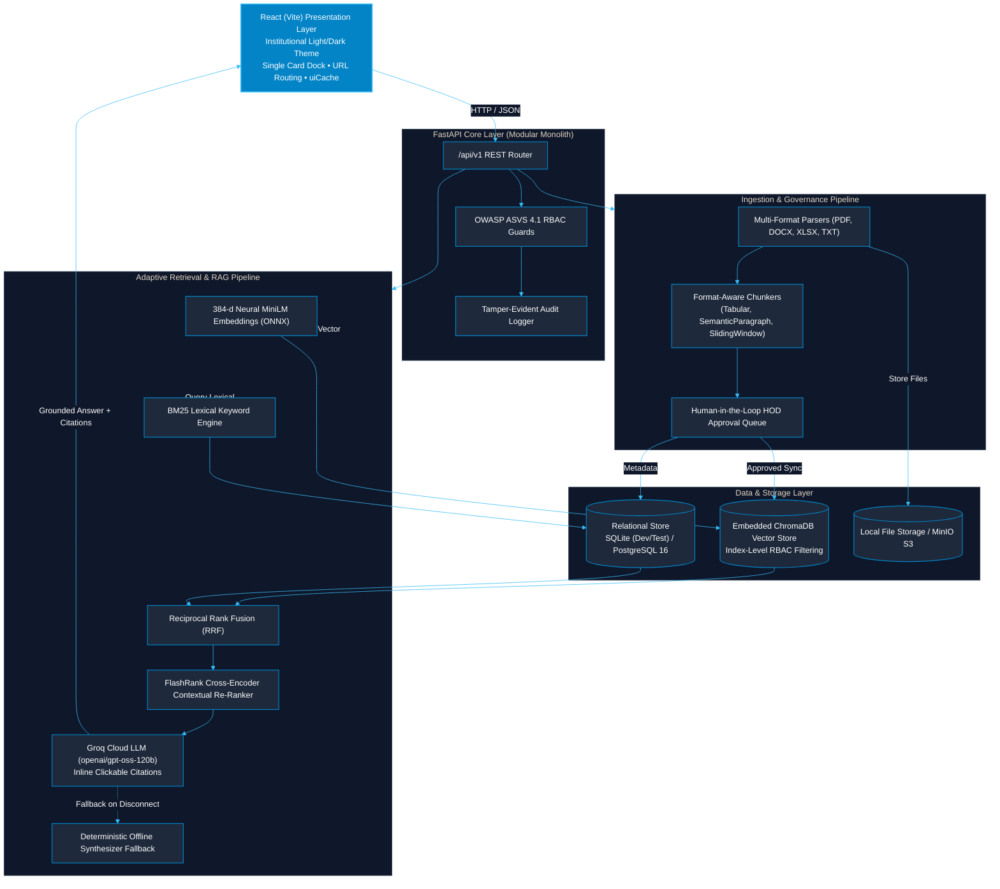

# CONCORD — Institutional Knowledge Management System (IKMS)

> **Context-Oriented Cognitive Memory Layer for Multi-Source Knowledge Integration, Adaptive Retrieval, and Trust-Aware Institutional Intelligence**  
> *Mega Project 2026–27 — Kolhapur Institute of Technology (KIT)*

---

---

## 📚 Documentation Index

| Specification | Document | Core Focus & Coverage |
| :--- | :--- | :--- |
| **Setup & Quickstart Guide** | [docs/SETUP_GUIDE.md](docs/SETUP_GUIDE.md) | Comprehensive step-by-step developer onboarding, virtualenv setup, Ollama local LLM execution, and troubleshooting. |
| **API Endpoints** | [docs/API_DOCUMENTATION.md](docs/API_DOCUMENTATION.md) | Full endpoint reference (`/auth`, `/documents`, `/conversations`, `/governance`, `/search`, `/rag`, `/evaluation`, `/system`). |
| **Quality & Test Architecture** | [docs/TESTING_DOCUMENTATION.md](docs/TESTING_DOCUMENTATION.md) | Multi-layered testing pyramid, BOLA prevention assertions, audit privacy checks, LLM prompt guardrails, Dual-Mode LLM hot-swap, and security hardening (95 tests). |
| **Infrastructure & Docker** | [docs/INFRASTRUCTURE_AND_UI.md](docs/INFRASTRUCTURE_AND_UI.md) | Dual-database setup (SQLite vs PostgreSQL 16), Embedded ChromaDB, MinIO, and UI design system. |
| **Technology Stack** | [docs/Tech_Stack.md](docs/Tech_Stack.md) | Frontend, backend, AI orchestration, database trade-offs, and architecture diagrams. |
| **Master Project Brief** | [docs/Project_Info.md](docs/Project_Info.md) | Product identity, mission, non-functional requirements, and institutional boundaries. |
| **Engineering Roadmap** | [docs/PROJECT_BRIEF.md](docs/PROJECT_BRIEF.md) | Phased milestones, design goals, and core system differentiation. |
| **Implementation Backlog** | [docs/architecture/BACKLOG.md](docs/architecture/BACKLOG.md) | Granular implementation status for Milestones 0 to 11 and blueprints for 12 & 13. |
| **Architectural Decisions** | [docs/decisions/](docs/decisions/) | ADR-0001 (Modular Monolith) through ADR-0011 (Conversational Zero-Citation Routing, Relevance Gating & Loop Breakers). |

---

## 1. Overview & Architecture

CONCORD is built as a high-integrity institutional knowledge platform designed to unify scattered institutional policies, circulars, department records, and syllabi, providing verifiable, auditable answers with cryptographic provenance.

### End-to-End System Architecture (GitHub Parsable Mermaid)



### End-to-End Lifecycle & Query Workflow

```mermaid
%%{init: {'theme': 'base', 'themeVariables': { 'primaryColor': '#0284c7', 'primaryTextColor': '#ffffff', 'primaryBorderColor': '#0369a1', 'lineColor': '#38bdf8', 'secondaryColor': '#0f172a', 'tertiaryColor': '#1e293b', 'actorBkg': '#1e293b', 'actorBorder': '#0284c7', 'actorTextColor': '#ffffff', 'signalColor': '#38bdf8', 'signalTextColor': '#f8fafc', 'labelBoxBkgColor': '#0f172a', 'labelBoxBorderColor': '#334155', 'labelTextColor': '#f8fafc', 'loopTextColor': '#f8fafc', 'noteBorderColor': '#0284c7', 'noteBkgColor': '#0f172a', 'noteTextColor': '#f8fafc', 'fontFamily': 'Inter, sans-serif'}}}%%
sequenceDiagram
    autonumber
    actor User as Student / Faculty
    actor HOD as HOD / Admin
    participant FE as React Vite Frontend
    participant API as FastAPI Backend
    participant DB as SQLite / PostgreSQL
    participant Vec as Embedded ChromaDB
    participant LLM as Groq Cloud LLM

    %% Document Upload & Governance Cycle
    rect rgb(30, 41, 59)
    note over User,LLM: Phase 1: Ingestion, Governance & Indexing
    HOD->>FE: Upload Circular / Syllabus (PDF/DOCX/XLSX)
    FE->>API: POST /api/v1/documents/upload-async (File Bytes + Dept ID)
    API->>API: Ingest, Parse, Tabular Chunk & Save (SHA-256)
    API-->>FE: HTTP 202 (job_id, queued)
    FE->>API: GET /api/v1/documents/jobs/{job_id} (Poll 0-100%)
    HOD->>FE: Review Pending Document
    FE->>API: POST /api/v1/governance/documents/{id}/review (Decision: Approved)
    API->>Vec: Generate 384-d Embeddings & Upsert (Dept Filter Tagged)
    API->>DB: Update Status to 'active' & Version Tag
    end

    %% Contextual RAG & Evidence Grounding
    rect rgb(15, 23, 42)
    note over User,LLM: Phase 2: Hybrid Retrieval, RAG & Verification
    User->>FE: Ask Question ("What is passing criteria under 2024 regulations?")
    FE->>API: POST /api/v1/conversations/ask-stream (Query + Session ID)
    API->>API: PromptGuard Security Validation (0ms short-circuit if hostile)
    API->>API: Query Normalization & Acronym Expansion
    API->>Vec: Vector Similarity Search (Filter: Dept & Status='active')
    API->>DB: BM25 Lexical Keyword Search
    API->>API: Reciprocal Rank Fusion (RRF k=60) & FlashRank Cross-Encoder Re-rank
    API->>LLM: Grounded Generation (Restricted Strictly to Top Chunks)
    LLM-->>API: SSE Stream (Tokens + Bracketed Inline Citations [1])
    API-->>FE: Stream Event Tokens (Real-time Typewriter Effect)
    User->>FE: Click Citation [1]
    FE->>API: GET /api/v1/documents/{id}/download
    FE->>FE: Open In-App Dual-Pane PDF Highlight Inspector (#page=N)
    end
```



---

## 2. Key Differentiators

1. **Zero Hallucination Grounding:** Prompts explicitly forbid speculative reasoning. Missing evidence triggers polite refusals instead of hallucinations.
2. **Real-Time SSE Token Streaming:** High-speed typewriter effect via `POST /api/v1/conversations/ask-stream`, cutting perceived TTFT to <200ms.
3. **In-App Dual-Pane PDF Highlight Inspector:** Direct in-app viewing of original PDF documents positioned at the exact cited `#page` with sentence grounding highlights.
4. **Asynchronous Multi-Format Ingestion:** Background upload queue with brutalist progress tracking across extracting (25%), chunking (50%), and vectorizing (75%).
5. **Tabular & Grid-Aware Document Chunker:** Table matrices in Word and PDF documents are atomically isolated as structured Markdown grids, keeping financial/grading tables intact.
6. **Cryptographic Tamper-Evidence:** SHA-256 content verification, hash-chained audit ledgers, and privacy-hardened event logging (prompt queries are never stored).

---

## 3. Quickstart & Installation

> **Complete Step-by-Step Guide:** See **[docs/SETUP_GUIDE.md](docs/SETUP_GUIDE.md)** for detailed troubleshooting, Ollama local model setup, and environment options.

### Option A: Local Development (Recommended)

```bash
# 1. Clone repository & configure environment
git clone https://github.com/abhay-patil-cse27/concord-ikms.git
cd concord-ikms
copy .env.example .env          # Windows (or cp .env.example .env on Linux/Mac)

# 2. Setup Backend
cd backend
python -m venv .venv
.\.venv\Scripts\activate      # Windows (or source .venv/bin/activate on Unix)
pip install -r requirements.txt
python -m alembic upgrade head
python scripts/seed_demo_data.py   # Seeds rich multi-department documents & ChromaDB
python -m uvicorn app.main:app --host 127.0.0.1 --port 8000 --reload
```

In a separate terminal:
```bash
# 3. Setup Frontend
cd frontend
npm install
npm run dev
```
Open [http://localhost:5173](http://localhost:5173) in your browser.

---

### Pre-Seeded Evaluator Personas

| Persona | Role Code | Email | Password | Primary Scope |
| :--- | :--- | :--- | :--- | :--- |
| **Platform Administrator** | `platform_admin` | `admin@concord.kit.edu` | `Admin@12345` | Global Institutional Oversight |
| **Department Admin (HOD CSE)** | `dept_admin` | `deptadmin.cse@concord.kit.edu` | `Dept@12345` | Department: `CSE` |
| **Faculty Member** | `faculty` | `faculty.cse@concord.kit.edu` | `Faculty@12345` | Department: `CSE` |
| **Enrolled Student** | `student` | `student.cse@concord.kit.edu` | `Student@12345` | Department: `CSE` |

*Note: You can switch between these personas instantly using the "Switch Role" pills in the top navbar.*

---

## 4. Running Automated Tests

Run the complete backend test suite:
```bash
.\.venv\Scripts\pytest -v backend/tests
```

Run the frontend cache isolation test suite:
```bash
cd frontend && npm test
```

> For full architectural details on test coverage, BOLA prevention, audit privacy assertions, and CI verification, see the **[Testing Architecture & QA Reference](docs/TESTING_DOCUMENTATION.md)**.

- **Test Coverage Includes (86 Backend + 9 Frontend = 95 Test Scenarios — 100% Passing):**
  - **Fuzzy Academic Spell-Checking & Query Normalizer (`AcademicQueryNormalizer` & `test_retrieval.py`):** Phrase-level typo repair (e.g. `"bid data"` $\rightarrow$ `"big data"`, `"atendance criteria"` $\rightarrow$ `"attendance criteria"`), institutional curriculum lexicon matching (`difflib.get_close_matches(cutoff=0.72)`), and auto-correction metadata emitted to frontend Yellow Brutalist badges.
  - **Zero-Hallucination Relevance Gating & Ungrounded Query Interception:** FlashRank cross-encoder scoring ($\ge 0.15$) and domain keyword filtering to discard unrelated chunks (e.g. eliminating Financial Analytics from Big Data queries). Intercepts off-topic or ungrounded queries with structured institutional guidance and 0 citations.
  - **Dual In-Composer & Global Response Stop Buttons:** In-composer `[STOP RESPONSE ESC]` button placed directly inside the query dock and primary action button, allowing instant stream abortion with partial token preservation.
  - **Dual-Mode LLM Engine & Hot-Swapping (`test_llm_providers.py`):** Modular shared helper reuse, `LocalLLMProvider` offline synthesizer resilience, dynamic factory hot-swapping between Cloud (Groq) and Local/Remote Node (Ollama/vLLM), `/system/llm-config` RBAC authorization, and live probe diagnostics.
  - **Per-User Isolation & Anti-BOLA (`test_isolation.py`):** Cross-user thread isolation returning 404, token-bound `owner_id`, audit event metadata privacy (no prompt text in audit logs), cross-department document protection, user profile self-only scoping, and benchmark admin-only protection.
  - **Real-Time Token Streaming & Speech Readout (`test_streaming.py` & `speechUtils.test.js`):** Server-Sent Events (SSE) `/ask-stream` response validation, chunk framing, prompt injection short-circuiting, Web Speech API sanitization (stripping citation tokens `[1]` and markdown formatting for smooth voice playback).
  - **Multi-Source Ingestion & SSRF Defense (`test_web_ingestion.py` & `test_async_ingestion.py`):** Web portal notice crawler, SSRF private IP & cloud metadata protection, HTML semantic purification, background upload queue (`/upload-async`), multi-file batch execution.
  - **LLM Safety & Guardrails (`test_guardrails.py` & `test_security_hardening.py`):** SQL injection blocking, ChromaDB NoSQL injection neutralization, path traversal stripping, OWASP ASVS HTTP headers.
  - **Multi-Format Parsers & Scanned Circular OCR (`test_parsers.py`):** Layout-aware `ImagePreprocessor` (1.5x upscaling, contrast boost, luminance binarization for faint circular stamps), `ScannedImageParser` (PNG, JPG, TIFF, BMP, WEBP), Word Markdown table extraction, atomic table grid preservation, Excel sheet extraction, OCR mocks.
  - **Hybrid Retrieval & Benchmark Suite (`test_retrieval.py` & `test_evaluation.py`):** BM25 + Vector reciprocal rank fusion (RRF), FlashRank Cross-Encoder re-ranking, Hit Rate@5 = 100%, MRR@5 = 1.000, 0.0% security leakage.

---

## 5. Directory Layout

```
IKMS/
├── backend/
│   ├── app/
│   │   ├── api/v1/          # HTTP endpoints: health, auth, users, organizations, audit, system
│   │   ├── core/            # Config, security, database, errors, logging, seed
│   │   ├── modules/
│   │   │   ├── identity/    # Users, Roles, Permissions, UserRoles, RolePermissions
│   │   │   ├── organizations/# Departments, Memberships
│   │   │   ├── retrieval/   # Dual-Mode LLM Providers, Hybrid RRF, FlashRank Re-ranker, Query Normalizer
│   │   │   └── audit/       # Tamper-evident Audit Events
│   │   └── main.py          # FastAPI application & lifecycle hooks
│   ├── alembic/             # Database migration environment & versions
│   ├── tests/               # Pytest automated test suite (86 test cases)
│   ├── scripts/             # Canonical demo data seeder & DB maintenance scripts
│   ├── requirements.txt     # Pinned Python dependencies
│   └── alembic.ini          # Migration configuration
├── frontend/
│   ├── src/
│   │   ├── api/             # Centralized API client (fetch wrapper)
│   │   ├── context/         # AuthContext & token management
│   │   ├── components/      # Navbar, Sidebar, HealthCard, documents/, BrutalToast, BrutalModal, Composer, MessageBlock
│   │   └── views/           # DashboardView, DocumentsView, SearchView, RAGAssistantView, BenchmarkView, etc.
│   ├── tests/               # Frontend unit test suites (cache isolation, speech sanitization)
│   ├── package.json
│   └── vite.config.js
├── docs/
│   ├── PROJECT_BRIEF.md     # Primary engineering specification
│   ├── API_DOCUMENTATION.md # Full OpenAPI REST and SSE streaming reference
│   ├── TESTING_DOCUMENTATION.md # Complete 95-test QA & test pyramid reference
│   ├── VIVA_PRESENTATION_GUIDE.md # 5-Minute presentation script & examiner defense guide
│   ├── architecture/        # System architecture, data model, prioritized backlog
│   └── decisions/           # Architecture Decision Records (ADR-0001 to ADR-0011)
├── infra/docker/            # Backend and Frontend Dockerfiles
├── docker-compose.yml       # Reproducible containerized local development stack
├── .env.example             # Documented environment template
└── README.md
```

---

## 6. Milestone Acceptance Status

- **Milestone 0 (Discovery & Baseline):** Completed (Audited repository, ADR-0001 through ADR-0004, system architecture, relational data model, risk register, prioritized backlog).
- **Milestone 1 (Platform Foundation):** Completed (Frontend & backend startup, config management, DB migrations, health probes, structured logging, error envelopes, and RBAC security foundation).
- **Milestone 2 (Document Ingestion, Multi-Format Parsing & Chunking):** Completed (Storage provider abstraction, PDF/DOCX/TXT/Excel parsers, format-aware chunking strategies, cryptographic provenance, and upload/preview/inspection UI).
- **Milestone 3 (Hybrid Search & Retrieval Engine):** Completed (Reciprocal Rank Fusion, BM25-style lexical search + vector cosine similarity, department-scoped RBAC retrieval, reusable SearchBar UI, and Institutional Landing Page).
- **Milestone 4 (Grounded RAG & Verifiable Answers):** Completed (Groq Cloud LLM provider integration with `openai/gpt-oss-120b`, offline synthesizer fallback, interactive click-to-inspect citations, zero-hallucination refusal rules, and `POST /api/v1/rag/ask`).
- **Phase 4b (Embedded Local Vector Store — ChromaDB Integration):** Completed (Embedded `PersistentClient` in `backend/data/chroma`, index-level RBAC filtering with `where={"department_id": dept_id}`, automated ingestion sync & deletion hooks, and hybrid RRF search optimization).
- **Phase 4c (Optimal RAG Architecture & Algorithmic Hardening):** Completed (Query normalization & acronym expansion, unified 384-d `NeuralONNXEmbeddingProvider`, and FlashRank cross-encoder deep contextual re-ranking).
- **Milestone 5 (Trust, Freshness & Institutional Memory):** Completed (Document lifecycle state machine `active`/`superseded`/`archived`, version tracking, default current-policy search filtering, discrepancy and conflict detection prompts, and frontend Trust Badges).
- **Milestone 6 (Agent Workflows & Human-in-the-Loop Governance):** Completed (Human-in-the-loop document approval queue and review endpoints, quarantined document retrieval protection, and Comparative Research Agent).
- **Milestone 7 (Evaluation, Benchmarking & Hardening):** Completed (Automated benchmark runner, Hit Rate@5 = 100%, MRR@5 = 1.000, 0.0% RBAC security leakage rate, dedicated frontend `BenchmarkView.jsx` dashboard, and live test run execution).
- **Milestone 8 (Institutional Demonstration & Viva Defense Readiness):** Completed (Pre-seeded multi-department data across CSE, ENTC, and Academic Examination Cell, interactive evaluator prompt presets, comprehensive `docs/VIVA_PRESENTATION_GUIDE.md`).
- **Milestone 9 (Post-Baseline Enterprise Tracks — Completed & Verified):**
  - **Track 1 (Real-Time SSE Streaming):** High-speed typewriter token generation via `POST /api/v1/conversations/ask-stream`, reducing perceived TTFT to <200ms.
  - **Track 2 (Tabular Document Chunker):** Word/PDF table extraction preserving atomic Markdown table grids without mid-row splits.
  - **Track 3 (Asynchronous Ingestion):** In-process `BackgroundJobManager` (`/upload-async`, `/jobs/{id}`) with multi-stage brutalist progress tracking.
  - **Track 4 (In-App PDF Highlight Inspector):** Dual-pane `PDFViewerModal` linking inline citations directly to exact `#page` coordinates and highlighted sentences.
  - **Track 5 (Scanned Circular Layout-Aware OCR):** Adaptive luminance binarization and $1.5\times$ upscaling for faint circular stamps with multi-format OCR fallback.
- **Milestone 10 (Multimodal Accessibility, Web Crawling & Accreditation Exporter — Completed):**
  - **Natural Academic Voice Readout (TTS):** Dynamic voice synthesis in `SpeechPlaybackButton.jsx` with automatic regex stripping of bracket citations `[1]`, Markdown formatting, and code blocks for fluid spoken cadence.
  - **Web Notice URL Crawler & SSRF Defense:** Automated HTML bulletin scraper with strict loopback/RFC-1918/cloud metadata SSRF guardrails (`/documents/ingest-url`).
  - **Multi-File Batch Drag-and-Drop Ingestion:** Asynchronous multi-document upload queue in `UploadModal.jsx` supporting 5–10 concurrent documents.
  - **Academic Dossier HTML Exporter:** Self-contained institutional compliance dossier generator for NAAC/NBA accreditation audits (`/audit/dossier/html`).
- **Milestone 11 (Dual-Mode LLM Engine & Interaction Control — Completed & Verified):**
  - **Decoupled Architecture:** Reusable `LocalLLMProvider` targeting standard OpenAI-compatible `/v1/chat/completions` (Ollama, vLLM, LAN lab PC, or internet tunnels).
  - **Ultra-Lightweight Consumer Footprint:** Configured default model `qwen2.5:1.5b` (~1.2 GB RAM, 20–35 tok/s on CPU) eliminating laptop hanging or thermal throttling.
  - **Zero-Redundancy Shared Pipeline:** Centralized context building, citation formatting, SSE parsing, and anti-hallucination temperature clamping (0.05).
  - **In-Memory Dynamic Routing:** Hot-swapping between Cloud (Groq) and Local/Remote Node with zero server restarts via `GET/PUT /api/v1/system/llm-config`.
  - **Live Diagnostics Beacon:** Tactical Yellow Brutalist Admin controller in `DashboardView.jsx` with probe testing (`POST /api/v1/system/llm-test`) and model tag auto-detection.
  - **Conversational Zero-Citation Routing:** Pattern-routed greetings, identity, and colloquial confusion queries directly to conversational synthesizers with `citations: []`.
  - **Relevance Score Gating:** Discards candidate chunks with score $\le 0.0001$ so out-of-domain queries never attach ungrounded citations.
  - **Anti-Repetition Guards:** Penalties (`presence_penalty: 0.3`, `frequency_penalty: 0.4`) and substring repetition detector `_has_repetition_loop` preventing quantized local model runaway loops.
  - **Claude-Style Progressive Thinking Block:** Unified assistant message card embedding rotating dynamic verbs and auto-collapsing expandable thought process tray (`[⚡ Thought Process (X steps) ▾]`).
  - **Interactive Stream Cancellation:** Red Brutalist `[STOP ⏹]` button and `Escape` key shortcut backed by client-side `AbortController` cancellation.
  - **Verified Quality Standard:** **94 / 94 automated test scenarios passing** (85 backend + 9 frontend, 100% green).
- **Milestone 12 (Institutional User Onboarding & 2-Tier Approval Queue — Planned Blueprint):**
  - Multi-department coverage across 10 official KIT departments (CSE, AIML, DS, ENTC, EE, ME, CE, BT, BSH, Exam Cell).
  - Public registration portal (`/register`) with PRN/Employee ID validation and `pending_approval` gating.
  - 2-Tier Approval Hierarchy: Tier 1 (HOD approves student & faculty) + Tier 2 (Platform Admin approves HODs).
- **Milestone 13 (Declarative Jenkins CI/CD Pipeline — Planned Blueprint):**
  - Multi-stage Jenkins declarative pipeline (Lint → Backend Tests → Frontend Tests → Vite Build → Docker Vulnerability Scan → Staging Deploy).
  - Automated JUnit XML reporting and security audit gating.


---

## 7. Engineering & Architectural Standards

All ongoing and upcoming developments adhere to industry-standard patterns:
- **Modular Monolith & Clean Boundaries:** Modules (`identity`, `organizations`, `documents`, `audit`, `retrieval`) retain strict encapsulation with isolated models, schemas, and services.
- **Provider Strategy Pattern:** Swappable interfaces for storage, embeddings, and vector stores allowing seamless offline development (SQLite / local embeddings) and scalable production deployment (PostgreSQL + `pgvector` / MinIO).
- **Reusable Frontend Design System:** Modular React UI components and custom hooks avoiding inline redundancies and enforcing consistent institutional styling tokens.
- **Security & Integrity First:** Cryptographic verification (SHA-256 content hashing), OWASP ASVS 4.1 compliant RBAC dependency guards, and comprehensive audit trail logging.
