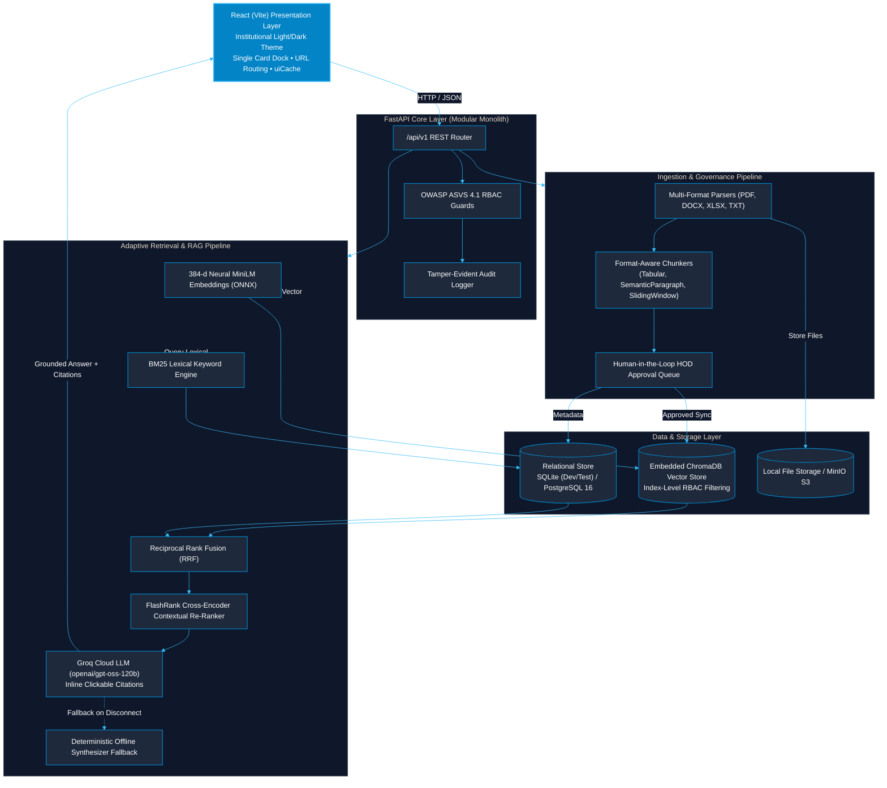
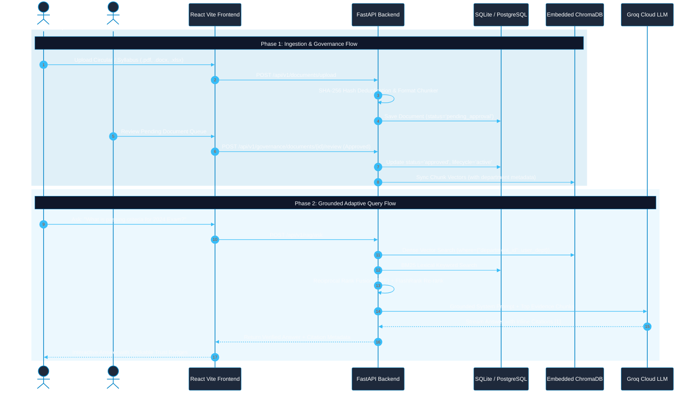

# CONCORD — Institutional Knowledge Management System (IKMS)

> **Context-Oriented Cognitive Memory Layer for Multi-Source Knowledge Integration, Adaptive Retrieval, and Trust-Aware Institutional Intelligence**  
> *Mega Project 2026–27 — Kolhapur Institute of Technology (KIT)*

---

---

## 📚 Documentation Index

| Specification | Document | Core Focus & Coverage |
| :--- | :--- | :--- |
| **API Endpoints** | [docs/API_DOCUMENTATION.md](docs/API_DOCUMENTATION.md) | Full endpoint reference (`/auth`, `/documents`, `/governance`, `/search`, `/rag`, `/evaluation`). |
| **Infrastructure & Docker** | [docs/INFRASTRUCTURE_AND_UI.md](docs/INFRASTRUCTURE_AND_UI.md) | Dual-database setup (SQLite vs PostgreSQL 16), Embedded ChromaDB, MinIO, and UI design system. |
| **Technology Stack** | [docs/Tech_Stack.md](docs/Tech_Stack.md) | Frontend, backend, AI orchestration, database trade-offs, and architecture diagrams. |
| **Master Project Brief** | [docs/Project_Info.md](docs/Project_Info.md) | Product identity, mission, non-functional requirements, and institutional boundaries. |
| **Engineering Roadmap** | [docs/PROJECT_BRIEF.md](docs/PROJECT_BRIEF.md) | Phased milestones, design goals, and core system differentiation. |
| **Implementation Backlog** | [docs/architecture/BACKLOG.md](docs/architecture/BACKLOG.md) | Granular implementation status for Milestones 0 to 8. |
| **Architectural Decisions** | [docs/decisions/](docs/decisions/) | ADR-0001 (Modular Monolith) through ADR-0005 (ChromaDB Vector Store). |

---

## 1. Overview & Architecture

CONCORD is built as a high-integrity institutional knowledge platform designed to unify scattered institutional policies, circulars, department records, and syllabi, providing verifiable, auditable answers with cryptographic provenance.

### End-to-End System Architecture (GitHub Parsable Mermaid)



### End-to-End Lifecycle & Query Workflow



---

## 2. Directory Layout

```
IKMS/
├── backend/
│   ├── app/
│   │   ├── api/v1/          # HTTP endpoints: health, auth, users, organizations, audit
│   │   ├── core/            # Config, security, database, errors, logging, seed
│   │   ├── modules/
│   │   │   ├── identity/    # Users, Roles, Permissions, UserRoles, RolePermissions
│   │   │   ├── organizations/# Departments, Memberships
│   │   │   └── audit/       # Tamper-evident Audit Events
│   │   └── main.py          # FastAPI application & lifecycle hooks
│   ├── alembic/             # Database migration environment & versions
│   ├── tests/               # Pytest automated test suite (47 test cases)
│   ├── scripts/             # Canonical demo data seeder & DB maintenance scripts
│   ├── requirements.txt     # Pinned Python dependencies
│   └── alembic.ini          # Migration configuration
├── frontend/
│   ├── src/
│   │   ├── api/             # Centralized API client (fetch wrapper)
│   │   ├── context/         # AuthContext & token management
│   │   ├── components/      # Navbar, Sidebar, HealthCard, documents/ (UploadModal, DocumentTable, ChunkInspector)
│   │   └── views/           # DashboardView, DocumentsView, SearchView, RAGAssistantView, BenchmarkView, etc.
│   ├── package.json
│   └── vite.config.js
├── docs/
│   ├── PROJECT_BRIEF.md     # Primary engineering specification
│   ├── VIVA_PRESENTATION_GUIDE.md # 5-Minute presentation script & examiner defense guide
│   ├── architecture/        # System architecture, data model, prioritized backlog
│   └── decisions/           # Architecture Decision Records (ADR-0001 to ADR-0005)
├── infra/docker/            # Backend and Frontend Dockerfiles
├── docker-compose.yml       # Reproducible containerized local development stack
├── .env.example             # Documented environment template
└── README.md
```

---

## 3. Quickstart: Local Development Setup

### Option A: Local Native Development (Recommended for fast offline iteration)

#### 1. Backend Setup
```bash
# 1. Activate virtual environment
.\.venv\Scripts\activate

# 2. Install dependencies (if not already installed)
pip install -r backend/requirements.txt

# 3. Apply database migrations
alembic -c backend/alembic.ini upgrade head

# 4. Start backend server (port 8000)
cd backend
python -m uvicorn app.main:app --host 127.0.0.1 --port 8000 --reload
```

#### 2. Frontend Setup
```bash
# In a separate terminal:
cd frontend
npm install
npm run dev
```
Open [http://localhost:5173](http://localhost:5173) in your browser.

---

### Option B: Containerized Setup via Docker Compose

```bash
# Ensure Docker Desktop is running, then launch all services:
docker compose up --build
```
This starts:
- `concord-postgres`: PostgreSQL 16 + pgvector on port `5432`
- `concord-minio`: MinIO S3 object storage on ports `9000` and `9001`
- `concord-backend`: FastAPI application on port `8000`
- `concord-frontend`: React Vite application on port `5173`

---

## 4. Pre-Seeded Personas & Demo Accounts

For rapid viva and evaluator demonstration, the system automatically initializes with pre-seeded institutional personas:

---

## 4. One-Click Quick Launch

For immediate institutional demonstrations on Windows or Unix machines:

- **Windows:** Double-click or run:
  ```cmd
  run_demo.bat
  ```
- **macOS / Linux:** Run:
  ```bash
  chmod +x run_demo.sh && ./run_demo.sh
  ```

This automatically initializes Python virtual environments, launches the FastAPI backend (:8000), starts the React Vite frontend (:5173), and opens `http://localhost:5173` in your default browser.

### Pre-Seeded Evaluator Personas

| Persona | Role Code | Email | Password | Primary Scope |
| :--- | :--- | :--- | :--- | :--- |
| **Platform Administrator** | `platform_admin` | `admin@concord.kit.edu` | `Admin@12345` | Global Institutional Oversight |
| **Department Admin (HOD CSE)** | `dept_admin` | `deptadmin.cse@concord.kit.edu` | `Dept@12345` | Department: `CSE` |
| **Faculty Member** | `faculty` | `faculty.cse@concord.kit.edu` | `Faculty@12345` | Department: `CSE` |
| **Enrolled Student** | `student` | `student.cse@concord.kit.edu` | `Student@12345` | Department: `CSE` |

*Note: You can switch between these personas instantly using the "Switch Role" pills in the top navbar.*

---

## 5. Running Automated Tests

Run the complete backend test suite:
```bash
.\.venv\Scripts\pytest -v backend/tests
```

Run the frontend cache isolation test suite:
```bash
cd frontend && npm test
```

> For full architectural details on test coverage, BOLA prevention, audit privacy assertions, and CI verification, see the **[Testing Architecture & QA Reference](docs/TESTING_DOCUMENTATION.md)**.

- **Test Coverage Includes (58 Backend + 5 Frontend Test Scenarios — 100% Passing):**
  - **Per-User Isolation & Anti-BOLA (`test_isolation.py`):** Cross-user thread isolation returning 404, token-bound `owner_id`, audit event metadata privacy (no prompt text in audit logs), cross-department document protection, user profile self-only scoping, and benchmark admin-only protection.
  - `/api/v1/healthz` and `/api/v1/readyz` probe liveness and DB connectivity.
  - Password login verification and invalid credential 401 rejections.
  - Server-side RBAC validation: ensuring students and faculty are rejected (403 Forbidden with standard error envelopes) from accessing restricted user management and audit log endpoints.
  - Document ingestion lifecycle: multipart file upload, SHA-256 deduplication, raw file download, document deletion, and lifecycle version transitions (`PATCH /api/v1/documents/{id}/lifecycle`).
  - Governance review queue: `GET /api/v1/governance/pending-documents` and `POST /api/v1/governance/documents/{id}/review` approval endpoints.
  - Multi-format parsers: PDF (`pypdf`), DOCX (`python-docx`), Excel (`openpyxl`), Markdown, and plain text.
  - Format-aware chunking strategies: `TabularChunker` (preserves rows & headers), `SemanticParagraphChunker` (preserves headings & paragraphs), and `SlidingWindowTextChunker` (boundary-aware sentence sliding).
  - Hybrid Retrieval Engine: Neural ONNX transformer embeddings (384-d), BM25 lexical scoring, Reciprocal Rank Fusion (RRF), FlashRank Cross-Encoder re-ranking, lifecycle filtering, and search API queries.
  - Comparative Research Agent: Automated multi-query decomposition and Markdown comparison tables.
  - Evaluation & Benchmarking Suite: `/api/v1/evaluation/metrics` and `POST /api/v1/evaluation/run` calculating Hit Rate@K, MRR@K, latency percentiles, and cross-department security leakage rates.
  - Multi-Department Institutional Scenarios: Canonical syllabus, exam rules, lab policies, and superseded version filtering tests.
  - Frontend Cache Partitioning: User-namespaced cache keys (`_user_{id}`), startup legacy unnamespaced key purging, and complete cache flushes on logout.

---

## 6. Milestone Acceptance Status

- **Milestone 0 (Discovery & Baseline):** Completed (Audited repository, ADR-0001 through ADR-0004, system architecture, relational data model, risk register, prioritized backlog).
- **Milestone 1 (Platform Foundation):** Completed (Frontend & backend startup, config management, DB migrations, health probes, structured logging, error envelopes, and RBAC security foundation).
- **Milestone 2 (Document Ingestion, Multi-Format Parsing & Chunking):** Completed (Storage provider abstraction, PDF/DOCX/TXT/Excel parsers, format-aware chunking strategies, cryptographic provenance, and upload/preview/inspection UI).
- **Milestone 3 (Hybrid Search & Retrieval Engine):** Completed (Reciprocal Rank Fusion, BM25-style lexical search + vector cosine similarity, department-scoped RBAC retrieval, reusable SearchBar UI, and Institutional Landing Page).
- **Milestone 4 (Grounded RAG & Verifiable Answers):** Completed (Groq Cloud LLM provider integration with `openai/gpt-oss-120b`, offline synthesizer fallback, interactive click-to-inspect citations, zero-hallucination refusal rules, and `POST /api/v1/rag/ask`).
- **Phase 4b (Embedded Local Vector Store — ChromaDB Integration):** Completed (Embedded `PersistentClient` in `backend/data/chroma`, index-level RBAC filtering with `where={"department_id": dept_id}`, automated ingestion sync & deletion hooks, and hybrid RRF search optimization).
- **Phase 4c (Optimal RAG Architecture & Algorithmic Hardening):** Completed (Query normalization & acronym expansion, unified 384-d `NeuralONNXEmbeddingProvider`, and FlashRank cross-encoder deep contextual re-ranking).
- **Milestone 5 (Trust, Freshness & Institutional Memory):** Completed (Document lifecycle state machine `active`/`superseded`/`archived`, version tracking, default current-policy search filtering, discrepancy and conflict detection prompts, and frontend Trust Badges).
- **Milestone 6 (Agent Workflows & Human-in-the-Loop Governance):** Completed (Human-in-the-loop document approval queue and review endpoints, quarantined document retrieval protection, and Comparative Research Agent).
- **Milestone 7 (Evaluation, Benchmarking & Hardening):** Completed (Automated benchmark runner, Hit Rate@5 = 100%, MRR@5 = 1.000, 0.0% RBAC security leakage rate, dedicated frontend `BenchmarkView.jsx` dashboard, and live test run execution).
- **Milestone 8 (Institutional Demonstration & Viva Defense Readiness):** Completed (Pre-seeded multi-department data across CSE, ENTC, and Academic Examination Cell, interactive evaluator prompt presets, comprehensive `docs/VIVA_PRESENTATION_GUIDE.md`, and 47 passing tests).


---

## 7. Engineering & Architectural Standards

All ongoing and upcoming developments adhere to industry-standard patterns:
- **Modular Monolith & Clean Boundaries:** Modules (`identity`, `organizations`, `documents`, `audit`, `retrieval`) retain strict encapsulation with isolated models, schemas, and services.
- **Provider Strategy Pattern:** Swappable interfaces for storage, embeddings, and vector stores allowing seamless offline development (SQLite / local embeddings) and scalable production deployment (PostgreSQL + `pgvector` / MinIO).
- **Reusable Frontend Design System:** Modular React UI components and custom hooks avoiding inline redundancies and enforcing consistent institutional styling tokens.
- **Security & Integrity First:** Cryptographic verification (SHA-256 content hashing), OWASP ASVS 4.1 compliant RBAC dependency guards, and comprehensive audit trail logging.
