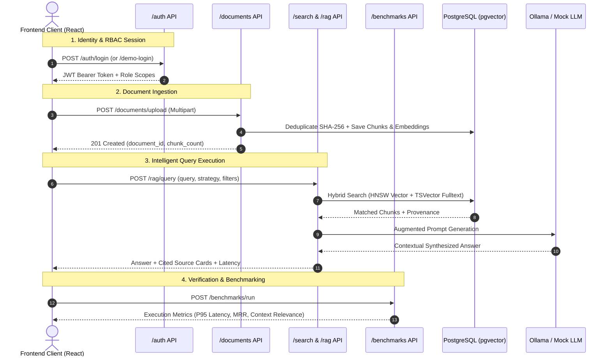

# CONCORD IKMS — Comprehensive API Reference

> Base URL: `http://localhost:8000/api/v1`  
> Interactive OpenAPI / Swagger UI: `http://localhost:8000/docs`  
> ReDoc Documentation: `http://localhost:8000/redoc`

[← Back to Main Documentation Index](../README.md#📚-documentation-index)



---

## 1. Authentication & Identity (`/auth`)

### `POST /auth/login`
- **Description:** Authenticates user via email and bcrypt password hash.
- **Request Body:**
  ```json
  {
    "email": "admin@concord.kit.edu",
    "password": "Admin@12345"
  }
  ```
- **Response (200 OK):**
  ```json
  {
    "access_token": "eyJhbGciOi...",
    "token_type": "bearer",
    "user": {
      "id": "uuid",
      "email": "admin@concord.kit.edu",
      "full_name": "Dr. A. Sharma (Platform Admin)",
      "roles": ["platform_admin"]
    }
  }
  ```

### `POST /auth/demo-login`
- **Description:** One-click instant login for viva evaluator role switching (`platform_admin`, `dept_admin`, `faculty`, `student`).
- **Request Body:** `{"role_code": "student"}`

### `GET /auth/me`
- **Description:** Returns the authenticated user's profile, roles, and granted permissions.
- **Headers:** `Authorization: Bearer <token>`

---

## 2. Document Ingestion & Chunk Inspection (`/documents`)

### `POST /documents/upload`
- **Description:** Multipart file upload. Automatically deduplicates via SHA-256 and routes to the appropriate chunker (`TabularChunker`, `SemanticParagraphChunker`, or `SlidingWindowTextChunker`).
  - **OCR Fallback Engine:** Automatically detects scanned image PDFs ($<30$ characters of text stream) and triggers the OCR provider pipeline (`PytesseractOCRProvider` / `GracefulFallbackOCRProvider`), tagging chunks with `is_ocr: true` and extraction engine.
- **Headers:** `Authorization: Bearer <token>` (Requires `documents:write`)
- **Form Data:**
  - `file`: Binary file (`.pdf`, `.docx`, `.xlsx`, `.txt`, `.md`, `.csv`)
  - `department_id`: Department UUID
  - `title`: Optional display title

### `GET /documents`
- **Description:** Lists documents filtered by department and user RBAC permissions.
- **Query Params:** `?department_id=<id>`

### `GET /documents/{document_id}`
- **Description:** Returns full document metadata and extracted chunk segments.

### `PATCH /documents/{document_id}/lifecycle`
- **Description:** Updates document lifecycle state (`active`, `superseded`, `archived`) and version tag.

### `DELETE /documents/{document_id}`
- **Description:** Permanently deletes document record, storage file, and associated ChromaDB vectors.

---

## 3. Governance & Human-in-the-Loop Review (`/governance`)

### `GET /governance/pending-documents`
- **Description:** Lists documents currently awaiting approval. HODs only see their assigned department. Platform Admins see all.

### `POST /governance/documents/{document_id}/review`
- **Description:** Approves or rejects a quarantined document. Upon approval, vectors are atomically synced into the active ChromaDB index.
- **Request Body:**
  ```json
  {
    "decision": "approved",
    "notes": "Verified against 2024 Academic Council circular."
  }
  ```

---

## 4. Contextual Search (`/search`)

### `POST /search/query`
- **Description:** Hybrid search combining BM25-style lexical matching and ChromaDB vector embeddings fused via Reciprocal Rank Fusion (RRF) and re-ranked with FlashRank Cross-Encoder.
- **Request Body:**
  ```json
  {
    "query": "passing criteria in autonomous exam",
    "top_k": 5,
    "lifecycle_status": "active"
  }
  ```
- **Response (200 OK):**
  ```json
  {
    "query": "passing criteria in autonomous exam",
    "results": [
      {
        "chunk_id": "uuid",
        "document_filename": "KIT_Autonomous_Academic_Regulations_2024.pdf",
        "score": 0.9845,
        "content": "A student must secure at least 40% in ESE...",
        "lifecycle_status": "active",
        "version": "v2.0"
      }
    ]
  }
  ```

---

## 5. Grounded RAG (`/rag`)

### `POST /rag/ask`
- **Description:** Submits a question to the Grounded RAG pipeline powered by Groq Cloud (`openai/gpt-oss-120b`). Answers are strictly bound to retrieved institutional evidence with interactive citation references.
- **Request Body:**
  ```json
  {
    "query": "What is the passing criteria for Autonomous Exam under 2024 regulations?",
    "include_superseded": false,
    "top_k": 5
  }
  ```
- **Response (200 OK):**
  ```json
  {
    "answer": "Under the 2024 Autonomous Academic Regulations, a student must secure at least 40% in the End Semester Examination [1]...",
    "citations": [
      {
        "citation_id": 1,
        "document_title": "Autonomous Academic & Examination Regulations (2024 Curriculum)",
        "document_filename": "KIT_Autonomous_Academic_Regulations_2024.pdf",
        "sha256_hash": "a4f8...",
        "lifecycle_status": "active",
        "version": "v2.0"
      }
    ],
    "model_used": "groq/openai/gpt-oss-120b",
    "latency_ms": 1120.4
  }
  ```

---

## 6. Evaluation & Benchmarking (`/evaluation`)

### `GET /evaluation/metrics`
- **Description:** Returns the comparative retrieval architecture matrix (BM25 vs Vector vs CONCORD Hybrid).

### `POST /evaluation/run`
- **Description:** Triggers live execution across 5 canonical test scenarios, calculating Hit Rate@5, MRR@5, and security leakage.

---

## 7. System Health & Maintenance (`/healthz`, `/readyz`, `/admin`)

### `GET /healthz`
- **Description:** Liveness probe returning service name and environment.

### `GET /readyz`
- **Description:** Readiness probe checking live database connectivity and round-trip latency.

### `POST /admin/reseed-demo`
- **Description:** Reseeds canonical multi-department demo records into SQLite and ChromaDB. Guarded by `platform_admin`.
