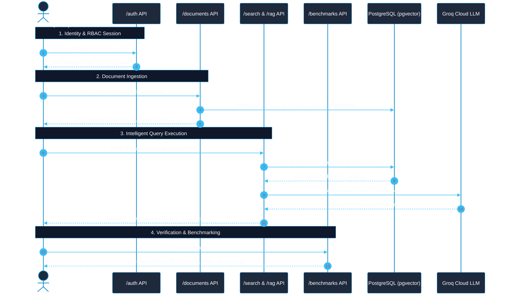

# CONCORD IKMS — Comprehensive API Reference

> Base URL: `http://localhost:8000/api/v1`  
> Interactive OpenAPI / Swagger UI: `http://localhost:8000/docs`  
> ReDoc Documentation: `http://localhost:8000/redoc`

[← Back to Main Documentation Index](../README.md#📚-documentation-index)



---

## 1. Authentication & Identity (`/auth`)

### `POST /auth/login`
- **Description:** Authenticates user via email and bcrypt password hash.
- **Request Body:**
  ```json
  {
    "email": "admin@concord.kit.edu",
    "password": "Admin@12345"
  }
  ```
- **Response (200 OK):**
  ```json
  {
    "access_token": "eyJhbGciOi...",
    "token_type": "bearer",
    "user": {
      "id": "uuid",
      "email": "admin@concord.kit.edu",
      "full_name": "Dr. A. Sharma (Platform Admin)",
      "roles": ["platform_admin"]
    }
  }
  ```

### `POST /auth/demo-login`
- **Description:** One-click instant login for viva evaluator role switching (`platform_admin`, `dept_admin`, `faculty`, `student`).
- **Request Body:** `{"role_code": "student"}`

### `GET /auth/me`
- **Description:** Returns the authenticated user's profile, roles, and granted permissions.
- **Headers:** `Authorization: Bearer <token>`

### `POST /auth/register`
- **Description:** Institutional self-registration for students, faculty, and HODs. Enforces PRN/Employee ID format validation, validates department assignment, and assigns initial approval state (`pending_tier1` for student/faculty, `pending_tier2` for HODs). Unapproved accounts are blocked from login until authorized.
- **Request Body:**
  ```json
  {
    "email": "student2024@kitcoek.in",
    "password": "StrongPassword123!",
    "full_name": "Rohan Deshmukh",
    "department_id": "3fa85f64-5717-4562-b3fc-2c963f66afa6",
    "role_code": "student",
    "registration_number": "2024CS089"
  }
  ```
- **Response (201 Created):**
  ```json
  {
    "id": "7ca64731-0164-4e46-95ff-51786524337b",
    "email": "student2024@kitcoek.in",
    "full_name": "Rohan Deshmukh",
    "approval_status": "pending_tier1",
    "registration_number": "2024CS089",
    "is_active": true
  }
  ```

### `GET /auth/departments`
- **Description:** Public directory of academic departments available for self-registration dropdowns without requiring pre-existing authentication.
- **Response (200 OK):**
  ```json
  [
    { "id": "uuid", "code": "CSE", "name": "Computer Science & Engineering" },
    { "id": "uuid", "code": "AIML", "name": "Artificial Intelligence & Machine Learning" }
  ]
  ```

---

## 2. Document Ingestion & Chunk Inspection (`/documents`)

### `POST /documents/upload`
- **Description:** Multipart file upload. Automatically deduplicates via SHA-256 and routes to the appropriate chunker (`TabularChunker`, `SemanticParagraphChunker`, or `SlidingWindowTextChunker`).
  - **OCR Fallback Engine:** Automatically detects scanned image PDFs ($<30$ characters of text stream) and triggers the OCR provider pipeline (`PytesseractOCRProvider` / `GracefulFallbackOCRProvider`), tagging chunks with `is_ocr: true` and extraction engine.
  - **Tabular Grid Preservation:** Word tables and structured Markdown matrices are preserved atomically with `has_table: true` and `chunk_type: "table_grid"`, ensuring academic fee structures, marks breakdown, and ordinance grading formulas are never fractured across chunk boundaries.
- **Headers:** `Authorization: Bearer <token>` (Requires `documents:write`)
- **Form Data:**
  - `file`: Binary file (`.pdf`, `.docx`, `.xlsx`, `.txt`, `.md`, `.csv`)
  - `department_id`: Department UUID
  - `title`: Optional display title

### `POST /documents/upload-async`
- **Description:** Non-blocking asynchronous document ingestion. Immediately queues file for parsing, semantic chunking, and vectorization, returning a unique background `job_id`.
- **Status Code:** `202 Accepted`
- **Response Body:**
  ```json
  {
    "job_id": "job_ingest_c4f828a10d82",
    "status": "pending",
    "phase": "queued",
    "message": "Ingestion job job_ingest_c4f828a10d82 scheduled for syllabus.pdf."
  }
  ```

### `GET /documents/jobs/{job_id}`
- **Description:** Polls real-time ingestion stage and percentage progress for an asynchronous ingestion job.
- **Response Body:**
  ```json
  {
    "job_id": "job_ingest_c4f828a10d82",
    "status": "completed",
    "phase": "done",
    "progress": 100,
    "message": "Document 'Autonomous Syllabus' successfully ingested with 24 chunks.",
    "result": { "document": { "id": "...", "title": "..." }, "chunk_count": 24 },
    "error": null
  }
  ```


### `GET /documents`
- **Description:** Lists documents filtered by department and user RBAC permissions.
- **Query Params:** `?department_id=<id>`

### `POST /documents/ingest-url` & `POST /documents/ingest-url-async`
- **Description:** Ingests live web notices and HTML bulletins directly from verified institutional URLs (e.g. `https://kitcoek.in/notices/exam-schedule`).
- **SSRF Defense:** Enforces strict protocol (`http`/`https`), DNS domain resolution, and blocks all loopback (`127.0.0.1`), RFC-1918 private IPs (`10.0.0.0/8`, `192.168.0.0/16`), and AWS/cloud metadata services (`169.254.169.254`).
- **Request Body:**
  ```json
  {
    "url": "https://kitcoek.in/notices/exam-schedule-2024",
    "department_id": "dept-cse-uuid",
    "title": "Semester Exam Schedule Notice"
  }
  ```
- **Response (200 OK / 202 Accepted):** Returns created document metadata or async job tracking ID.

### `GET /documents/{document_id}`
- **Description:** Returns full document metadata and extracted chunk segments.

### `PATCH /documents/{document_id}/lifecycle`
- **Description:** Updates document lifecycle state (`active`, `superseded`, `archived`) and version tag.

### `DELETE /documents/{document_id}`
- **Description:** Permanently deletes document record, storage file, and associated ChromaDB vectors.

---

## 3. Governance & Human-in-the-Loop Review (`/governance`)

### `GET /governance/pending-documents`
- **Description:** Lists documents currently awaiting approval. HODs only see their assigned department. Platform Admins see all.

### `POST /governance/documents/{document_id}/review`
- **Description:** Approves or rejects a quarantined document. Upon approval, vectors are atomically synced into the active ChromaDB index.
- **Request Body:**
  ```json
  {
    "decision": "approved",
    "notes": "Verified against 2024 Academic Council circular."
  }
  ```

### `GET /governance/pending-users`
- **Description:** Retrieves pending self-registered users awaiting institutional verification.
  - **HOD Scope (`dept_admin`):** Returns only Tier 1 applicants (`pending_tier1`) for their specific academic department (tenant isolation).
  - **Platform Admin Scope (`platform_admin`):** Returns Tier 2 applicants (`pending_tier2` HODs) as well as department-level applicants across all colleges.
- **Headers:** `Authorization: Bearer <token>` (Requires `users:read`)
- **Response (200 OK):**
  ```json
  [
    {
      "id": "7ca64731-0164-4e46-95ff-51786524337b",
      "email": "student2024@kitcoek.in",
      "full_name": "Rohan Deshmukh",
      "registration_number": "2024CS089",
      "approval_status": "pending_tier1",
      "department": { "id": "uuid", "code": "CSE", "name": "Computer Science & Engineering" },
      "roles": [{ "code": "student", "name": "Student" }]
    }
  ]
  ```

### `POST /governance/users/{user_id}/review`
- **Description:** Executes 2-Tier approval or rejection with reason tracking.
  - HODs approve Tier 1 applicants in their department $\rightarrow$ state updates to `approved` and user can authenticate.
  - Cross-department approvals return `403 Forbidden` (BOLA prevention).
  - Rejection transitions state to `rejected` with `rejection_reason` logged for audit.
- **Headers:** `Authorization: Bearer <token>` (Requires `users:read`)
- **Request Body:**
  ```json
  {
    "action": "reject",
    "reason": "PRN not found in official university enrollment records."
  }
  ```

---

## 4. Contextual Search (`/search`)

### `POST /search/query`
- **Description:** Hybrid search combining BM25-style lexical matching and ChromaDB vector embeddings fused via Reciprocal Rank Fusion (RRF) and re-ranked with FlashRank Cross-Encoder.
- **Request Body:**
  ```json
  {
    "query": "passing criteria in autonomous exam",
    "top_k": 5,
    "lifecycle_status": "active"
  }
  ```
- **Response (200 OK):**
  ```json
  {
    "query": "passing criteria in autonomous exam",
    "results": [
      {
        "chunk_id": "uuid",
        "document_filename": "KIT_Autonomous_Academic_Regulations_2024.pdf",
        "score": 0.9845,
        "content": "A student must secure at least 40% in ESE...",
        "lifecycle_status": "active",
        "version": "v2.0"
      }
    ]
  }
  ```

---

## 5. Grounded RAG & Conversational Assistant (`/rag`, `/conversations`)

### `POST /rag/ask`
- **Description:** Adaptive query endpoint. Automatically routes between:
  1. **Direct Conversational Response:** Natural chit-chat / greetings without querying the vector index (`retrieval_mode: "direct_conversational"`).
  2. **Multi-Step Comparative Synthesis:** Version and policy comparisons (`retrieval_mode: "multi_step_comparative"`).
  3. **Grounded RAG:** Strict institutional evidence grounding with verified bracket citations (`retrieval_mode: "hybrid_rrf"`).
  4. **Guardrail Defense Interception:** If prompt injection, delimiter smuggling (`[INST]`, `<|im_start|>`), or harmful queries are detected, the request is intercepted at 0ms latency (`retrieval_mode: "blocked_by_guardrail"`), returning a polite institutional refusal.
- **Request Body:**
  ```json
  {
    "query": "What is the passing criteria for Autonomous Exam under 2024 regulations?",
    "include_superseded": false,
    "top_k": 5
  }
  ```
- **Response (200 OK — Grounded Mode):**
  ```json
  {
    "answer": "Under the 2024 Autonomous Academic Regulations, a student must secure at least 40% in the End Semester Examination [1]...",
    "citations": [
      {
        "citation_id": 1,
        "document_title": "Autonomous Academic & Examination Regulations (2024 Curriculum)",
        "document_filename": "KIT_Autonomous_Academic_Regulations_2024.pdf",
        "sha256_hash": "a4f8...",
        "lifecycle_status": "active",
        "version": "v2.0"
      }
    ],
    "model_used": "groq:openai/gpt-oss-120b",
    "latency_ms": 1120.4,
    "retrieval_mode": "hybrid_rrf"
  }
  ```
- **Response (200 OK — Conversational Greeting Mode):**
  ```json
  {
    "answer": "Hello! I am CONCORD, your Institutional Knowledge Assistant for Kolhapur Institute of Technology...",
    "citations": [],
    "model_used": "groq:openai/gpt-oss-120b",
    "latency_ms": 380.2,
    "retrieval_mode": "direct_conversational"
  }
  ```

### `GET /conversations`
- **Description:** Lists recent conversation sessions belonging to the authenticated user.
- **Access Rule:** Scoped strictly to threads where `owner_id == current_user.id`. Other users' threads are never returned.
- **Query Parameters:** `limit` (default: 30)

### `POST /conversations`
- **Description:** Explicitly creates a new multi-turn conversation session.
- **Security Rule:** `owner_id` is derived server-side from the verified JWT token. Any `owner_id` or `user_id` in the request payload is ignored.

### `GET /conversations/{conversation_id}`
- **Description:** Retrieves message history and citations for a conversation thread.
- **Access Rule:** Enforces `ConversationPolicy`. If the requestor is not the owner, returns **`404 Not Found`** (anti-probing). Platform administrators cannot inspect private conversation dialogues of other users.

### `DELETE /conversations/{conversation_id}`
- **Description:** Deletes a conversation session and cascades deletion of its message turns.
- **Access Rule:** Owner only. Non-owners receive **`404 Not Found`**.

### `POST /conversations/ask`
- **Description:** Executes a turn in an active or new conversation, resolving pronouns from preceding turns and grounding responses with ChromaDB vector citations.
- **Access Rule:** Requires `documents:read`. Grounding citations strictly respect departmental RBAC boundaries.

### `POST /conversations/ask-stream`
- **Description:** Executes a conversational turn with real-time Server-Sent Events (SSE) token streaming. Drops Time-to-First-Token (TTFT) to `<200ms` with live typewriter rendering.
- **Access Rule:** Requires `documents:read`. Enforces `PromptGuard` security interception before opening LLM stream.
- **Fuzzy Academic Spell-Checking & Typing Correction (`AcademicQueryNormalizer`):** Corrects multi-word phrase typos (e.g. `"bid data"` $\rightarrow$ `"big data"`, `"atendance criteria"` $\rightarrow$ `"attendance criteria"`) and applies Levenshtein edit-distance resolution (`difflib.get_close_matches(cutoff=0.72)`) against the institutional curriculum lexicon. Detected typos are emitted as `corrections` metadata so the frontend can render an interactive Yellow Brutalist auto-correction badge.
- **Zero-Hallucination Relevance Gating & Ungrounded Query Interception:** Candidate chunks are evaluated via FlashRank cross-encoder scores and keyword specificity. Chunks with near-zero relevance ($\le 0.001$) or cross-encoder score $< 0.15$ without specific topic overlap are actively discarded. If no evidence passes (e.g. ungrounded or off-topic questions), CONCORD intercepts the query with a zero-hallucination institutional clarification and course suggestions with 0 citations (`citations: []`).
- **Conversational Zero-Citation Routing:** Casual greetings ("hi", "hello", "namaste"), identity inquiries ("who are you"), and colloquial confusion expressions ("whyyyy", "help me") are recognized automatically and short-circuited to conversational synthesizers with zero retrieval citations (`citations: []`).
- **Anti-Repetition & Generation Loop Breakers:** Generates tokens with `presence_penalty: 0.3` and `frequency_penalty: 0.4`, backed by sliding-window substring loop detector `_has_repetition_loop` to prevent quantized local models from looping indefinitely.
- **Client-Side Stream Cancellation & Dual Stop Buttons:** Supports instant stream abortion via client-side `AbortController`. The user can halt synthesis either via the **in-composer Stop button** (`[STOP RESPONSE ESC]`) positioned directly within the query input dock, the primary action button, or the global `Escape` key shortcut, cleanly preserving partial tokens and freeing server resources.
- **Event Flow:**
  1. `event: session` — Emits `conversation_id` and auto-generated title.
  2. `event: status` — Emits progressive thinking steps, effective resolved query, and any `corrections` applied (`{"state": "retrieving", "effective_query": "...", "corrections": {"bid data": "big data"}}`).
  3. `event: citations` — Emits verified institutional source citations array before token synthesis (or `[]` for conversational turns).
  4. `event: token` — Yields delta word/character chunks in real-time (`{"chunk": "..."}`).
  5. `event: done` — Emits message completion, latency metrics, message UUID, active model tag, and `corrections` metadata.

---

## 6. Resource Access & Isolation Matrix

| Endpoint | Method | Resource | Access Rule | Unowned / Unauthorized Response |
| :--- | :--- | :--- | :--- | :--- |
| `/conversations` | `GET` | Threads List | `owner_id == current_user.id` | Returns only own threads |
| `/conversations/{id}` | `GET` | Thread Detail | `owner_id == current_user.id` | **`404 Not Found`** |
| `/conversations/{id}` | `DELETE` | Thread Delete | `owner_id == current_user.id` | **`404 Not Found`** |
| `/conversations` | `POST` | Thread Create | Bound to token user ID | N/A (Server sets owner) |
| `/documents` | `GET` | Documents List | Department membership or `visibility == 'public'` | Filtered by tenant/visibility |
| `/documents/{id}` | `GET` | Document Detail | Department membership or public | **`404 Not Found`** |
| `/documents/{id}/download` | `GET` | Raw Binary | Department membership or public | **`404 Not Found`** |
| `/audit/events` | `GET` | Security Logs | `platform_admin` only | **`403 Forbidden`** |
| `/audit/dossier/html` | `GET` | Self-Contained Academic Dossier HTML | `audit:read` | **`403 Forbidden`** |
| `/audit/feedback` | `POST` | Answer Ratings & Hallucination Flagging | Authenticated users | **`401 Unauthorized`** |
| `/users` | `GET` | Users List | `platform_admin` (all) / Others (self profile only) | Scoped to self |
| `/evaluation/run` | `POST` | Live Benchmark | `platform_admin` (`system:admin`) | **`403 Forbidden`** |

---

## 7. Evaluation & Benchmarking (`/evaluation`)

### `GET /evaluation/metrics`
- **Description:** Returns the comparative retrieval architecture matrix (BM25 vs Vector vs CONCORD Hybrid).

### `POST /evaluation/run`
- **Description:** Triggers live execution across 5 canonical test scenarios, calculating Hit Rate@5, MRR@5, and security leakage. Requires `system:admin`.

---

## 8. System Health & Maintenance (`/healthz`, `/readyz`, `/admin`)

### `GET /healthz`
- **Description:** Liveness probe returning service name and environment.

### `GET /readyz`
- **Description:** Readiness probe checking live database connectivity and round-trip latency.

### `POST /admin/reseed-demo`
- **Description:** Reseeds canonical multi-department demo records into SQLite and ChromaDB. Guarded by `platform_admin`.

---

## 9. System & Dual-Mode LLM Engine (`/system`)

### `GET /system/llm-config`
- **Description:** Returns active LLM provider routing (`cloud` or `local`), node URL, model tag, and Groq configuration status.
- **Authorization:** `platform_admin` only (`403 Forbidden` for non-admins).
- **Response (200 OK):**
  ```json
  {
    "success": true,
    "config": {
      "provider_mode": "cloud",
      "local_url": "http://127.0.0.1:11434",
      "local_model": "qwen2.5:1.5b",
      "groq_model": "openai/gpt-oss-120b",
      "has_groq_key": true
    }
  }
  ```

### `PUT /system/llm-config`
- **Description:** Hot-swaps inference routing strategy, target OpenAI-compatible node URL, or model tag in-memory without server downtime.
- **Authorization:** `platform_admin` only.
- **Request Body:**
  ```json
  {
    "provider_mode": "local",
    "local_url": "http://127.0.0.1:11434",
    "local_model": "qwen2.5:1.5b"
  }
  ```
- **Response (200 OK):**
  ```json
  {
    "success": true,
    "message": "LLM Engine configuration updated successfully.",
    "config": { ... }
  }
  ```

### `POST /system/llm-test`
- **Description:** Probes an inference node URL (Ollama, vLLM, LAN lab PC, or tunnel) for reachability, latency, and available models.
- **Authorization:** `platform_admin` only.
- **Request Body:**
  ```json
  {
    "node_url": "http://127.0.0.1:11434",
    "timeout_seconds": 5.0
  }
  ```
- **Response (200 OK):**
  ```json
  {
    "reachable": true,
    "latency_ms": 14.2,
    "status_message": "Node reachable (OpenAI-compatible /v1/models)",
    "target_url": "http://127.0.0.1:11434",
    "models": ["qwen2.5:1.5b", "llama3.2:3b"]
  }
  ```

