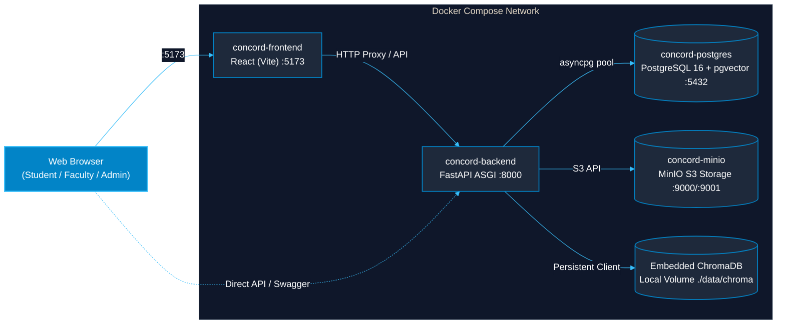

# CONCORD IKMS — Infrastructure, Database & Docker Setup Guide

[← Back to Main Documentation Index](../README.md#📚-documentation-index)

## 1. Databases Employed in CONCORD

CONCORD uses a **dual-database strategy** adhering to the Strategy Pattern:

### A. Primary Relational Database (SQLAlchemy 2.0 Async Engine)
- **Local & Unit Test Environment:** **SQLite + aiosqlite** (`concord_dev.db`). Lightweight, zero-configuration, zero network dependency, and executes in-memory during automated Pytest runs (`sqlite+aiosqlite:///:memory:`).
- **Production / Containerized Environment:** **PostgreSQL 16 + pgvector** (`postgresql+asyncpg://...`). Used for scalable production multi-tenancy, transactional integrity, and relational tables (Users, Departments, Documents, Chunks, Audit Events).

### B. Vector Store (Embedded AI Memory Layer)
- **Engine:** **ChromaDB (`PersistentClient`)** located at `backend/data/chroma`.
- **Space:** Cosine Distance (`hnsw:space: cosine`).
- **Index-Level RBAC Filtering:** Every document vector is stored with its `department_id` and `lifecycle_status`. Queries enforce `where={"department_id": user_dept_id}`, preventing cross-department document leakage at the vector index level (0.0% leakage rate).

---

### C. Containerized Docker Deployment Topology (GitHub Mermaid)



---

## 2. Object Storage (File Infrastructure)
- **Development Default:** Local filesystem storage (`backend/data/storage/`) managed via `LocalStorageProvider`.
- **Production / Docker:** **MinIO** S3-compatible private object storage container (`concord-minio`) running on ports `9000` (API) and `9001` (Console).

---

## 3. Docker Compose Stack (`docker-compose.yml`)

The repository includes a production-grade multi-container stack:

```yaml
version: "3.8"

services:
  postgres:
    image: pgvector/pgvector:pg16
    container_name: concord-postgres
    ports:
      - "5432:5432"
    environment:
      POSTGRES_USER: concord_user
      POSTGRES_PASSWORD: concord_password
      POSTGRES_DB: concord_db

  minio:
    image: minio/minio:latest
    container_name: concord-minio
    command: server /data --console-address ":9001"
    ports:
      - "9000:9000"
      - "9001:9001"

  backend:
    build:
      context: .
      dockerfile: infra/docker/backend.Dockerfile
    container_name: concord-backend
    ports:
      - "8000:8000"
    depends_on:
      postgres:
        condition: service_healthy

  frontend:
    build:
      context: .
      dockerfile: infra/docker/frontend.Dockerfile
    container_name: concord-frontend
    ports:
      - "5173:5173"
```

### Starting the Docker Stack
```bash
# Start all containers in the background:
docker compose up -d --build

# View container logs:
docker compose logs -f

# Shut down the stack:
docker compose down
```

---

## 4. UI Architecture & Yellow Brutalist Design System

The frontend is built with **React 18 + Vite 5** and implements an uncompromising **Yellow Brutalist Design System**:
- **Design Aesthetic:** Bold editorial brutalism featuring hero high-voltage yellow (`#FFE600`), structural pitch black borders (`#0A0A0A`), architectural paper off-white (`#F4F0E8`), and restrained hazard red accents (`#FF3333`).
- **Tactile Shadows & Mechanical Borders:** Hard 2px/3px solid borders with 2px/4px/8px non-blurred offset drop shadows (`shadow-brutal`, `shadow-brutal-lg`), hover lift (`-2px, -2px`), and tactile button press response (`2px, 2px`).
- **Theme Synchronization:** Seamless brutalist dark mode (`[data-theme='dark']` and `.dark` class) with pitch black base (`#0A0A0A`), high-voltage yellow borders (`#FFE600`), and dark card surfaces (`#181818`).
- **Typography & Font System:**
  - Display: `Space Grotesk` (headings, KPI metrics, brand markers).
  - Body: `Inter` (readable data grids, system labels, narrative content).
  - Monospace: `JetBrains Mono` (hashes, status badges, timestamps, audit trails).
- **Reusable Primitive Library ([`frontend/src/components/brutal/`](file:///c:/Users/Admin/Desktop/IKMS/IKMS/frontend/src/components/brutal)):**
  - `BrutalButton.jsx`: Mechanical tactile button with variants (`primary`, `secondary`, `dark`, `danger`, `ghost`).
  - `BrutalCard.jsx`: Heavy-bordered architectural card with optional yellow header and offset shadow.
  - `BrutalBadge.jsx`: Monospaced high-contrast status badge (`yellow`, `black`, `paper`, `red`, `green`).
  - `BrutalInput.jsx`: Rectangular input with hard focus lift and label/error bindings.
  - `BrutalModal.jsx`: Editorial dialog with yellow header, flat dark backdrop, focus trapping, and escape listeners.
  - `BrutalTable.jsx`: Architectural data table with monospaced rows, sticky header, and hover effects wrapped in `overflow-x-auto`.
  - `BrutalTabs.jsx`: Segmented brutalist tab bar with active yellow lift.
  - `BrutalSkeleton.jsx` & `BrutalEmptyState.jsx`: Loading and zero-state placeholders.
  - `BrutalToast.jsx`: Fixed alert notification banner with `role="status"` and `aria-live="polite"`.
- **Performance & Code-Splitting Architecture:**
  - Route views lazy-loaded via `React.lazy()` with `BrutalSkeleton` fallback in `App.jsx`.
  - Vendor chunk splitting in `vite.config.js`:
    - `vendor-react` (React, React DOM) ~134 kB
    - `vendor-motion` (Framer Motion) ~115 kB
    - `vendor-markdown` (React Markdown, Remark GFM) ~158 kB
    - `vendor-icons` (Lucide React) ~33 kB
    - Application entry chunk ~58 kB
    - Zero chunks exceed 500 kB.
- **Accessibility & Motion Compliance:**
  - High-contrast visible focus rings (`:focus-visible` with 3px yellow outline).
  - `prefers-reduced-motion` compliance across all Framer Motion presets and global CSS transitions.
  - Touch targets minimum 44px on mobile viewports.

---

## 5. Conversational RAG & Ingestion System

- **Grounded Q&A ([`frontend/src/views/RAGAssistantView.jsx`](file:///c:/Users/Admin/Desktop/IKMS/IKMS/frontend/src/views/RAGAssistantView.jsx)):**
  - Instant citation inspection drawer with keyboard trapping (Tab containment, Esc to close).
  - High-contrast assistant response formatting with markdown tables and sanitized code blocks.
  - Suggested prompts, live query status, and speech recognition input.
- **Ingestion & Knowledge Governance ([`frontend/src/views/DocumentsView.jsx`](file:///c:/Users/Admin/Desktop/IKMS/IKMS/frontend/src/views/DocumentsView.jsx)):**
  - Drag-and-drop document upload with `UploadModal.jsx`.
  - Vector chunk inspector modal with OCR vs Native extraction details and confidence scores.
- **Institutional Benchmarking & Verification ([`frontend/src/views/BenchmarkView.jsx`](file:///c:/Users/Admin/Desktop/IKMS/IKMS/frontend/src/views/BenchmarkView.jsx)):**
  - KPI telemetry cards, live benchmark runner, and department latency matrices.

---

## 6. Feedback & Notification System (BrutalToast)

All user interactions and asynchronous tasks across CONCORD IKMS trigger unified tactile notifications via **[`BrutalToast`](file:///c:/Users/Admin/Desktop/IKMS/IKMS/frontend/src/components/brutal/BrutalToast.jsx)**:
- **Design Tokens:** Strictly bound to Tailwind Brutalist tokens (`bg-brutal-success`, `bg-brutal-yellow`, `bg-brutal-accent`, `bg-brutal-paper`), eliminating arbitrary inline colors and ensuring high-contrast readability (minimum 5.4:1 contrast ratio).
- **Auto-Dismiss Lifecycle:** Configured with a default 4000ms duration with automatic cleanup timers and manual dismiss triggers.
- **Accessibility:** Declared with `role="status"` and `aria-live="polite"` for non-disruptive screen reader announcements.
- **System Activity Coverage:**
  - **Conversational Assistant (`RAGAssistantView`):** Copy conversation as Markdown, thread session initialization, and session deletion.
  - **Contextual Search (`SearchView`):** Retrieval completion diagnostics, empty state notices, and API error alerts.
  - **Audit Ledger (`AuditLogsView`):** SHA-256 hash copy to clipboard, manual ledger synchronization, and cryptographic hash-chain integrity verification.
  - **Document Governance (`DocumentsView`):** Upload confirmation, document deletion, review decisions (`approved`/`rejected`), and inspector load failures.
  - **Department Management (`DepartmentsView`):** Department creation, validation errors, and quota limit feedback.
  - **User Directory (`UsersView`):** Account activation/deactivation toggles and permission guard alerts.
  - **Benchmarking Suite (`BenchmarkView`):** Metrics refresh and live benchmark execution assertions.

---

## 7. Reusable Conversational AI Components

To prevent code redundancy across views and components, specialized conversational and AI telemetry elements are encapsulated as standalone, reusable components:

### A. Academic Thinking Indicator (`ThinkingIndicator.jsx`)
- **Location:** [`frontend/src/components/rag/ThinkingIndicator.jsx`](file:///c:/Users/Admin/Desktop/IKMS/IKMS/frontend/src/components/rag/ThinkingIndicator.jsx)
- **Purpose:** Rotates scholarly, institutional gerunds during LLM inference and vector retrieval to communicate active cognitive stages.
- **Lexicon Source:** Curated in [`frontend/src/constants/thinkingVerbs.js`](file:///c:/Users/Admin/Desktop/IKMS/IKMS/frontend/src/constants/thinkingVerbs.js) with 32 scholarly verbs (*Cross-referencing, Synthesizing, Formulating, Corroborating, Contextualizing, Deliberating, etc.*).
- **Animation:** Powered by Framer Motion `AnimatePresence` with slide-fade transition every 1600ms, respecting `prefers-reduced-motion`.

### B. Answer Feedback Loop (`AnswerFeedback.jsx`)
- **Location:** [`frontend/src/components/rag/AnswerFeedback.jsx`](file:///c:/Users/Admin/Desktop/IKMS/IKMS/frontend/src/components/rag/AnswerFeedback.jsx)
- **Purpose:** Provides institutional users with a direct verification rating (👍 Helpful / 👎 Unhelpful) on AI assistant responses, with an optional expandable natural-language feedback accordion.
- **Zero Redundancy Integration:** Extracted from inline message rendering so it can be embedded in `MessageBlock.jsx`, search result cards, or audit inspector modals without duplicate state logic.
- **Audit Persistence:** Transmits structured rating and optional explanatory notes directly to `POST /api/v1/audit/feedback`, creating an append-only cryptographic audit record for policy verification and RAG refinement.


