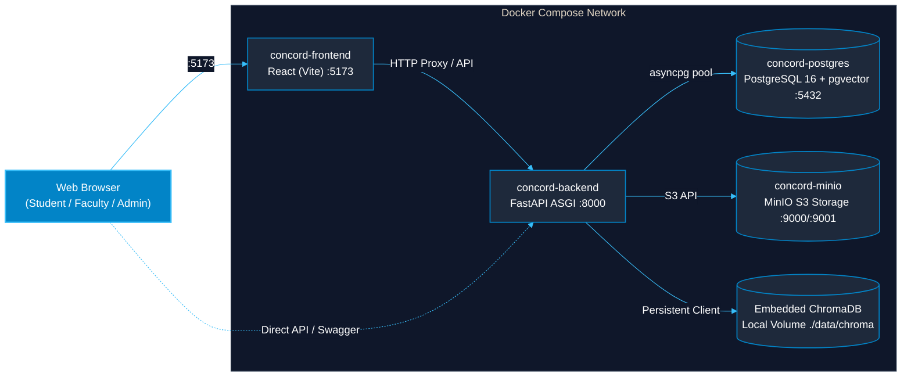

# CONCORD IKMS — Infrastructure, Database & Docker Setup Guide

[← Back to Main Documentation Index](../README.md#📚-documentation-index)

## 1. Databases Employed in CONCORD

CONCORD uses a **dual-database strategy** adhering to the Strategy Pattern:

### A. Primary Relational Database (SQLAlchemy 2.0 Async Engine)
- **Local & Unit Test Environment:** **SQLite + aiosqlite** (`concord_dev.db`). Lightweight, zero-configuration, zero network dependency, and executes in-memory during automated Pytest runs (`sqlite+aiosqlite:///:memory:`).
- **Production / Containerized Environment:** **PostgreSQL 16 + pgvector** (`postgresql+asyncpg://...`). Used for scalable production multi-tenancy, transactional integrity, and relational tables (Users, Departments, Documents, Chunks, Audit Events).

### B. Vector Store (Embedded AI Memory Layer)
- **Engine:** **ChromaDB (`PersistentClient`)** located at `backend/data/chroma`.
- **Space:** Cosine Distance (`hnsw:space: cosine`).
- **Index-Level RBAC Filtering:** Every document vector is stored with its `department_id` and `lifecycle_status`. Queries enforce `where={"department_id": user_dept_id}`, preventing cross-department document leakage at the vector index level (0.0% leakage rate).

---

### C. Containerized Docker Deployment Topology (GitHub Mermaid)



---

## 2. Object Storage (File Infrastructure)
- **Development Default:** Local filesystem storage (`backend/data/storage/`) managed via `LocalStorageProvider`.
- **Production / Docker:** **MinIO** S3-compatible private object storage container (`concord-minio`) running on ports `9000` (API) and `9001` (Console).

---

## 3. Docker Compose Stack (`docker-compose.yml`)

The repository includes a production-grade multi-container stack:

```yaml
version: "3.8"

services:
  postgres:
    image: pgvector/pgvector:pg16
    container_name: concord-postgres
    ports:
      - "5432:5432"
    environment:
      POSTGRES_USER: concord_user
      POSTGRES_PASSWORD: concord_password
      POSTGRES_DB: concord_db

  minio:
    image: minio/minio:latest
    container_name: concord-minio
    command: server /data --console-address ":9001"
    ports:
      - "9000:9000"
      - "9001:9001"

  backend:
    build:
      context: .
      dockerfile: infra/docker/backend.Dockerfile
    container_name: concord-backend
    ports:
      - "8000:8000"
    depends_on:
      postgres:
        condition: service_healthy

  frontend:
    build:
      context: .
      dockerfile: infra/docker/frontend.Dockerfile
    container_name: concord-frontend
    ports:
      - "5173:5173"
```

### Starting the Docker Stack
```bash
# Start all containers in the background:
docker compose up -d --build

# View container logs:
docker compose logs -f

# Shut down the stack:
docker compose down
```

---

## 4. UI Architecture & Yellow Brutalist Design System

The frontend is built with **React 18 + Vite 5** and features a **Yellow Brutalist Design System**:
- **Design Aesthetic:** Bold editorial brutalism with hero high-voltage yellow (`#FFE600`), structural pitch black borders (`#0A0A0A`), architectural paper off-white (`#F4F0E8`), and restrained hazard red accents (`#FF3333`).
- **Tactile Shadows & Mechanical Borders:** Hard 2px/3px solid borders with 4px/8px non-blurred offset drop shadows (`shadow-brutal`), hover lift (`-2px, -2px`), and tactile button press response (`2px, 2px`).
- **Theme Synchronization:** Seamless brutalist dark mode (`[data-theme='dark']` and `.dark` class) with near-black base (`#121212`), high-contrast yellow borders, and dark cards (`#1C1C1C`).
- **Reusable Primitive Library ([`frontend/src/components/brutal/`](file:///c:/Users/Admin/Desktop/IKMS/IKMS/frontend/src/components/brutal)):**
  - `BrutalButton.jsx`: Mechanical tactile button (`primary`, `secondary`, `dark`, `danger`, `ghost`).
  - `BrutalCard.jsx`: Heavy-bordered container with optional yellow header and hard offset shadow.
  - `BrutalBadge.jsx`: Monospaced high-contrast status pills (`yellow`, `black`, `paper`, `red`, `green`).
  - `BrutalInput.jsx`: Rectangular input with hard focus lift and label/error bindings.
  - `BrutalModal.jsx`: Editorial dialog with yellow header, flat dark backdrop, and escape listeners.
  - `BrutalTable.jsx`: Architectural data table with monospaced rows, sticky header, and hover effects.
  - `BrutalTabs.jsx`: Segmented brutalist tab bar with active yellow lift.
  - `BrutalSkeleton.jsx` & `BrutalEmptyState.jsx`: Loading and zero-state placeholders.
  - `BrutalToast.jsx`: Fixed alert notification banner with hard offset shadows.
- **Decomposed Layout Shell ([`frontend/src/components/layout/`](file:///c:/Users/Admin/Desktop/IKMS/IKMS/frontend/src/components/layout)):**
  - `AppShell.jsx`: Full-height frame coordinating header, ticker, sidebar, and view transitions.
  - `Navbar.jsx`: Brand identity, mobile drawer toggle, user profile dropdown with DEV-only role switching, and logout.
  - `Sidebar.jsx`: Collapsible navigation with shortened labels (`Overview`, `Departments`, `Users`, `Audit Logs`, `Ingestion`, `Search`, `Grounded Q&A`, `Benchmarks`) and explicit tooltips.
  - `MarqueeTicker.jsx`: Seamless edge-to-edge institutional ticker tape with hard bottom border and offset shadow.
  - `PageTransition.jsx`: Framer Motion view transition wrapper.
- **Custom Interaction Hooks ([`frontend/src/hooks/`](file:///c:/Users/Admin/Desktop/IKMS/IKMS/frontend/src/hooks)):**
  - `useScrollReveal.js`: IntersectionObserver entry reveal hook respecting `prefers-reduced-motion`.
  - `useMagnetic.js`: Tactile hover cursor displacement hook for hero action triggers.
- **Institutional Portal Landing ([`frontend/src/views/LandingView.jsx`](file:///c:/Users/Admin/Desktop/IKMS/IKMS/frontend/src/views/LandingView.jsx)):**
  - Modular section breakdown: `HeroSection`, `StatsStrip`, `FeatureGrid`, `HowItWorks`, `RoleCards`, and `FooterBlock`.
  - Oversized editorial typography, technical specification cards, and zero generic gradients or emojis.
- **Security Authentication Gateway ([`frontend/src/views/LoginView.jsx`](file:///c:/Users/Admin/Desktop/IKMS/IKMS/frontend/src/views/LoginView.jsx)):**
  - Instant 1-click persona quick login cards (Admin, HOD CSE, Faculty, Student) with pre-fill capability.
  - Built with `BrutalInput` and `BrutalCard`, providing error alerts, loading state feedback, and OWASP compliance notes.
- **Knowledge Ingestion & Document Governance ([`frontend/src/views/DocumentsView.jsx`](file:///c:/Users/Admin/Desktop/IKMS/IKMS/frontend/src/views/DocumentsView.jsx)):**
  - Modular section architecture: `DocumentsHeader`, `DocumentFilters`, and `DocumentTable`.
  - Drag-and-drop file ingestion dialog with `UploadModal.jsx`.
  - Semantic vector chunk inspection with OCR vs native tagging in `ChunkInspectorModal.jsx`.
  - Live search filtering, department scope dropdown, and review queue tabs.

---

## 5. Conversational UI & Animations System

The RAG Assistant uses modern interactive animations and chronological layout:
- **Chronological Flow:** Questions and synthesized answers flow top-to-bottom with smooth automatic scrolling (`messagesEndRef.current.scrollIntoView`).
- **Entrance Transitions:**
  - `.animate-user-msg`: Fluid slide-up transition from bottom right with scale pop (`userMsgSlide 0.28s`).
  - `.animate-assistant-msg`: Smooth fade-and-lift elevation (`assistantMsgSlide 0.35s`).
  - `.typing-dot`: Staggered wave animation (`pulseDot 1.4s`) while Groq Cloud synthesizes evidence chunks.
- **Sanitized Markdown Rendering:** Strips out raw `<br>` and HTML artifacts, rendering clean typography, tables, and clickable evidence citation badges `[1]`, `[2]`.
- **Institutional Single-Card Surface:** Side panel threads and conversation stream unified in a clean, elevated card with zero disjointed borders.

