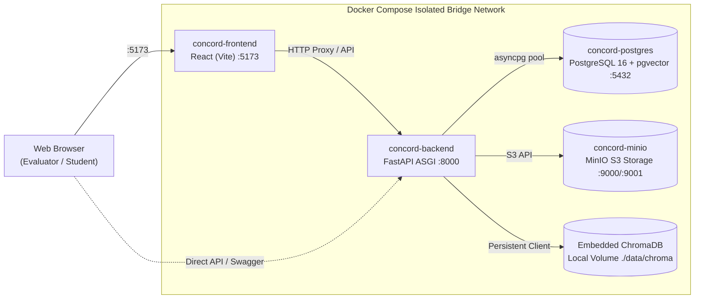

# CONCORD IKMS — Infrastructure, Database & Docker Setup Guide

[← Back to Main Documentation Index](../README.md#📚-documentation-index)

## 1. Databases Employed in CONCORD

CONCORD uses a **dual-database strategy** adhering to the Strategy Pattern:

### A. Primary Relational Database (SQLAlchemy 2.0 Async Engine)
- **Local & Unit Test Environment:** **SQLite + aiosqlite** (`concord_dev.db`). Lightweight, zero-configuration, zero network dependency, and executes in-memory during automated Pytest runs (`sqlite+aiosqlite:///:memory:`).
- **Production / Containerized Environment:** **PostgreSQL 16 + pgvector** (`postgresql+asyncpg://...`). Used for scalable production multi-tenancy, transactional integrity, and relational tables (Users, Departments, Documents, Chunks, Audit Events).

### B. Vector Store (Embedded AI Memory Layer)
- **Engine:** **ChromaDB (`PersistentClient`)** located at `backend/data/chroma`.
- **Space:** Cosine Distance (`hnsw:space: cosine`).
- **Index-Level RBAC Filtering:** Every document vector is stored with its `department_id` and `lifecycle_status`. Queries enforce `where={"department_id": user_dept_id}`, preventing cross-department document leakage at the vector index level (0.0% leakage rate).

---

### C. Containerized Docker Deployment Topology (GitHub Mermaid)



---

## 2. Object Storage (File Infrastructure)
- **Development Default:** Local filesystem storage (`backend/data/storage/`) managed via `LocalStorageProvider`.
- **Production / Docker:** **MinIO** S3-compatible private object storage container (`concord-minio`) running on ports `9000` (API) and `9001` (Console).

---

## 3. Docker Compose Stack (`docker-compose.yml`)

The repository includes a production-grade multi-container stack:

```yaml
version: "3.8"

services:
  postgres:
    image: pgvector/pgvector:pg16
    container_name: concord-postgres
    ports:
      - "5432:5432"
    environment:
      POSTGRES_USER: concord_user
      POSTGRES_PASSWORD: concord_password
      POSTGRES_DB: concord_db

  minio:
    image: minio/minio:latest
    container_name: concord-minio
    command: server /data --console-address ":9001"
    ports:
      - "9000:9000"
      - "9001:9001"

  backend:
    build:
      context: .
      dockerfile: infra/docker/backend.Dockerfile
    container_name: concord-backend
    ports:
      - "8000:8000"
    depends_on:
      postgres:
        condition: service_healthy

  frontend:
    build:
      context: .
      dockerfile: infra/docker/frontend.Dockerfile
    container_name: concord-frontend
    ports:
      - "5173:5173"
```

### Starting the Docker Stack
```bash
# Start all containers in the background:
docker compose up -d --build

# View container logs:
docker compose logs -f

# Shut down the stack:
docker compose down
```

---

## 4. UI Architecture & Design System

The frontend is built with **React + Vite** and uses a bespoke Institutional Design System:
- **Typography:** Inter (body) & Outfit (display headers) via Google Fonts.
- **Theming:** High-contrast Institutional Light Theme default with seamless Dark Mode toggle via CSS variables (`--bg-primary`, `--bg-card`, `--text-main`, `--border-light`).
- **Modular Components ([`frontend/src/components/`](file:///c:/Users/Admin/Desktop/IKMS/IKMS/frontend/src/components)):**
  - `Navbar.jsx`: Top navigation, live health indicator, role switcher pills (`Admin`, `HOD CSE`, `Faculty`, `Student`).
  - `Sidebar.jsx`: Platform module navigation with RBAC access locks and milestone tags.
  - `HealthCard.jsx`: Live heartbeat checking backend `/healthz` and database latency.
  - `documents/`: Decomposed sub-components (`UploadModal`, `DocumentTable`, `ChunkInspectorModal`).
  - `ui/`: Reusable primitives (`SearchBar`, `EvidenceCitationCard`).
- **Interactive Views ([`frontend/src/views/`](file:///c:/Users/Admin/Desktop/IKMS/IKMS/frontend/src/views)):**
  - `LandingView.jsx`: Institutional welcome portal with search bar and feature highlights.
  - `DashboardView.jsx`: System overview, permissions breakdown, and evaluator demo controls.
  - `DocumentsView.jsx`: Ingestion, chunk inspector, and HOD governance review queue.
  - `SearchView.jsx`: Contextual search with department filter and RRF score breakdowns.
  - `RAGAssistantView.jsx`: Grounded Q&A assistant with Groq Cloud streaming, clickable citations `[1]`, and discrepancy reports.
  - `BenchmarkView.jsx`: Empirical evaluation matrix (Hit Rate@5, MRR@5, latency) and live benchmark runner.
