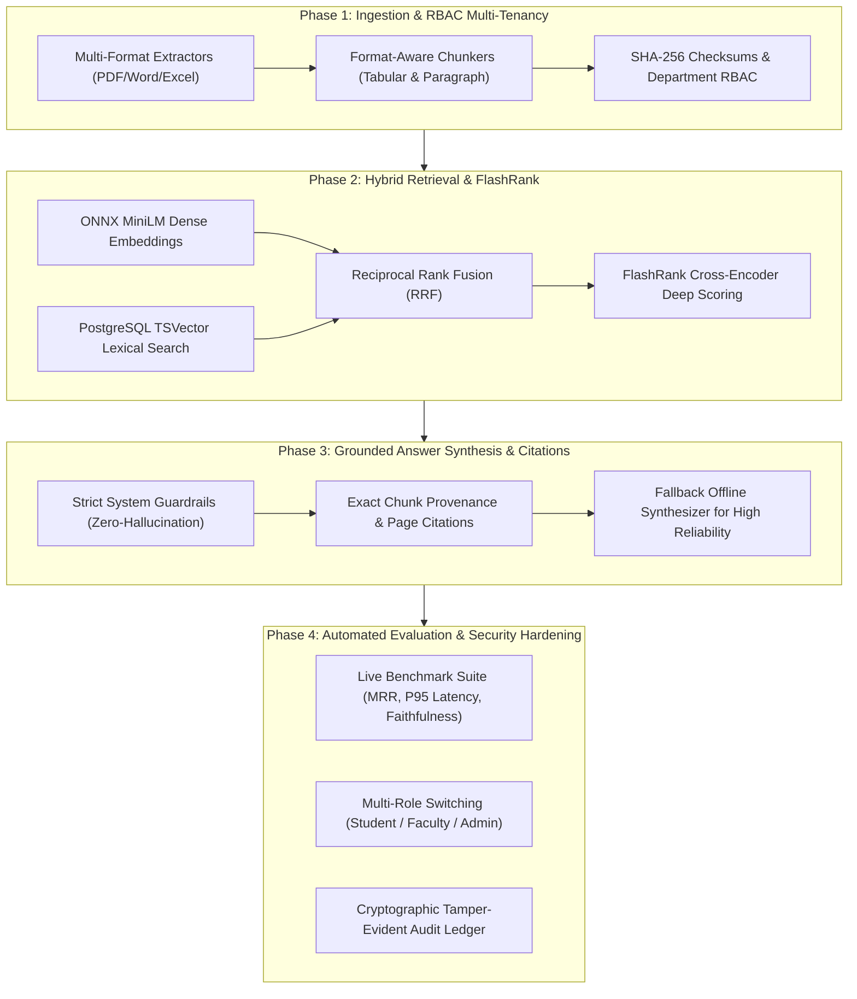

# CONCORD — Mega Project 2026–27: Engineering Master Brief

[← Back to Main Documentation Index](../README.md#📚-documentation-index)

---

The most important decision at this stage is to build CONCORD as a real institutional knowledge platform, not merely a chatbot connected to PDFs.
Your project combines the core ideas of enterprise knowledge discovery and persistent contextual memory into a system designed for an educational institution such as KIT. It must bring scattered institutional information together, retrieve the right evidence for a particular user and situation, and generate answers that can be verified, audited, and trusted.
The implementation should be ambitious enough for a major project, but every feature must have a clear purpose, a feasible development path, and measurable acceptance criteria.
CONCORD
Context-Oriented Cognitive Memory Layer for Multi-Source Knowledge Integration, Adaptive Retrieval, and Trust-Aware Institutional Intelligence
A unified intelligence layer over institutional documents, policies, notices, structured records, and other approved knowledge sources.
UNIFY
Integrate sources, ownership, metadata, and versions.
UNDERSTAND
Retrieve relevant knowledge using context and hybrid search.
TRUST
Enforce permissions, provenance, freshness, and evidence checks.

1. What we are actually building
   Imagine a student asks:
   What documents are required for the internship permission process, who needs to approve it, and which form is currently valid?
   A conventional chatbot might search a few PDFs and produce a plausible answer. CONCORD must do substantially more.
   Identify the user's identity, role, department, and access permissions.
   Search the approved institutional knowledge sources.
   Retrieve the relevant internship policy, current application form, and approval instructions.
   Distinguish the current document from older versions.
   Detect contradictory instructions instead of silently choosing one.
   Generate a structured answer with citations to the actual source and relevant page or section.
   Abstain or ask for clarification when the evidence is incomplete.
   Record the retrieval and response metadata needed for auditing.
   The system should work for training and placement, examinations, college administration, accounts, and other approved departments without creating a completely separate application for each department.
   The differentiator is the combination of shared institutional memory, contextual retrieval, and enforceable trust controls. A conversational interface is only one way of using that underlying platform.
   What the first version should and should not be
   Build first
   A secure, modular institutional knowledge system with document ingestion, OCR, hybrid retrieval, evidence-grounded answers, RBAC, versioning, audit logs, and an evaluation framework.
   Build progressively
   Persistent conversational memory, automated conflict detection, multi-step agent workflows, multiple model providers, structured-system connectors, and sophisticated administration tools.
   Do not assume
   Live integration with KIT's private systems, access to real student records, production deployment approval, or availability of GPU infrastructure. Use synthetic data and adapters until these are explicitly authorized and available.
2. Recommended implementation architecture
   For a major project with several modules, multiple developers, AI workflows, and an eventual institutional deployment, I recommend a modular monolith first, with clearly separated worker processes and provider adapters.
   This gives you industry-style boundaries without the operational overhead of starting with ten microservices. If a component later needs independent scaling, its interface is already defined.
   Presentation layer
   Next.js · TypeScript · Responsive dashboard · Search · Chat · Admin
   API and application layer
   FastAPI · Authentication · RBAC · Tenant/department scope · Validation · Audit
   Knowledge pipeline
   Upload → extraction/OCR → normalization → chunking → indexing
   Intelligence pipeline
   Query analysis → hybrid retrieval → reranking → grounded generation
   Structured data
   PostgreSQL · pgvector · Full-text search · Migrations
   File and job infrastructure
   Private object storage · Background workers · Optional Redis
   Provider abstraction layer
   Local LLMs · Embedding models · OCR engines · Rerankers · Optional approved external providers
   Recommended baseline stack
   Layer
   Recommendation
   Why it fits CONCORD
   Frontend
   Next.js + TypeScript
   Modular UI, typed API integration, scalable administration screens
   Backend
   Python + FastAPI
   Strong document-processing and AI ecosystem; typed request/response contracts
   Primary database
   PostgreSQL
   Transactional records, metadata, relationships, and audit data
   Vector retrieval
   pgvector
   Keeps vector search with relational data; supports exact/approximate search and hybrid retrieval patterns.
   GitHub
   +1
   File storage
   S3-compatible private object storage; MinIO for local development
   Separates file binaries from relational records and supports a portable storage interface
   Document extraction
   PyMuPDF, python-docx, python-pptx, openpyxl; OCR adapter for scanned files
   Supports common institutional formats
   OCR
   PaddleOCR as an initial candidate
   A replaceable OCR engine, subject to testing on actual document samples
   LLM orchestration
   Explicit retrieval pipeline first; LangGraph for workflows that justify graph-based orchestration
   Avoids unnecessary agent complexity; supports later resumable workflows and human approval
   Embeddings
   Configurable local embedding model, with BGE-M3 as a candidate
   Avoids tying the application to one model or embedding dimension
   Background processing
   Dedicated worker and job queue; Redis only if needed
   Prevents lengthy ingestion from blocking API requests
   Deployment
   Docker Compose initially; production container orchestration only when justified
   Reproducible development and easier deployment portability
   Testing and quality
   pytest, API integration tests, frontend tests, linting, type checking, CI
   Makes progress measurable and regressions detectable
   The architecture deliberately does not hardwire a single LLM, embedding model, cloud provider, or storage backend. PostgreSQL plus pgvector is a reasonable starting point because its official documentation describes both vector similarity and hybrid search with PostgreSQL full-text search.
   GitHub
   +1
   The architectural rule that matters most
   Define interfaces such as:
   DocumentParser
   OCRProvider
   EmbeddingProvider
   ChatModelProvider
   RerankerProvider
   ObjectStorageProvider
   RetrievalStrategy
   InstitutionalConnector
   Every implementation should be replaceable behind a stable interface. For example, switching from Ollama to vLLM should require configuration changes and possibly a provider adapter—not rewriting the retrieval service, chat API, and frontend.
   Use a modular monolith with dependency inversion, not a single large Python file and not premature microservices.
3. The complete milestone journey
   Treat these milestones as development gates rather than just calendar deadlines. The estimates below are an initial planning baseline for a student team; adjust them after inspecting the repository, team availability, and hardware.
   M0 — Discovery and baseline
   Week 1
   Repository audit, requirements, architecture decisions, risks, sample datasets, acceptance criteria.
   Exit gate: Approved scope, architecture decision records, repository map, development setup, and initial backlog.
   M1 — Platform foundation
   Weeks 2–3
   Frontend shell, backend API, database migrations, configuration, authentication, roles, permissions, audit events, Docker Compose. Exit gate: A user can sign in, access only authorized screens, and interact with a persistent database.
   M2 — Document ingestion
   Weeks 4–5
   Upload, file validation, private storage, parsing, OCR, metadata, chunking, background jobs, failure recovery. Exit gate: A PDF or supported office document can be processed, inspected, retried, and traced to its source.
   M3 — Search and retrieval
   Weeks 6–7
   Keyword search, vector search, hybrid ranking, department filters, source links, retrieval diagnostics. Exit gate: Users retrieve relevant, authorized evidence even when wording differs from the original document.
   M4 — Evidence-grounded answers
   Weeks 8–9
   Model adapter, answer generation, citation validation, insufficient-evidence handling, conversation history. Exit gate: Every factual answer is grounded in retrievable evidence or explicitly states that the evidence is insufficient.
   M5 — Institutional memory and trust
   Weeks 10–11
   Version history, superseded documents, freshness indicators, conflict candidates, provenance, conversation continuity. Exit gate: Users can identify current versus obsolete evidence, and conflicting sources are surfaced for review.
   M6 — Agent workflows
   Weeks 12–13
   Bounded multi-step retrieval, workflow state, human approval, safe tool interfaces, checkpoints and failure recovery. Exit gate: At least one auditable workflow executes multiple steps without bypassing permissions or approval rules.
   M7 — Hardening and evaluation
   Weeks 14–15
   Security testing, retrieval benchmarks, answer-quality tests, load tests, backup and restore, error handling. Exit gate: A documented test report establishes what the system can reliably do and where it fails.
   M8 — Deployment and demonstration
   Week 16 onward
   Deployment profiles, sample institutional workspace, observability, user guide, architecture documentation, demonstration scenarios. Exit gate: A reproducible deployment and end-to-end demonstration work from a clean environment.
   Planning note: Sixteen weeks is a target for a meaningful demonstrable system, not a guarantee that every advanced capability will be production-ready. For a major project, reserve additional time for evaluation, documentation, feedback, and integration.
   How to prioritize when the timeline slips
   Keep the following order:
   Secure access and a working database.
   Reliable document ingestion and traceable metadata.
   Search with permission filtering.
   Grounded answers with working citations.
   Versioning, freshness, conflict handling, and evaluation.
   Persistent memory and agent workflows.
   Advanced connectors, deployment scaling, and optional enterprise integrations.
   Never sacrifice authorization, evidence traceability, or testing just to demonstrate a more sophisticated agent.
4. Detailed module specifications
   These are the functional boundaries the coding agent should implement. Each module should have its own responsibilities, contracts, tests, and acceptance criteria.
   Module A — Identity, access control, and institutional tenancy
   Purpose: Ensure the correct person can access the correct information, regardless of whether the request comes through search, chat, an API, a background job, or an agent.
   Core functionality:
   Users, roles, departments, organizational units, and membership.
   Roles such as platform administrator, department administrator, staff, faculty, and student.
   Document-level and department-level access policies.
   Authentication with secure sessions or tokens, depending on the selected implementation.
   Authorization enforced on the server, not just by hiding frontend controls.
   Permission checks on uploads, downloads, search results, citation links, and retrieved chunks.
   Audit events for security-relevant actions.
   An explicit development-only demo authentication mode, isolated from production.
   Important distinction: a department filter is not an authorization system. The backend must verify the user's effective permissions before returning document content. The OWASP ASVS guidance specifically calls for access controls enforced in a trusted service layer and least-privilege permissions.
   GitHub
   +1
   Acceptance criteria:
   A student cannot retrieve a private accounts document by changing an API parameter.
   An unauthorized document cannot leak through citations, search snippets, chat context, or error messages.
   Background jobs retain the authorization context and cannot silently run as an unrestricted administrator.
   Tests cover cross-department access, revoked permissions, and unauthorized file downloads.
   Module B — Institutional source registry and document ingestion
   Purpose: Convert different institutional sources into consistently managed knowledge assets.
   Start with PDF, DOCX, PPTX, XLSX, and TXT/Markdown files. Add other formats only through tested parser adapters.
   A standard ingestion pipeline:
   #chatgpt-mermaid-_r_ra_{font-family:-apple-system-body,ui-sans-serif,-apple-system,system-ui,"Segoe UI",Helvetica,"Apple Color Emoji",Arial,sans-serif,"Segoe UI Emoji","Segoe UI Symbol";font-size:16px;fill:rgb(237, 237, 237);}@keyframes edge-animation-frame{from{stroke-dashoffset:0;}}@keyframes dash{to{stroke-dashoffset:0;}}#chatgpt-mermaid-_r_ra_ .edge-animation-slow{stroke-dasharray:9,5!important;stroke-dashoffset:900;animation:dash 50s linear infinite;stroke-linecap:round;}#chatgpt-mermaid-_r_ra_ .edge-animation-fast{stroke-dasharray:9,5!important;stroke-dashoffset:900;animation:dash 20s linear infinite;stroke-linecap:round;}#chatgpt-mermaid-_r_ra_ .error-icon{fill:rgb(48, 48, 48);}#chatgpt-mermaid-_r_ra_ .error-text{fill:rgb(237, 237, 237);stroke:rgb(237, 237, 237);}#chatgpt-mermaid-_r_ra_ .edge-thickness-normal{stroke-width:1px;}#chatgpt-mermaid-_r_ra_ .edge-thickness-thick{stroke-width:3.5px;}#chatgpt-mermaid-_r_ra_ .edge-pattern-solid{stroke-dasharray:0;}#chatgpt-mermaid-_r_ra_ .edge-thickness-invisible{stroke-width:0;fill:none;}#chatgpt-mermaid-_r_ra_ .edge-pattern-dashed{stroke-dasharray:3;}#chatgpt-mermaid-_r_ra_ .edge-pattern-dotted{stroke-dasharray:2;}#chatgpt-mermaid-_r_ra_ .marker{fill:rgb(175, 175, 175);stroke:rgb(175, 175, 175);}#chatgpt-mermaid-_r_ra_ .marker.cross{stroke:rgb(175, 175, 175);}#chatgpt-mermaid-_r_ra_ svg{font-family:-apple-system-body,ui-sans-serif,-apple-system,system-ui,"Segoe UI",Helvetica,"Apple Color Emoji",Arial,sans-serif,"Segoe UI Emoji","Segoe UI Symbol";font-size:16px;}#chatgpt-mermaid-_r_ra_ p{margin:0;}#chatgpt-mermaid-_r_ra_ .label{font-family:-apple-system-body,ui-sans-serif,-apple-system,system-ui,"Segoe UI",Helvetica,"Apple Color Emoji",Arial,sans-serif,"Segoe UI Emoji","Segoe UI Symbol";color:rgb(237, 237, 237);}#chatgpt-mermaid-_r_ra_ .cluster-label text{fill:rgb(237, 237, 237);}#chatgpt-mermaid-_r_ra_ .cluster-label span{color:rgb(237, 237, 237);}#chatgpt-mermaid-_r_ra_ .cluster-label span p{background-color:transparent;}#chatgpt-mermaid-_r_ra_ .label text,#chatgpt-mermaid-_r_ra_ span{fill:rgb(237, 237, 237);color:rgb(237, 237, 237);}#chatgpt-mermaid-_r_ra_ .node rect,#chatgpt-mermaid-_r_ra_ .node circle,#chatgpt-mermaid-_r_ra_ .node ellipse,#chatgpt-mermaid-_r_ra_ .node polygon,#chatgpt-mermaid-_r_ra_ .node path{fill:rgb(9, 23, 44);stroke:rgb(31, 78, 148);stroke-width:1px;}#chatgpt-mermaid-_r_ra_ .rough-node .label text,#chatgpt-mermaid-_r_ra_ .node .label text,#chatgpt-mermaid-_r_ra_ .image-shape .label,#chatgpt-mermaid-_r_ra_ .icon-shape .label{text-anchor:middle;}#chatgpt-mermaid-_r_ra_ .node .katex path{fill:#000;stroke:#000;stroke-width:1px;}#chatgpt-mermaid-_r_ra_ .rough-node .label,#chatgpt-mermaid-_r_ra_ .node .label,#chatgpt-mermaid-_r_ra_ .image-shape .label,#chatgpt-mermaid-_r_ra_ .icon-shape .label{text-align:center;}#chatgpt-mermaid-_r_ra_ .node.clickable{cursor:pointer;}#chatgpt-mermaid-_r_ra_ .root .anchor path{fill:rgb(175, 175, 175)!important;stroke-width:0;stroke:rgb(175, 175, 175);}#chatgpt-mermaid-_r_ra_ .arrowheadPath{fill:rgb(175, 175, 175);}#chatgpt-mermaid-_r_ra_ .edgePath .path{stroke:rgb(175, 175, 175);stroke-width:1px;}#chatgpt-mermaid-_r_ra_ .flowchart-link{stroke:rgb(175, 175, 175);fill:none;}#chatgpt-mermaid-_r_ra_ .edgeLabel{background-color:rgb(0, 0, 0);text-align:center;}#chatgpt-mermaid-_r_ra_ .edgeLabel p{background-color:rgb(0, 0, 0);}#chatgpt-mermaid-_r_ra_ .edgeLabel rect{opacity:0.5;background-color:rgb(0, 0, 0);fill:rgb(0, 0, 0);}#chatgpt-mermaid-_r_ra_ .labelBkg{background-color:rgba(0, 0, 0, 0.5);}#chatgpt-mermaid-_r_ra_ .cluster rect{fill:rgb(48, 48, 48);stroke:rgba(255, 255, 255, 0.15);stroke-width:1px;}#chatgpt-mermaid-_r_ra_ .cluster text{fill:rgb(237, 237, 237);}#chatgpt-mermaid-_r_ra_ .cluster span{color:rgb(237, 237, 237);}#chatgpt-mermaid-_r_ra_ div.mermaidTooltip{position:absolute;text-align:center;max-width:200px;padding:2px;font-family:-apple-system-body,ui-sans-serif,-apple-system,system-ui,"Segoe UI",Helvetica,"Apple Color Emoji",Arial,sans-serif,"Segoe UI Emoji","Segoe UI Symbol";font-size:12px;background:rgb(48, 48, 48);border:1px solid rgba(255, 255, 255, 0.15);border-radius:2px;pointer-events:none;z-index:100;}#chatgpt-mermaid-_r_ra_ .flowchartTitleText{text-anchor:middle;font-size:18px;fill:rgb(237, 237, 237);}#chatgpt-mermaid-_r_ra_ rect.text{fill:none;stroke-width:0;}#chatgpt-mermaid-_r_ra_ .icon-shape,#chatgpt-mermaid-_r_ra_ .image-shape{background-color:rgb(0, 0, 0);text-align:center;}#chatgpt-mermaid-_r_ra_ .icon-shape p,#chatgpt-mermaid-_r_ra_ .image-shape p{background-color:rgb(0, 0, 0);padding:2px;}#chatgpt-mermaid-_r_ra_ .icon-shape .label rect,#chatgpt-mermaid-_r_ra_ .image-shape .label rect{opacity:0.5;background-color:rgb(0, 0, 0);fill:rgb(0, 0, 0);}#chatgpt-mermaid-_r_ra_ .label-icon{display:inline-block;height:1em;overflow:visible;vertical-align:-0.125em;}#chatgpt-mermaid-_r_ra_ .node .label-icon path{fill:currentColor;stroke:revert;stroke-width:revert;}#chatgpt-mermaid-_r_ra_ .node .neo-node{stroke:rgb(31, 78, 148);}#chatgpt-mermaid-_r_ra_ [data-look="neo"].node rect,#chatgpt-mermaid-_r_ra_ [data-look="neo"].cluster rect,#chatgpt-mermaid-_r_ra_ [data-look="neo"].node polygon{stroke:url(#chatgpt-mermaid-_r_ra_-gradient);filter:drop-shadow( 1px 2px 2px rgba(185,185,185,1));}#chatgpt-mermaid-_r_ra_ [data-look="neo"].swimlane.cluster rect{filter:none;}#chatgpt-mermaid-_r_ra_ [data-look="neo"].node path{stroke:url(#chatgpt-mermaid-_r_ra_-gradient);stroke-width:1px;}#chatgpt-mermaid-_r_ra_ [data-look="neo"].node .outer-path{filter:drop-shadow( 1px 2px 2px rgba(185,185,185,1));}#chatgpt-mermaid-_r_ra_ [data-look="neo"].node .neo-line path{stroke:rgb(31, 78, 148);filter:none;}#chatgpt-mermaid-_r_ra_ [data-look="neo"].node circle{stroke:url(#chatgpt-mermaid-_r_ra_-gradient);filter:drop-shadow( 1px 2px 2px rgba(185,185,185,1));}#chatgpt-mermaid-_r_ra_ [data-look="neo"].node circle .state-start{fill:#000000;}#chatgpt-mermaid-_r_ra_ [data-look="neo"].icon-shape .icon{fill:url(#chatgpt-mermaid-_r_ra_-gradient);filter:drop-shadow( 1px 2px 2px rgba(185,185,185,1));}#chatgpt-mermaid-_r_ra_ [data-look="neo"].icon-shape .icon-neo path{stroke:url(#chatgpt-mermaid-_r_ra_-gradient);filter:drop-shadow( 1px 2px 2px rgba(185,185,185,1));}#chatgpt-mermaid-_r_ra_ .node text{font-size:14px;font-weight:600;letter-spacing:normal;fill:rgb(153, 206, 255);}#chatgpt-mermaid-_r_ra_ .edgeLabels text{font-size:13px;font-weight:600;letter-spacing:-0.08px;fill:rgb(153, 206, 255);}#chatgpt-mermaid-_r_ra_ .node tspan[font-weight="normal"],#chatgpt-mermaid-_r_ra_ .edgeLabels tspan[font-weight="normal"]{font-weight:600;}#chatgpt-mermaid-_r_ra_ .edgeLabel .label rect{opacity:1;rx:13px;ry:13px;fill:rgb(0, 14, 26);stroke:rgb(26, 62, 95);stroke-width:1px;}#chatgpt-mermaid-_r_ra_ .node rect,#chatgpt-mermaid-_r_ra_ .node circle,#chatgpt-mermaid-_r_ra_ .node ellipse,#chatgpt-mermaid-_r_ra_ .node polygon,#chatgpt-mermaid-_r_ra_ .node path{fill:rgb(0, 40, 77);stroke:rgba(255, 255, 255, 0.1);stroke-width:1px;}#chatgpt-mermaid-_r_ra_ .node rect{rx:16px;ry:16px;}#chatgpt-mermaid-_r_ra_ .node.mermaid-decision .label-container{fill:rgb(0, 14, 26);stroke:rgb(26, 62, 95);stroke-dasharray:2,2;}#chatgpt-mermaid-_r_ra_ .edgePaths .flowchart-link{stroke:rgb(175, 175, 175);stroke-width:1px;stroke-linecap:round;stroke-linejoin:round;}#chatgpt-mermaid-_r_ra_ .marker{fill:rgb(175, 175, 175);stroke:rgb(175, 175, 175);}#chatgpt-mermaid-_r_ra_ :root{--mermaid-font-family:-apple-system-body,ui-sans-serif,-apple-system,system-ui,"Segoe UI",Helvetica,"Apple Color Emoji",Arial,sans-serif,"Segoe UI Emoji","Segoe UI Symbol";}Upload or approved connectorValidate file and permissionsStore original privatelyCreate ingestion jobExtract text and structureText sufficient?Normalize and preservepage/sectionOCR or manual reviewAttach metadata andprovenanceChunk contentGenerate embeddingsIndex and mark version readyRecord status and audit eventYesNo
   Each document should have:
   Stable document ID and version ID.
   Original filename, media type, checksum, storage reference, and uploader.
   Owning department and access policy.
   Document type, title, tags, effective date, issue date if known, and ingestion time.
   Extraction status, OCR status, index status, and processing errors.
   Relationships to previous versions, superseding documents, and source records.
   Original file and source-location references for citation reconstruction.
   Operational requirements:
   File-size and type limits.
   File signature validation instead of trusting the extension.
   Malware scanning integration point.
   Duplicate detection using checksums.
   Idempotent processing jobs.
   Retry policies and dead-letter/error states.
   Reprocessing when the parser or embedding model changes.
   No partial indexing that makes a failed document appear fully available.
   Separate storage of raw files and derived text/chunks.
   Acceptance criteria:
   A user uploads a scanned internship form, the system extracts its content through OCR, retains the page reference, indexes it, and shows a useful failure status if processing cannot complete.
   Module C — Metadata, versions, and lifecycle management
   Purpose: Make the institutional knowledge base reliable over time.
   The database must distinguish a logical document from its individual versions. Never overwrite the original and lose the historical record.
   Model at least:
   Document: logical identity, ownership, and current-version pointer.
   DocumentVersion: immutable content/version metadata.
   Chunk: a section of one specific document version.
   SourceRelationship: supersedes, superseded by, references, or conflicts with.
   IngestionJob: processing state and retry metadata.
   SourceEvidence: source location and citation metadata.
   Document lifecycle states could include draft, processing, active, superseded, archived, and failed. Enforce valid transitions rather than letting every API endpoint set arbitrary statuses.
   Do not infer authority from upload recency alone. A newly uploaded old notice is not automatically more authoritative than an approved policy. Authority should be based on explicit metadata, ownership, approval, effective dates, and source relationships.
   Acceptance criteria:
   A newer version can be published without deleting the old one.
   Citations point to the exact version that supported the answer.
   Superseded documents can be excluded from current-policy retrieval by default while remaining available to authorized historical queries.
   Unknown dates and uncertain version relationships are represented honestly rather than invented.
   Module D — Search, retrieval, and evidence ranking
   Purpose: Retrieve the most useful authorized evidence, not merely the most semantically similar text.
   Implement retrieval in stages:
   Normalize the query without changing its meaning.
   Resolve user and department context.
   Apply access and lifecycle filters.
   Run keyword/full-text retrieval.
   Run vector similarity retrieval.
   Merge candidate lists using Reciprocal Rank Fusion or a tested alternative.
   Optionally rerank candidates with a configurable reranker.
   Select a bounded, token-aware evidence set.
   Return source IDs, versions, locations, scores, and retrieval diagnostics.
   Hybrid retrieval is important because institutional queries contain both natural-language concepts and exact terms such as circular numbers, course codes, form names, dates, and policy identifiers. pgvector documents combining vector search with PostgreSQL full-text search and rank fusion.
   GitHub
   +1
   Expose search modes such as:
   Current policy: active and approved sources only.
   General knowledge: authorized active sources.
   Historical lookup: previous versions and archived material.
   Department-scoped: results limited to a specific authorized scope.
   These are query intents, not permission overrides.
   Acceptance criteria:
   Search supports both exact keyword matching and semantically related phrasing.
   Retrieval never includes inaccessible documents, even as intermediate evidence sent to an LLM.
   Results show source title, version/status, location, and why they were selected where feasible.
   Retrieval can be benchmarked independently from answer generation.
   Module E — RAG answer generation and citations
   Purpose: Turn retrieved evidence into useful, verifiable answers.
   The answer-generation service should receive a structured evidence bundle rather than querying the database on its own.
   Expected behavior:
   Answer the actual question, not a generic topic.
   Use the supplied evidence as the authoritative basis for institutional claims.
   Provide citations linked to valid retrieved evidence IDs.
   Preserve the distinction between explicit facts and reasonable interpretations.
   State when sources conflict or evidence is missing.
   Ask a clarifying question when the answer depends on an unresolved ambiguity.
   Avoid exposing internal prompts, hidden metadata, or unauthorized content.
   Validate citation IDs against the evidence bundle before returning a response.
   Suggested response structure:
   Direct answer.
   Required steps or explanation.
   Evidence citations.
   Caveats, conflicting sources, or missing information where relevant.
   Optional suggested follow-up.
   Do not let the model fabricate a URL, document ID, page number, or citation. Citations must be resolved from backend metadata.
   Acceptance criteria:
   A claim that cannot be supported by the evidence results in a qualified answer or abstention.
   A nonexistent citation is rejected.
   A query with no relevant evidence does not produce a confident fabricated institutional policy.
   An answer based on an old document makes the historical context explicit.
   Module F — Persistent memory and context
   Purpose: Preserve useful context across interactions without treating every past message as permanent truth.
   Separate three concepts:
   Conversation state: messages and context for the current thread.
   Long-term memory: explicitly selected, permitted facts or preferences that are useful across conversations.
   Institutional knowledge: governed documents and records, which remain the source of truth for policies.
   Do not confuse them.
   Use explicit schemas for memory entries:
   Memory ID and owner/scope.
   Type and content.
   Source or origin.
   Created and updated timestamps.
   Confidence or validation state where meaningful.
   Expiry or review date where appropriate.
   Permission scope and deletion status.
   For example, a user may prefer answers in a particular format. That preference can be remembered. A claim about the currently valid examination rule should still be retrieved from the approved institutional source each time it matters.
   LangGraph's documented separation between thread-scoped checkpoints and longer-lived stores is a useful reference for implementing conversational continuity and long-term memory as distinct mechanisms.
   Docs by LangChain
   +1
   Acceptance criteria:
   Conversation context is isolated by user and thread.
   Memory is not shared across users without an explicit, authorized scope.
   Outdated memory can be invalidated.
   Institutional policy answers are re-grounded in current evidence instead of trusting stale conversational memory.
   Module G — Trust, freshness, and conflict resolution
   Purpose: Make uncertainty visible rather than concealing it.
   This module should identify potential issues such as:
   A policy and notice giving different deadlines.
   A superseded form appearing alongside the current form.
   Missing effective dates.
   Two documents claiming different approval procedures.
   An answer relying on an old source when a newer applicable source exists.
   Start with deterministic rules:
   Explicit supersession relationships.
   Active status and effective-date checks.
   Source authority and ownership.
   Version consistency.
   Metadata validation.
   Then add AI-assisted semantic comparison as a candidate generator, not as an automatic authority.
   A conflict record should capture the two or more sources, the conflicting statements, the reason it was flagged, review status, and any human resolution. Do not automatically rewrite institutional policy based on an LLM judgment.
   Acceptance criteria:
   Conflicting evidence is flagged with references to both sources.
   The system distinguishes a confirmed contradiction from a possible one.
   Authorized staff can resolve the issue and record the decision.
   The resolution process is auditable and reversible.
   Module H — Agent orchestration and human approval
   Purpose: Support multi-step workflows that need planning, retrieval, validation, or approval.
   Implement this only after ingestion, retrieval, and grounded answering are stable.
   A bounded example workflow:
   Interpret a user's request.
   Determine which knowledge sources are relevant.
   Retrieve authorized evidence.
   Check completeness and identify unresolved questions.
   Generate a proposed report or checklist.
   Validate citations and policy constraints.
   Request human approval if the workflow has a consequential action.
   Return the result and record the workflow trace.
   Use a state machine or graph with explicit nodes and typed inputs/outputs. Give tools the minimum permissions needed. Do not grant a general-purpose agent direct database access, arbitrary shell execution, or unrestricted file access.
   Human approval is required before consequential operations such as publishing an official document, modifying institutional records, or sending an externally visible communication.
   Acceptance criteria:
   Each workflow step has defined inputs, outputs, and failure behavior.
   A paused workflow can resume without repeating unsafe side effects.
   The agent cannot bypass RBAC through a tool.
   Every consequential action has a clear approval policy and audit record.
   Module I — Administration, observability, and evaluation
   Purpose: Make the system maintainable by people other than its original developers.
   Administrative features:
   User, role, and department management.
   Document ingestion status and error inspection.
   Version and lifecycle management.
   Conflict-review queue.
   Model and embedding configuration.
   Audit-event inspection.
   Health and readiness checks.
   Usage, latency, failure, and retrieval metrics.
   Exportable evaluation results.
   Evaluation should include a manually reviewed dataset of realistic institutional questions, expected evidence, permission expectations, and acceptable answers.
   Measure at least:
   Dimension
   Example metric
   Retrieval
   Recall@k, Precision@k, MRR or nDCG
   Answer quality
   Evidence support, citation correctness, completeness, abstention quality
   Security
   Unauthorized retrieval leakage count; target zero
   Ingestion
   Successful processing rate by format and OCR requirement
   Performance
   p50/p95 latency, throughput, job duration
   Reliability
   Failure rate, retry recovery, successful backup restoration
   Operations
   Time to identify a failed job or incorrect document version
   Do not invent target performance numbers before establishing a baseline. Record initial measurements and then set explicit targets based on hardware, dataset size, and expected concurrency.
5. Industry-grade project structure
   Use a repository layout that supports independent development, testing, and future extraction of services without imposing microservice complexity today.
   concord/ ├── apps/ │ ├── web/ # Next.js frontend │ │ ├── src/ │ │ │ ├── app/ # Routes and layouts │ │ │ ├── features/ # Chat, search, documents, admin │ │ │ ├── components/ # Shared UI components │ │ │ ├── lib/ # API client, auth, utilities │ │ │ └── types/ # Shared frontend contracts │ │ └── tests/ │ └── api/ # FastAPI application │ ├── app/ │ │ ├── api/v1/ # Versioned HTTP routes │ │ ├── core/ # Config, logging, errors │ │ ├── modules/ │ │ │ ├── identity/ │ │ │ ├── organizations/ │ │ │ ├── documents/ │ │ │ ├── ingestion/ │ │ │ ├── retrieval/ │ │ │ ├── conversations/ │ │ │ ├── memory/ │ │ │ ├── trust/ │ │ │ ├── workflows/ │ │ │ ├── audit/ │ │ │ └── evaluation/ │ │ ├── providers/ # LLM, embedding, OCR, storage │ │ ├── infrastructure/ # DB, queue, storage adapters │ │ └── main.py │ ├── migrations/ │ └── tests/ ├── workers/ │ ├── ingestion/ # Document-processing jobs │ └── workflows/ # Optional separate worker ├── packages/ │ ├── contracts/ # API schemas and shared contracts │ └── evaluation/ # Benchmark schemas and utilities ├── infra/ │ ├── docker/ │ ├── scripts/ │ └── deployment/ ├── docs/ │ ├── architecture/ │ ├── decisions/ │ ├── api/ │ ├── security/ │ ├── evaluation/ │ └── operations/ ├── tests/ │ └── e2e/ ├── .github/ │ └── workflows/ ├── .env.example ├── .gitignore ├── docker-compose.yml ├── Makefile ├── README.md └── pyproject.toml
   This is the target logical structure, not a demand to create every empty directory on day one. The agent should inspect the existing repository and adapt the layout if a good implementation already exists.
   Architectural rules
   Each module owns its business logic, schemas, and service interfaces.
   Routes should be thin; they should validate input, call application services, and return typed responses.
   Database access should be organized around explicit repositories or equivalent data-access boundaries.
   Database migrations, not manual database edits, define schema evolution.
   Provider-specific code must stay behind adapters.
   Business logic must not depend on frontend implementation details.
   Workers must be independently runnable, retryable, and observable.
   Avoid circular imports and hidden cross-module dependencies.
   Use versioned API contracts and explicit error schemas.
   Keep development, test, and production configurations separate.
   Add new infrastructure only when a specific requirement justifies it.
   Recommended data model
   Start with a relational model and add vector columns only where retrieval requires them.
   Entity
   Responsibility
   users
   Identity and account status
   roles, permissions, user_roles
   Authorization model
   departments, memberships
   Institutional organizational scope
   documents
   Stable logical document identity
   document_versions
   Immutable source versions and lifecycle
   document_chunks
   Extracted text, structure, and source locations
   chunk_embeddings
   Embeddings and model/version metadata
   source_relationships
   Supersession, references, and conflict relationships
   ingestion_jobs
   Job status, retries, errors, and timestamps
   conversations, messages
   Thread-scoped chat state
   memory_entries
   Governed persistent contextual memory
   conflict_cases
   Potential contradictions and human resolutions
   workflow_runs, workflow_events
   Execution state, approvals, and traceability
   audit_events
   Security-relevant and administrative activity
   evaluation_runs, evaluation_cases
   Reproducible quality measurements
   The agent must validate the schema against actual use cases before adding tables. For example, do not duplicate embedding vectors in multiple tables without a clear reason, and do not put all structured metadata into a single untyped JSON column.
6. Grounding the project in evidence
   A major project should be defensible in a review or viva. The team should be able to explain not only what it implemented but why each architectural decision was made.
   Use these as implementation references:
7. NIST AI Risk Management Framework
   Use for identifying AI risks, defining human oversight, measuring performance, and managing model limitations. The framework organizes risk management around Govern, Map, Measure, and Manage.
   NIST
   +1
   [Official NIST resource](https://www.nist.gov/itl/ai-risk-management-framework)
8. OWASP Application Security Verification Standard
   Translate access control, input validation, authentication, and security requirements into implementation checks and test cases. Use ASVS 5.0 as the starting reference, confirming the relevant controls for the selected deployment.
   GitHub
   +1
   [Official OWASP ASVS](https://owasp.org/www-project-application-security-verification-standard/)
9. OWASP GenAI / LLM security guidance
   Use the current LLM security guidance to threat-model prompt injection, sensitive-information disclosure, insecure tool use, excessive agency, and overreliance. Treat retrieved documents as untrusted input, not as executable instructions.
   OWASP Foundation
   [OWASP LLM security resource](https://owasp.org/www-project-top-10-for-large-language-model-applications/)
10. PostgreSQL and pgvector
    Use the official documentation to implement vector similarity, indexing, filtering, and hybrid retrieval. Benchmark the exact retrieval approach on your own corpus rather than claiming vector search is inherently accurate.
    GitHub
    +1
    [pgvector documentation and examples](https://github.com/pgvector/pgvector)
11. LangGraph persistence and workflow design
    Use the official documentation to understand checkpointed execution, thread continuity, durable state, and human-in-the-loop workflows. Introduce it only where its capabilities are useful.
    Docs by LangChain
    +1
    [LangGraph persistence documentation](https://langchain-ai.github.io/langgraph/concepts/persistence/)
    For the project report, maintain an evidence register with columns for requirement, supporting source or experiment, implementation decision, validation method, and result. A documentation reference is not proof that your implementation works; the corresponding test or experiment provides that evidence.
