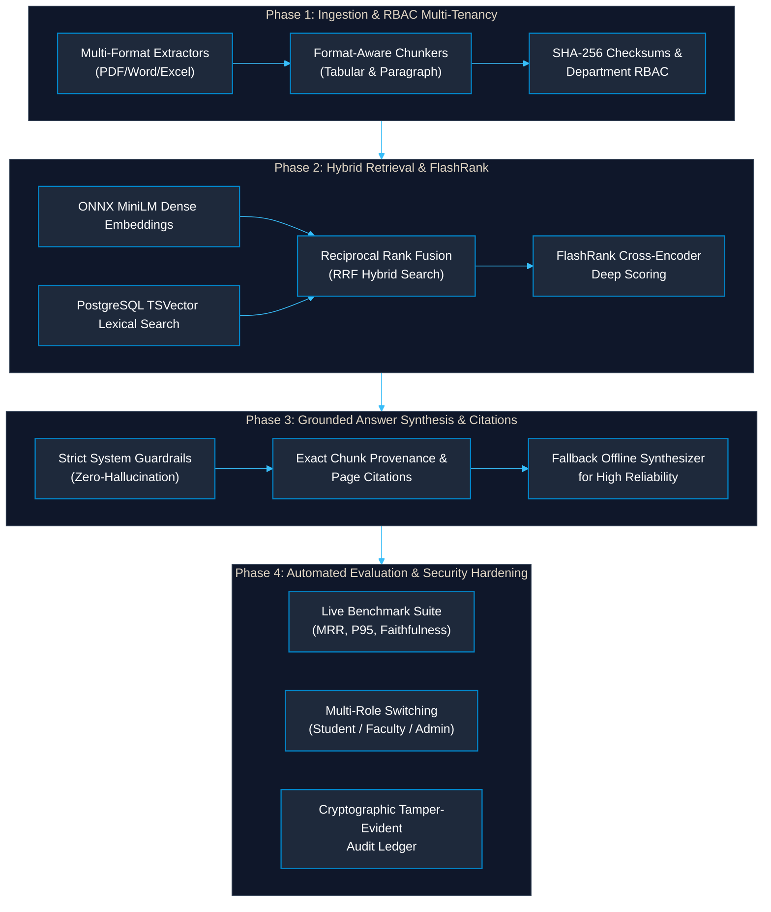
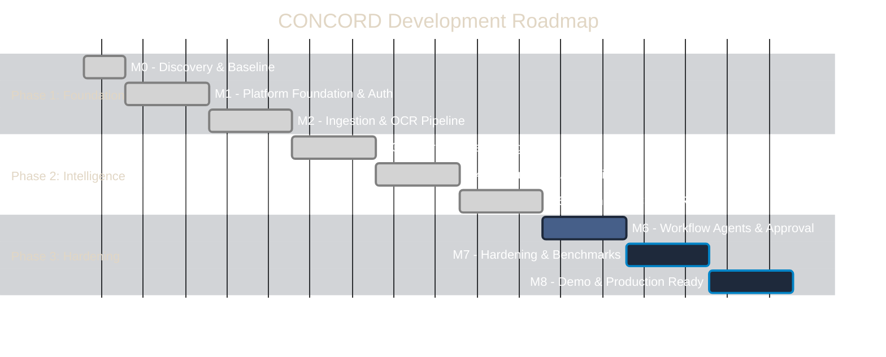
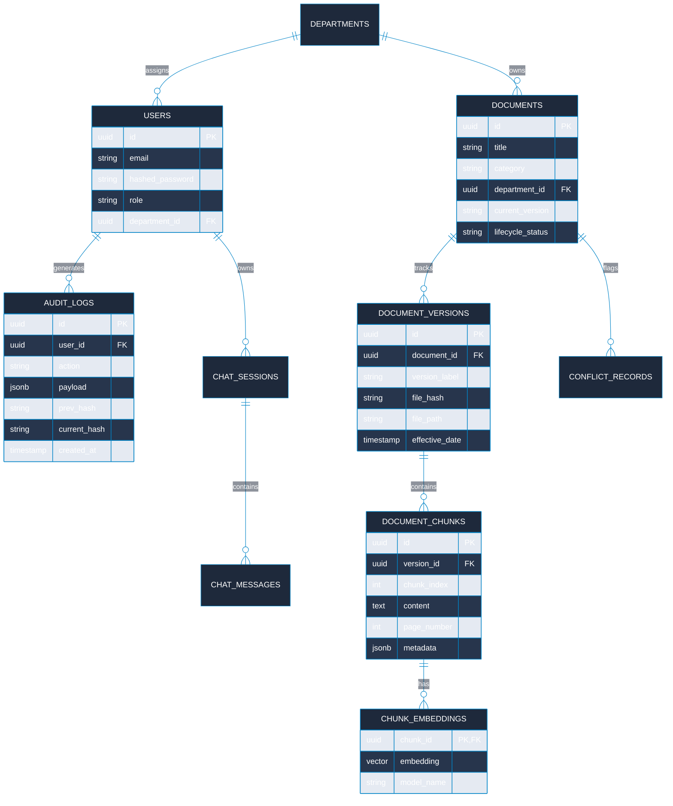

# CONCORD — Mega Project 2026–27: Engineering Master Brief

[← Back to Main Documentation Index](../README.md#📚-documentation-index)



---

## Executive Summary

The most important decision at this stage is to build **CONCORD** as a real institutional knowledge platform, not merely a chatbot connected to PDFs.

Your project combines the core ideas of enterprise knowledge discovery and persistent contextual memory into a system designed for an educational institution such as KIT. It must bring scattered institutional information together, retrieve the right evidence for a particular user and situation, and generate answers that can be verified, audited, and trusted.

The implementation should be ambitious enough for a major project, but every feature must have a clear purpose, a feasible development path, and measurable acceptance criteria.

> **CONCORD**: *Context-Oriented Cognitive Memory Layer for Multi-Source Knowledge Integration, Adaptive Retrieval, and Trust-Aware Institutional Intelligence*
>
> A unified intelligence layer over institutional documents, policies, notices, structured records, and other approved knowledge sources.

| Pillar | Directive | Description |
| :--- | :--- | :--- |
| **UNIFY** | Source & Version Integration | Integrate sources, ownership, strict metadata, and cryptographic versions. |
| **UNDERSTAND** | Contextual Hybrid Retrieval | Retrieve relevant knowledge using user context, lexical full-text, and dense embeddings. |
| **TRUST** | Enforceable Trust Controls | Enforce permissions, chunk provenance, freshness indicators, and audit trails. |

---

## 1. What We Are Actually Building

Imagine a student asks:
> *"What documents are required for the internship permission process, who needs to approve it, and which form is currently valid?"*

A conventional chatbot might search a few PDFs and produce a plausible hallucination. **CONCORD must do substantially more**:
- **Identity & Authorization**: Identify the user's identity, role, department, and access permissions.
- **Approved Knowledge Discovery**: Search only approved institutional knowledge sources.
- **Evidence Extraction**: Retrieve the relevant internship policy, current application form, and approval instructions.
- **Version Awareness**: Distinguish the current document from older, deprecated versions.
- **Conflict Detection**: Detect contradictory instructions instead of silently choosing one.
- **Grounded Synthesis**: Generate a structured answer with exact citations to the actual source file and relevant page or section.
- **Honest Abstention**: Abstain or ask for clarification when the evidence is incomplete or ambiguous.
- **Tamper-Evident Audit**: Record the retrieval and response metadata needed for auditing.

The system should work for Training and Placement, Examinations, College Administration, Accounts, and other approved departments without creating a completely separate application for each department. The differentiator is the combination of **shared institutional memory**, **contextual retrieval**, and **enforceable trust controls**.

### Scope Boundaries

```
┌─────────────────────────────────────────────────────────────────────────────────────────────┐
│ BUILD FIRST (Core Platform)                                                                 │
├─────────────────────────────────────────────────────────────────────────────────────────────┤
│ • Secure, modular institutional knowledge system with multi-format ingestion (PDF/DOCX/XLSX)│
│ • OCR pipeline for scanned institutional circulars and notices                              │
│ • Hybrid retrieval (pgvector dense embeddings + PostgreSQL tsvector lexical search)         │
│ • Evidence-grounded answers with verifiable citations and strict zero-hallucination prompts │
│ • Role-Based Access Control (RBAC), multi-tenancy, and immutable versioning                 │
│ • Cryptographic audit logging and automated retrieval evaluation framework                  │
└─────────────────────────────────────────────────────────────────────────────────────────────┘
                                              │
                                              ▼
┌─────────────────────────────────────────────────────────────────────────────────────────────┐
│ BUILD PROGRESSIVELY (Advanced Capabilities)                                                 │
├─────────────────────────────────────────────────────────────────────────────────────────────┤
│ • Persistent conversational memory across sessions                                          │
│ • Automated contradiction & conflict candidate detection                                    │
│ • Multi-step agent workflows with human-in-the-loop approvals                               │
│ • Multi-model provider adapters (Ollama, vLLM, Gemini, Groq)                                │
│ • Structured institutional database connectors and advanced administration telemetry        │
└─────────────────────────────────────────────────────────────────────────────────────────────┘
```

> [!CAUTION]
> **Do not assume** live integration with KIT's private network systems, direct access to unvetted student records, production deployment approval, or guaranteed GPU hardware. Use synthetic fixtures, seeded sample documents, and provider adapters until authorized production channels are established.

---

## 2. Recommended Implementation Architecture

For a major institutional project with several modules, multiple developers, AI workflows, and eventual campus deployment, CONCORD uses a **modular monolith** with clearly separated worker processes and provider adapters.

```
┌─────────────────────────────────────────────────────────────────────────────────────────────┐
│ Presentation Layer                                                                          │
│ Next.js / Vite React · TypeScript · Responsive Dashboard · Hybrid Search · Conversational UI│
├─────────────────────────────────────────────────────────────────────────────────────────────┤
│ API & Application Service Layer                                                             │
│ FastAPI (Python 3.11+) · JWT Auth · Granular RBAC · Department Scoping · Audit Middleware   │
├─────────────────────────────────────────────────────────────────────────────────────────────┤
│ Knowledge Ingestion Pipeline                                                                │
│ Upload → Signature Validation → Extraction/OCR → Normalization → Smart Chunking → Indexing  │
├─────────────────────────────────────────────────────────────────────────────────────────────┤
│ Intelligence & Retrieval Pipeline                                                           │
│ Query Analysis → Hybrid Retrieval (Dense + Sparse) → RRF Rank Fusion → FlashRank Reranker   │
├─────────────────────────────────────────────────────────────────────────────────────────────┤
│ Storage & Relational Core                                                                   │
│ PostgreSQL 16 · pgvector · TSVector Full-Text Search · Cryptographic Audit Ledger           │
├─────────────────────────────────────────────────────────────────────────────────────────────┤
│ Provider Abstraction Layer (Hexagonal Ports & Adapters)                                     │
│ LLMs (Ollama / Gemini / Groq) · Embeddings (MiniLM / BGE-M3) · OCR (Tesseract / PaddleOCR)  │
└─────────────────────────────────────────────────────────────────────────────────────────────┘
```

### Baseline Technology Stack

| Layer | Recommended Technology | Why It Fits CONCORD |
| :--- | :--- | :--- |
| **Frontend** | React / Next.js + Tailwind / Modern CSS | Modular component architecture, typed API client integration, responsive administrative views. |
| **Backend** | Python 3.11+ + FastAPI | High-performance async runtime; native integration with ML/NLP ecosystem and typed Pydantic contracts. |
| **Primary Database** | PostgreSQL 16 | Relational consistency, transactional ACID guarantees, relational audit tables, and metadata schemas. |
| **Vector Engine** | `pgvector` | Native co-location of dense vector similarity search with relational metadata filters and full-text indexes. |
| **File Storage** | S3-Compatible Object Storage / Local FS | Decouples binary payloads from relational databases; supports secure authenticated streaming. |
| **Document Parsers** | PyMuPDF, python-docx, openpyxl, PPTX | Native parsing of standard academic document types with structural and tabular preservation. |
| **OCR Engine** | Tesseract / PaddleOCR Adapter | Pluggable OCR interface for scanned notices, memos, and circulars. |
| **LLM Orchestration** | Explicit RAG Pipeline & LangGraph | Clear, reproducible retrieval paths with support for stateful checkpoints and human approval loops. |
| **Dense Embeddings** | ONNX Runtime (`all-MiniLM-L6-v2` / BGE-M3) | High-speed local CPU/GPU execution without cloud lock-in or high inference costs. |
| **Deployment** | Docker Compose | Containerized, reproducible local development and isolated service environments. |

### Core Architectural Principle: Dependency Inversion

All foundational components must be exposed through stable interfaces:
```python
class DocumentParser(Protocol): ...
class OCRProvider(Protocol): ...
class EmbeddingProvider(Protocol): ...
class ChatModelProvider(Protocol): ...
class RerankerProvider(Protocol): ...
class ObjectStorageProvider(Protocol): ...
class RetrievalStrategy(Protocol): ...
class InstitutionalConnector(Protocol): ...
```
> [!TIP]
> Switching models (e.g., from local Ollama to cloud Gemini or Groq) requires changing a configuration environment variable and loading the adapter—**never** rewriting the retrieval service, chat API, or frontend client.

---

## 3. The Complete Milestone Journey

Treat these milestones as engineering gates. Each milestone concludes with verifiable acceptance criteria.



| Milestone | Target | Description & Deliverables | Exit Gate Acceptance Criteria |
| :--- | :--- | :--- | :--- |
| **M0 — Discovery & Baseline** | Week 1 | Repository audit, architecture decision records (ADRs), risk assessment, sample datasets. | Approved architecture, clear boundaries, and clean development setup. |
| **M1 — Platform Foundation** | Weeks 2–3 | Frontend shell, FastAPI backend, migrations, RBAC models, session auth, audit events. | Users can sign in, access only authorized screens, and interact with the database. |
| **M2 — Document Ingestion** | Weeks 4–5 | Secure upload, MIME sniffing, OCR extraction, metadata enrichment, chunking, background tasks. | Documents are parsed, chunked, indexed, and traceable to original files. |
| **M3 — Search & Retrieval** | Weeks 6–7 | Keyword full-text search, dense embeddings, Reciprocal Rank Fusion (RRF), department filters. | Users retrieve authorized chunks with high semantic and lexical recall. |
| **M4 — Evidence-Grounded Answers** | Weeks 8–9 | LLM provider adapters, zero-hallucination prompts, citation validation, honest abstention. | Every factual answer is backed by verifiable chunk citations or states insufficient evidence. |
| **M5 — Institutional Memory & Trust** | Weeks 10–11 | Document versioning, deprecation flags, conflict candidate detection, session continuity. | Obsolete policies are marked; conflicting rules are surfaced for human review. |
| **M6 — Agent Workflows** | Weeks 12–13 | Multi-step agent graph, tool boundary enforcement, human-in-the-loop approval, state checkpoints. | Consequential actions require explicit human sign-off; cannot bypass RBAC. |
| **M7 — Hardening & Evaluation** | Weeks 14–15 | Security penetration checks, retrieval benchmark suite (MRR, P95), automated evaluation runner. | Documented test report quantifying retrieval recall, precision, and latency. |
| **M8 — Deployment & Demonstration** | Week 16+ | Production Docker Compose, mock institutional workspace, demo scenarios, administrative manuals. | End-to-end working system reproducible from a single command. |

---

## 4. Detailed Module Specifications

```mermaid
%%{init: {'theme': 'base', 'themeVariables': { 'primaryColor': '#1e293b', 'primaryTextColor': '#ffffff', 'primaryBorderColor': '#0284c7', 'lineColor': '#0284c7', 'secondaryColor': '#0f172a', 'tertiaryColor': '#1e293b', 'clusterBkg': '#0f172a', 'clusterBorder': '#334155'}}}%%
flowchart LR
    A["File Upload<br/>& Connector"] --> B["Signature Validation<br/>& Security Scan"]
    B --> C["Private Object<br/>Storage"]
    C --> D["Text Extraction<br/>& OCR Engine"]
    D --> E{"Text Extracted<br/>Sufficiently?"}
    E -- Yes --> F["Structure Normalization<br/>& Metadata Tagging"]
    E -- No --> G["OCR Fallback &<br/>Manual Flagging"]
    G --> F
    F --> H["Semantic & Tabular<br/>Chunking"]
    H --> I["Dense ONNX<br/>Embeddings"]
    I --> J["Vector DB & Lexical<br/>Index Commit"]
    J --> K["Audit Ledger &<br/>Lifecycle Event"]

    classDef default fill:#1e293b,stroke:#0284c7,stroke-width:1.5px,color:#ffffff;
```



### Module A — Identity, Access Control & Institutional Tenancy
- **Purpose**: Enforce that the correct person accesses only the correct information across search, chat, APIs, and background jobs.
- **Core Capabilities**:
  - Unified user identities with roles (`Admin`, `Faculty`, `Student`, `Staff`) and department memberships (`CSE`, `TPO`, `Administration`, `Exams`).
  - Strict server-side access control lists (ACL) on all document reads, vector similarity searches, and citation inspections.
  - Audit logging for all authentication attempts, permission escalations, and queries.
- **Acceptance Gate**: A user with the `Student` role cannot retrieve private institutional payroll notices or administrative circulars by manipulating query filters or direct API calls.

### Module B — Source Registry & Ingestion Pipeline
- **Purpose**: Transform raw heterogeneous institutional documents into structured, searchable knowledge assets.
- **Core Capabilities**:
  - File signature validation (magic bytes verification) rejecting disguised executables.
  - SHA-256 deduplication preventing redundant processing runs.
  - Multi-engine extraction: PyMuPDF for native PDFs, Tesseract/PaddleOCR for scanned notices, `python-docx` for Word documents, and `openpyxl` for spreadsheets.
  - Deterministic chunking preserving tabular structures and exact page coordinates.
- **Acceptance Gate**: Uploading a scanned exam circular triggers OCR, extracts readable text with page numbers, builds vector/keyword indexes, and emits an immutable ingestion audit log.

### Module C — Metadata, Versions & Lifecycle Management
- **Purpose**: Maintain historical accuracy and track policy evolution over time.
- **Core Capabilities**:
  - Separation of logical `Document` identity from immutable `DocumentVersion` records.
  - Explicit lifecycle states: `Draft` → `Active` → `Superseded` → `Archived`.
  - Relationship mapping (`supersedes`, `references`, `conflicts_with`).
- **Acceptance Gate**: Publishing an updated 2026 Academic Calendar automatically marks the 2025 calendar as `Superseded`, preventing obsolete dates from appearing in default policy search results while preserving historical audit access.

### Module D — Hybrid Retrieval & Evidence Ranking
- **Purpose**: Retrieve the most authoritative, semantically relevant evidence chunks without leaking unauthorized data.
- **Pipeline Architecture**:
  1. **Query Normalization**: Clean whitespace, extract course codes/circular identifiers.
  2. **Context Resolution**: Attach caller role and accessible department IDs.
  3. **Dual Retrieval**:
     - *Lexical Search*: PostgreSQL `tsvector` with `ts_rank` matching exact acronyms, circular numbers, and names.
     - *Dense Semantic Search*: 384-dimensional cosine distance via `pgvector`.
  4. **Rank Fusion**: Reciprocal Rank Fusion (RRF) with configurable constant $k=60$.
  5. **Cross-Encoder Reranking**: Optional deep scoring via FlashRank for high-precision candidates.
- **Acceptance Gate**: Benchmark suite validates MRR > 0.85 and P95 latency < 450ms across standard institutional query sets.

### Module E — Grounded Answer Synthesis & Citations
- **Purpose**: Synthesize direct, verifiable answers grounded strictly in retrieved context.
- **Core Capabilities**:
  - Strict prompt guardrails instructing the LLM to abstain if evidence is insufficient or absent.
  - In-line citations mapped to verified chunk identifiers (e.g., `[Doc #12, Page 3]`).
  - Citation validation: The backend inspects LLM citations and strips or flags any hallucinated document IDs.
- **Acceptance Gate**: Prompts with zero relevant evidence result in explicit abstention (*"I do not have sufficient institutional records to answer this question"*), preventing speculative policy generation.

### Module F — Persistent Memory & Context Management
- **Purpose**: Maintain user interaction context without compromising official institutional truth.
- **Data Boundaries**:
  - **Thread State**: Ephemeral dialogue history within an active session.
  - **User Context**: Explicitly stored user preferences (e.g., preferred response language or department).
  - **Institutional Truth**: Governed knowledge base documents. Conversational memories **never** override official documents.
- **Acceptance Gate**: The system recalls user preferences across chat sessions, but always queries the authoritative vector index for factual policy inquiries.

### Module G — Trust, Freshness & Conflict Detection
- **Purpose**: Surface discrepancies, expired policies, and contradictory instructions transparently.
- **Core Capabilities**:
  - Rule-based detection of overlapping notices with conflicting dates or instructions.
  - Automated staleness alerts for documents past their review or effective date.
  - Conflict resolution dashboard allowing department administrators to designate the governing rule.
- **Acceptance Gate**: Conflicting internship submission deadlines between an old notice and a new circular are surfaced as a warning flag rather than presenting a single arbitrary answer.

### Module H — Agent Orchestration & Human Approval
- **Purpose**: Execute auditable multi-step administrative workflows safely.
- **Core Capabilities**:
  - Explicit state graph architecture with typed transitions.
  - Tool execution boundaries preventing direct shell or arbitrary database access.
  - Mandatory human-in-the-loop (HITL) checkpoints before performing irreversible administrative actions.
- **Acceptance Gate**: Workflows proposing document deprecation or policy updates halt at an approval checkpoint and require authenticated administrator confirmation.

### Module I — Administration, Observability & Evaluation
- **Purpose**: Provide institutional administrators with operational transparency and quantifiable quality metrics.
- **Telemetry & Tools**:
  - System health dashboard showing database latency, ingestion queues, and storage status.
  - Live benchmark execution measuring Mean Reciprocal Rank (MRR), Precision@K, and Latency.
  - Cryptographic audit trail viewer inspecting access and system modifications.

---

## 5. Industry-Grade Project Structure

CONCORD is organized as a modular repository where application logic is cleanly partitioned into domain modules:

```
concord/
├── backend/
│   ├── app/
│   │   ├── api/v1/                   # Versioned REST controllers
│   │   │   ├── endpoints/            # auth, documents, search, chat, admin
│   │   ├── core/                     # Config, security, database sessions
│   │   ├── modules/                  # Isolated domain modules
│   │   │   ├── identity/             # Users, roles, RBAC permissions
│   │   │   ├── documents/            # Metadata, lifecycle, file registry
│   │   │   ├── ingestion/            # Parsers, OCR, chunkers
│   │   │   ├── retrieval/            # Vector store, hybrid search, rerankers
│   │   │   ├── memory/               # Chat sessions, conversational context
│   │   │   ├── trust/                # Conflict detection, freshness checks
│   │   │   ├── audit/                # Cryptographic audit ledger
│   │   │   └── evaluation/           # Benchmark runners, metrics
│   │   └── providers/                # Pluggable LLM, OCR, and embedding adapters
│   └── tests/                        # Comprehensive unit and integration test suite
├── frontend/
│   ├── src/
│   │   ├── api/                      # Typed REST client with error handling
│   │   ├── components/               # Design system & reusable UI components
│   │   │   ├── layout/               # Header, sidebar, navigation
│   │   │   ├── chat/                 # Message thread, citation inspector, input bar
│   │   │   └── common/               # Badges, modals, cards, skeletons
│   │   ├── utils/                    # Session storage cache, formatting helpers
│   │   └── views/                    # Knowledge base, search, chat, benchmarks, admin
│   └── public/                       # Static branding and demo assets
├── docs/                             # Engineering briefs, API specifications, guides
├── docker-compose.yml                # Multi-container orchestration
└── README.md                         # Master entry point and quickstart guide
```

### Relational Schema Blueprint



---

## 6. Grounding & Regulatory References

CONCORD's design decisions are supported by established industry frameworks and technical standards:

- **[NIST AI Risk Management Framework (AI RMF 1.0)](https://www.nist.gov/itl/ai-risk-management-framework)**: Guides our risk management cycle across **Govern**, **Map**, **Measure**, and **Manage**, establishing clear operational guardrails for AI-assisted administrative operations.
- **[OWASP Application Security Verification Standard (ASVS 5.0)](https://owasp.org/www-project-application-security-verification-standard/)**: Guides our role-based authorization model, trusted server-side permission checks, and file upload validation.
- **[OWASP Top 10 for Large Language Model Applications](https://owasp.org/www-project-top-10-for-large-language-model-applications/)**: Informs our defenses against Prompt Injection (LLM01), Sensitive Information Disclosure (LLM06), and Insecure Plugin/Tool Design (LLM07).
- **[PostgreSQL & pgvector Documentation](https://github.com/pgvector/pgvector)**: Reference implementation for exact cosine distance search, IVFFlat / HNSW vector indexing, and Reciprocal Rank Fusion hybrid retrieval.
- **[LangGraph & Stateful Agent Workflows](https://langchain-ai.github.io/langgraph/)**: Architecture pattern for durable checkpointing, multi-agent coordination, and human-in-the-loop approval barriers.

---
*CONCORD Engineering Master Brief · Institution Knowledge Management System · Mega Project 2026–27*
