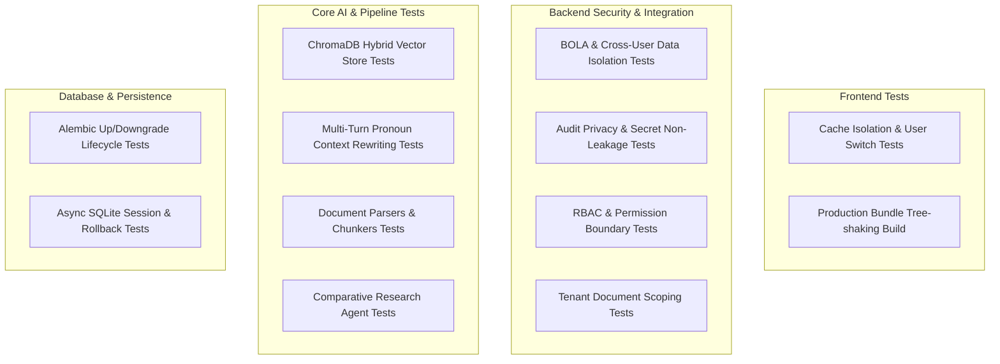
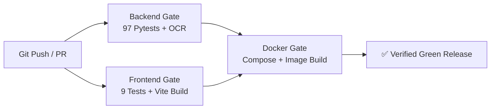

# CONCORD IKMS — Comprehensive Testing Architecture & Quality Assurance Reference

This document provides a complete guide to the automated verification, security isolation, benchmarking, and unit test suites implemented in CONCORD IKMS.

---

## 1. Test Architecture Overview

CONCORD IKMS maintains a multi-layered testing pyramid spanning backend API authorization, vector retrieval fidelity, LLM output groundedness, document chunking parsers, database migration safety, and frontend cache namespacing.



---

## 2. Test Suites Summary & File Mapping

| Test Category | File Path | Focus & Coverage | Test Runner | Total Tests |
| :--- | :--- | :--- | :--- | :--- |
| **Data Isolation & Anti-BOLA** | `backend/tests/test_isolation.py` | Cross-user thread isolation (404 anti-probing), token-bound `owner_id`, audit prompt privacy, document scoping, self-profile listing, benchmark restrictions. | `pytest` | 9 |
| **Authentication & Profile** | `backend/tests/test_auth.py` | JWT token generation, bcrypt validation, invalid password handling, demo logins across 4 personas, expired token rejection. | `pytest` | 6 |
| **RBAC & Authorization** | `backend/tests/test_rbac.py` | Role-permission enforcement (`users:read`, `audit:read`, `documents:write`), superuser bypass for `platform_admin`. | `pytest` | 5 |
| **Document Lifecycle** | `backend/tests/test_documents.py` | Upload, SHA-256 deduplication, lifecycle transitions (`active` → `superseded`), governance approvals. | `pytest` | 5 |
| **Conversations & Memory** | `backend/tests/test_conversations.py` | Multi-turn inquiry persistence, conversational pronoun contextualization (*"What about it?"* rewriting). | `pytest` | 1 |
| **Vector Store & Chroma** | `backend/tests/test_chroma.py` | Embedded ChromaDB collection initialization, vector querying, metadata filtering. | `pytest` | 3 |
| **Parsers & Chunkers** | `backend/tests/test_parsers.py` | PDF, DOCX, TXT, Excel semantic parsing, token counting, atomic table preservation, scanned circular image preprocessing (1.5x upscaling, adaptive binarization) & OCR parser. | `pytest` | 12 |
| **Grounded RAG Pipeline** | `backend/tests/test_rag.py` | Prompt augmentation, hallucination guardrails, citation metadata extraction. | `pytest` | 5 |
| **Retrieval & Reranking** | `backend/tests/test_retrieval.py` | Hybrid BM25 + Vector reciprocal rank fusion (RRF), cross-encoder scoring, fuzzy typo normalizer (phrase & difflib edit distance), and zero-hallucination relevance gating. | `pytest` | 9 |
| **Health & Readiness** | `backend/tests/test_health.py` | `/healthz`, `/readyz` DB latency checks, root status. | `pytest` | 3 |
| **Evaluation Benchmark** | `backend/tests/test_evaluation.py` | Hit Rate@5, MRR@5, latency metrics. | `pytest` | 2 |
| **Demo Scenarios** | `backend/tests/test_demo_scenarios.py` | End-to-end academic regulations question workflows. | `pytest` | 2 |
| **LLM Safety & Guardrails** | `backend/tests/test_guardrails.py` | Prompt injection blocking, instruction overrides, delimiter smuggling, zero-width spaces, output sanitization. | `pytest` | 6 |
| **System Security Hardening** | `backend/tests/test_security_hardening.py` | SQL injection detection, ChromaDB NoSQL injection neutralization, OWASP ASVS HTTP headers, path traversal stripping. | `pytest` | 5 |
| **AI Rate Limiting** | `backend/tests/test_rate_limiter.py` | Sliding-window token bucket quotas, per-IP isolation, HTTP 429 Retry-After responses. | `pytest` | 3 |
| **Real-Time Token Streaming** | `backend/tests/test_streaming.py` | Server-Sent Events (SSE) `/ask-stream` response validation, chunk framing, prompt injection short-circuiting, and casual query zero-citation routing. | `pytest` | 3 |
| **Asynchronous Ingestion** | `backend/tests/test_async_ingestion.py` | Non-blocking background document upload (`/upload-async`), 4-stage job progress polling (`/jobs/{id}`), and completion assertions. | `pytest` | 1 |
| **Web Notice Crawler & SSRF** | `backend/tests/test_web_ingestion.py` | Protocol enforcement, loopback & RFC-1918 private IP defense, AWS metadata IP blocking, HTML boilerplate purification. | `pytest` | 2 |
| **Dual-Mode LLM Engine** | `backend/tests/test_llm_providers.py` | Shared helper extraction, `LocalLLMProvider` offline resilience, dynamic factory hot-swapping between Cloud & Local, `/system/llm-config` RBAC authorization, live probe diagnostics, global cross-user reflection, and persistence. | `pytest` | 6 |
| **User Onboarding & 2-Tier Approvals** | `backend/tests/test_user_onboarding.py` | Self-registration, PRN/EmpID validation, unapproved login blocking, Tier 1 HOD departmental tenant isolation (BOLA 403), Tier 2 Platform Admin review, rejection reason tracking, break-glass administrative bypass with audit justification, direct administrative user provisioning, and student dual-approval rules (Admin or HOD). | `pytest` | 7 |
| **Database & Persistence** | `backend/tests/test_database_persistence.py` | Programmatic Alembic migration revision inspection (DB1) and Async SQLAlchemy session rollback on constraint violation (DB2). | `pytest` | 2 |
| **Frontend Cache Isolation** | `frontend/tests/cacheIsolation.test.js` | User switching, cache namespacing (`_user_{id}`), startup legacy purge, `clearAll()`. | `node (Node.js Test)` | 5 |
| **Frontend Speech Sanitization** | `frontend/tests/speechUtils.test.js` | Citation token removal (`[1]`), markdown formatting stripping, code block normalization, null safety. | `node (Node.js Test)` | 4 |
| **Institutional Real-Time Broadcast** | `frontend/tests/broadcast.test.js` | Cross-tab synchronization, SSE payload serialization, custom event dispatching, drawer persistence. | `node (Node.js Test)` | 4 |
| **Backend Real-Time Broadcast Hub** | `backend/tests/test_broadcast.py` | Asynchronous pub/sub queue isolation, live LLM hot-swap event broadcasting, custom admin bulletins. | `pytest (asyncio)` | 3 |

**Total Automated Tests:** **114 automated test scenarios** (101 backend + 13 frontend, 100% passing).

---

## 3. How to Run Tests

### Running Backend Tests
From the workspace root or `backend` directory with active virtual environment:

```bash
# Run full backend test suite (97 tests)
python -m pytest backend/tests/

# Run isolation & authorization tests only
python -m pytest backend/tests/test_isolation.py -v

# Run with verbose output and duration profiling
python -m pytest backend/tests/ -v --durations=10
```

### Running Frontend Tests & Production Build
From the `frontend` directory:

```bash
# Run frontend cache isolation and speech sanitizer unit tests (9 tests)
npm test

# Verify production Vite build & asset transformation
npm run build
```

### Running Database Migration Verification
From the `backend` directory:

```bash
# Verify upgrade to latest schema
python -m alembic upgrade head

# Verify downgrade capability
python -m alembic downgrade -1

# Re-apply upgrade
python -m alembic upgrade head
```

---

## 4. Key Security & Quality Guarantees

1. **Anti-Probing (HTTP 404):** Unauthorized attempts to view or delete another user's chat or unowned document always return `404 Not Found`, preventing ID enumeration.
2. **Audit Privacy:** Audit event tables record query lengths, latencies, timestamps, and model identifiers—**never raw prompt, question, or answer text**.
3. **Cache Partitioning:** All browser storage is strictly partitioned by user ID and flushed on logout or demo persona transitions.
4. **Token Integrity:** Object ownership is derived strictly from the server-side verified JWT payload, rejecting spoofed `owner_id` parameters in request bodies.

---

## 5. Automated GitHub Actions CI/CD Quality Gate

Continuous Integration is automated via [`.github/workflows/ci.yml`](file:///c:/Users/Admin/Desktop/IKMS/IKMS/.github/workflows/ci.yml) on every commit to `main`, `feature/**`, and all Pull Requests.



### Workflow Pipeline Jobs:
1. **`backend-tests` (Python 3.11):**
   - Provisions `ubuntu-latest` with native `tesseract-ocr`, `tesseract-ocr-eng`, and `libpq-dev`.
   - Caches pip packages based on `backend/requirements.txt`.
   - Runs full **97 pytest scenarios** with SQLite in-memory test database and mock vector Chroma directory.
2. **`frontend-tests` (Node 20):**
   - Caches npm dependencies based on `frontend/package-lock.json`.
   - Runs **9 unit tests** (cache isolation & speech sanitizers).
   - Executes production `vite build` validating bundling and tree-shaking with 0 errors.
3. **`docker-gate` (Infrastructure & Containerization):**
   - Depends on both `backend-tests` and `frontend-tests`.
   - Validates `docker-compose.yml` integrity via `docker compose config --quiet`.
   - Verifies buildability of `infra/docker/backend.Dockerfile` and `infra/docker/frontend.Dockerfile`.
