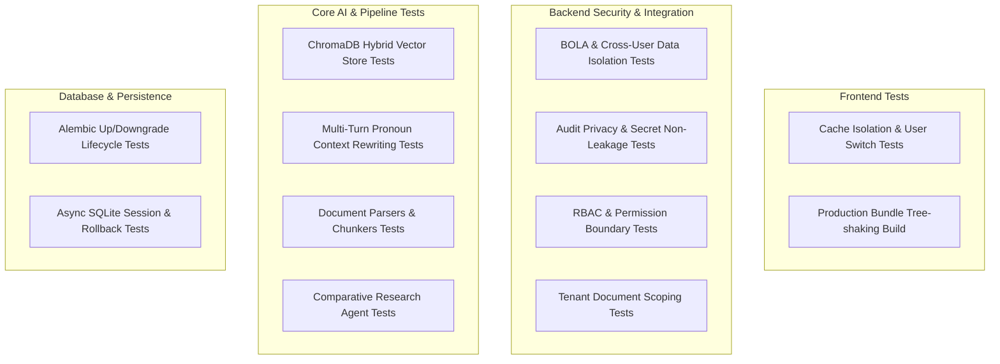

# CONCORD IKMS — Comprehensive Testing Architecture & Quality Assurance Reference

This document provides a complete guide to the automated verification, security isolation, benchmarking, and unit test suites implemented in CONCORD IKMS.

---

## 1. Test Architecture Overview

CONCORD IKMS maintains a multi-layered testing pyramid spanning backend API authorization, vector retrieval fidelity, LLM output groundedness, document chunking parsers, database migration safety, and frontend cache namespacing.



---

## 2. Test Suites Summary & File Mapping

| Test Category | File Path | Focus & Coverage | Test Runner | Total Tests |
| :--- | :--- | :--- | :--- | :--- |
| **Data Isolation & Anti-BOLA** | `backend/tests/test_isolation.py` | Cross-user thread isolation (404 anti-probing), token-bound `owner_id`, audit prompt privacy, document scoping, self-profile listing, benchmark restrictions. | `pytest` | 9 |
| **Authentication & Profile** | `backend/tests/test_auth.py` | JWT token generation, bcrypt validation, invalid password handling, demo logins across 4 personas, expired token rejection. | `pytest` | 6 |
| **RBAC & Authorization** | `backend/tests/test_rbac.py` | Role-permission enforcement (`users:read`, `audit:read`, `documents:write`), superuser bypass for `platform_admin`. | `pytest` | 5 |
| **Document Lifecycle** | `backend/tests/test_documents.py` | Upload, SHA-256 deduplication, lifecycle transitions (`active` → `superseded`), governance approvals. | `pytest` | 5 |
| **Conversations & Memory** | `backend/tests/test_conversations.py` | Multi-turn inquiry persistence, conversational pronoun contextualization (*"What about it?"* rewriting). | `pytest` | 1 |
| **Vector Store & Chroma** | `backend/tests/test_chroma.py` | Embedded ChromaDB collection initialization, vector querying, metadata filtering. | `pytest` | 3 |
| **Parsers & Chunkers** | `backend/tests/test_parsers.py` | PDF, DOCX, TXT semantic parsing, token counting, table preservation. | `pytest` | 9 |
| **Grounded RAG Pipeline** | `backend/tests/test_rag.py` | Prompt augmentation, hallucination guardrails, citation metadata extraction. | `pytest` | 5 |
| **Retrieval & Reranking** | `backend/tests/test_retrieval.py` | Hybrid BM25 + Vector reciprocal rank fusion (RRF), cross-encoder scoring. | `pytest` | 8 |
| **Health & Readiness** | `backend/tests/test_health.py` | `/healthz`, `/readyz` DB latency checks, root status. | `pytest` | 3 |
| **Evaluation Benchmark** | `backend/tests/test_evaluation.py` | Hit Rate@5, MRR@5, latency metrics. | `pytest` | 2 |
| **Demo Scenarios** | `backend/tests/test_demo_scenarios.py` | End-to-end academic regulations question workflows. | `pytest` | 2 |
| **LLM Safety & Guardrails** | `backend/tests/test_guardrails.py` | Prompt injection blocking, instruction overrides, delimiter smuggling, zero-width spaces, output sanitization. | `pytest` | 6 |
| **System Security Hardening** | `backend/tests/test_security_hardening.py` | SQL injection detection, ChromaDB NoSQL injection neutralization, OWASP ASVS HTTP headers, path traversal stripping. | `pytest` | 5 |
| **AI Rate Limiting** | `backend/tests/test_rate_limiter.py` | Sliding-window token bucket quotas, per-IP isolation, HTTP 429 Retry-After responses. | `pytest` | 3 |
| **Frontend Cache Isolation** | `frontend/tests/cacheIsolation.test.js` | User switching, cache namespacing (`_user_{id}`), startup legacy purge, `clearAll()`. | `node (Node.js Test)` | 5 |

**Total Automated Tests:** **77 automated test scenarios** (72 backend + 5 frontend).

---

## 3. How to Run Tests

### Running Backend Tests
From the `backend` directory with active virtual environment:

```bash
# Run full backend test suite
pytest tests/

# Run isolation & authorization tests only
pytest tests/test_isolation.py -v

# Run with verbose output and duration profiling
pytest tests/ -v --durations=10
```

### Running Frontend Tests & Production Build
From the `frontend` directory:

```bash
# Run frontend cache isolation test suite
npm test

# Verify production Vite build & asset transformation
npm run build
```

### Running Database Migration Verification
From the `backend` directory:

```bash
# Verify upgrade to latest schema
python -m alembic upgrade head

# Verify downgrade capability
python -m alembic downgrade -1

# Re-apply upgrade
python -m alembic upgrade head
```

---

## 4. Key Security & Quality Guarantees

1. **Anti-Probing (HTTP 404):** Unauthorized attempts to view or delete another user's chat or unowned document always return `404 Not Found`, preventing ID enumeration.
2. **Audit Privacy:** Audit event tables record query lengths, latencies, timestamps, and model identifiers—**never raw prompt, question, or answer text**.
3. **Cache Partitioning:** All browser storage is strictly partitioned by user ID and flushed on logout or demo persona transitions.
4. **Token Integrity:** Object ownership is derived strictly from the server-side verified JWT payload, rejecting spoofed `owner_id` parameters in request bodies.
