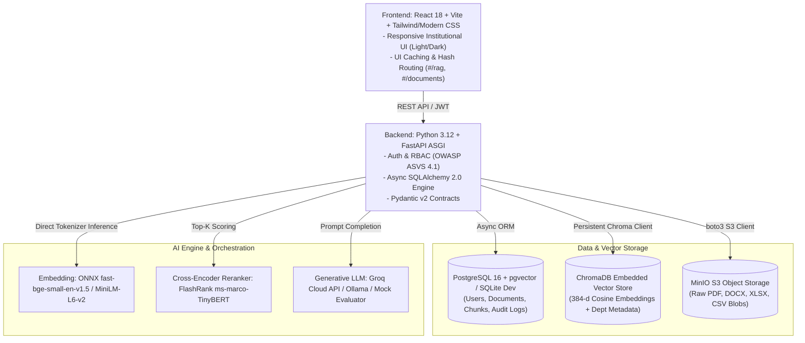

# CONCORD IKMS — Technology Stack & Architectural Decision Reference

[← Back to Main Documentation Index](../README.md#📚-documentation-index)

---

For CONCORD, I would choose a stack that balances three things: your existing skills, the AI capabilities the project genuinely needs, and industry-grade architecture.
You do not need to learn five frameworks simultaneously to build a strong major project. Since you're comfortable with React and JavaScript, know Python, and are learning LangChain, LangGraph, and MCP, we can make those skills work together rather than forcing you into an unfamiliar stack everywhere.
My recommendation is to use React + JavaScript for the frontend, Python + FastAPI for the core backend and AI, and LangChain/LangGraph selectively. Node.js is optional, and MCP should be added when the project has a real need for standardized tool integration.

1. The recommended CONCORD stack

Frontend — React + JavaScript
Use
Build the dashboard, document upload interface, search results, chat, source citations, version history, and administration screens.
Recommended: React with Vite, React Router, a reusable component library, and a typed-by-contract API client. TypeScript can be introduced gradually, but it is not mandatory to start.

Core backend and AI — Python + FastAPI
Use
Own authentication and authorization, document processing, retrieval, RAG, model integrations, evaluation, and AI workflow execution.
Python is the natural choice here because the document-processing and AI ecosystems you need are strongest in this environment.

AI orchestration — LangChain + LangGraph
Use selectively
Use LangChain components where they simplify model integration, document processing, and retrieval. Use LangGraph when CONCORD needs explicit multi-step workflows, checkpoints, retries, or human approval.
Do not make every backend operation an AI chain or graph. Ordinary Python services are simpler for permissions, CRUD, metadata, and predictable business rules.

Data layer — PostgreSQL + pgvector
Use
Store users, departments, documents, versions, conversations, memory metadata, audit events, and vector embeddings.
One primary database reduces operational complexity and supports relational queries alongside semantic retrieval.

Node.js — optional
Not required initially
Use it if you have a specific JavaScript-based integration or existing Node service to preserve. React's development tooling already uses Node.js, but that does not mean you need a separate Node backend.

MCP — later integration layer
Introduce after the core
Use the Model Context Protocol when CONCORD needs standardized access to approved tools or external knowledge systems, such as a document search tool, an institutional connector, or a controlled workflow capability.
MCP is a protocol for connecting AI applications to tools and context. It does not replace your REST API, database, authentication system, or retrieval architecture.

2. How these technologies fit together
   The key is to keep the responsibilities separate. React should not run your AI logic, LangGraph should not control your entire backend, and MCP should not become a replacement for your application API.
   React + JavaScript
   User interface · Upload · Search · Chat · Admin

Python + FastAPI
REST APIs · Authentication · RBAC · Business logic

Document services
Extraction · OCR · Chunking · Versioning

AI services
Retrieval · RAG · LangChain · LangGraph

Shared data and infrastructure
PostgreSQL + pgvector · Private file storage · Background jobs

Optional MCP integration
Standardized tools and approved external-system connections, behind authorization controls

For example, when a student asks about the internship policy:

1. React sends the question to FastAPI over HTTPS.
2. FastAPI authenticates the user and determines their permissions.
3. The retrieval service searches PostgreSQL and pgvector for authorized evidence.
4. The AI service generates an answer from the selected evidence.
5. FastAPI validates citations and returns the answer.
6. React renders the answer and clickable source references.
   LangGraph is unnecessary for this simple request if a normal retrieval pipeline can handle it. It becomes useful when a request requires multiple dependent steps, conflict checks, report generation, and approval.
7. Recommended project structure for your stack
   I would simplify the earlier architecture into this structure. It supports your preferred languages without sacrificing module boundaries.

concord/
├── frontend/ # React + Vite + JavaScript
│ ├── src/
│ │ ├── app/ # Routes and application setup
│ │ ├── components/ # Shared UI components
│ │ ├── features/
│ │ │ ├── auth/
│ │ │ ├── documents/
│ │ │ ├── search/
│ │ │ ├── chat/
│ │ │ ├── memory/
│ │ │ ├── workflows/
│ │ │ └── admin/
│ │ ├── services/ # API clients
│ │ ├── hooks/
│ │ └── utils/
│ ├── package.json
│ └── vite.config.js
│
├── backend/ # Python + FastAPI
│ ├── app/
│ │ ├── api/v1/
│ │ ├── core/ # Config, security, logging
│ │ ├── modules/
│ │ │ ├── identity/
│ │ │ ├── organizations/
│ │ │ ├── documents/
│ │ │ ├── ingestion/
│ │ │ ├── retrieval/
│ │ │ ├── conversations/
│ │ │ ├── memory/
│ │ │ ├── trust/
│ │ │ ├── workflows/
│ │ │ ├── audit/
│ │ │ └── evaluation/
│ │ ├── ai/
│ │ │ ├── providers/
│ │ │ ├── embeddings/
│ │ │ ├── retrieval/
│ │ │ ├── rag/
│ │ │ └── graphs/
│ │ ├── integrations/
│ │ │ └── mcp/
│ │ ├── infrastructure/
│ │ └── main.py
│ ├── migrations/
│ ├── tests/
│ └── pyproject.toml
│
├── workers/ # Background processing
│ ├── ingestion.py
│ └── README.md
│
├── infra/
│ ├── docker/
│ └── deployment/
├── docs/
│ ├── PROJECT_BRIEF.md
│ ├── architecture/
│ ├── decisions/
│ ├── security/
│ └── evaluation/
├── docker-compose.yml
├── .env.example
├── .gitignore
└── README.md

This is a target structure, not a requirement to create every module immediately. The agent should create only what the current milestone needs.
One important choice: use JavaScript initially, with the option to migrate frontend files to TypeScript incrementally. TypeScript is valuable for a larger team, but you can introduce it after the first working React application rather than adding another learning burden on day one. 4. When exactly should you use LangChain, LangGraph, and MCP?
LangChain — during the RAG milestone

Use it for supported model integrations, prompt templates, document-related integrations, and retrieval components where it genuinely simplifies the implementation. Keep your own retrieval interfaces and application services independent of LangChain so you can replace individual components later.

LangGraph — during the workflow milestone

Use it for workflows with explicit state and transitions, such as retrieving multiple policies, identifying conflicting evidence, generating a report, and pausing for staff approval. Do not use it for simple CRUD operations or every chat request.

MCP — when tool interoperability becomes necessary

Start with ordinary internal Python service interfaces. Later, expose selected capabilities through MCP when an AI client or agent needs a standardized way to discover and invoke approved tools. Each MCP tool must still enforce authorization and validate its inputs.

My recommended sequence is:

- First: React, FastAPI, PostgreSQL, authentication, and document ingestion.
- Second: Embeddings, hybrid retrieval, and a simple RAG pipeline.
- Third: LangChain components where they add value, plus source citations and evaluation.
- Fourth: LangGraph for stateful workflows and human approval.
- Fifth: MCP integration for selected tools and institutional connectors.
  This sequence also helps you learn each technology by applying it to a real project requirement.

5. Revised prompt to give Copilot or Antigravity
   Use this as an addendum to the existing CONCORD master engineering brief. It overrides the earlier default preference for a Next.js frontend and establishes your preferred stack.

# CONCORD — Technology Stack Decision and Implementation Addendum

Read `docs/PROJECT_BRIEF.md` and this addendum before making architectural or technology decisions.

## 1. Approved technology direction

The project owner prefers technologies they are actively learning and can maintain:

- Frontend: React with JavaScript and Vite.
- Backend: Python with FastAPI.
- Database: PostgreSQL with pgvector.
- AI integration: Configurable model and embedding providers.
- AI orchestration: Selective use of LangChain and LangGraph.
- Tool integration: MCP when there is a demonstrated interoperability requirement.
- Frontend tooling: Node.js and npm.
- Development and deployment: Docker Compose, with deployment choices kept configurable.
- File storage: Private S3-compatible storage, with a local development implementation as appropriate.

Do not replace React with Next.js or introduce a separate Node.js application backend without a documented requirement.

Use JavaScript initially. Keep API contracts explicit and validated. TypeScript may be introduced incrementally when its benefits justify the additional learning and migration work.

## 2. Architectural responsibilities

### React frontend

Responsible for:

- Authentication interface.
- Dashboard and navigation.
- Document upload and processing status.
- Search interface.
- Conversational interface.
- Evidence citations and source viewing.
- Document versions and conflict-review interface.
- Workflow status and approval interface.
- Administrative screens.

The frontend must not contain authorization decisions that the backend relies on. It must not connect directly to PostgreSQL or invoke unrestricted AI tools.

### Python and FastAPI backend

Responsible for:

- Authentication and authorization.
- Department and role management.
- Document registry and lifecycle.
- Ingestion orchestration.
- Search and retrieval.
- RAG and citation validation.
- Conversation and memory persistence.
- Conflict management.
- Workflow execution.
- Audit logging.
- Evaluation APIs.
- Model, OCR, storage, and embedding provider adapters.

Keep API routes thin. Put business rules in application services and keep provider-specific implementations behind interfaces.

### PostgreSQL and pgvector

Use PostgreSQL for structured institutional metadata, identity and access relationships, document records, versions, chunks, conversations, memory metadata, conflicts, workflows, and audit events.

Use pgvector for embedding storage and similarity search. Combine it with PostgreSQL full-text search to implement hybrid retrieval.

Use database migrations and explicit integrity constraints. Do not rely on manually created database tables.

### LangChain

Introduce LangChain when implementing model integration and retrieval.

Use only the components that simplify the actual design. Do not couple the entire backend to framework-specific objects. Keep domain models, permissions, document lifecycle, and citation validation under application control.

### LangGraph

Introduce LangGraph only after basic retrieval and evidence-grounded answering work reliably.

Use it for bounded workflows requiring multiple steps, explicit state, conditional transitions, retries, checkpointing, or human approval.

Do not use a graph framework for simple CRUD, deterministic business logic, or every ordinary question.

### MCP

MCP is an optional tool-integration layer, not a replacement for FastAPI, REST APIs, PostgreSQL, or application authentication.

Start with internal Python service interfaces. When interoperability becomes useful, expose selected operations through MCP, such as authorized document search, source inspection, or controlled report generation.

Validate tool inputs and enforce permissions inside the backend. Never treat an MCP client or model as inherently trusted.

### Node.js

Use Node.js for the React/Vite toolchain. A separate Node.js backend is unnecessary unless an independently justified integration or service requires it.

## 3. Dependency and learning discipline

Do not add a technology merely because it is popular.

Before introducing a dependency, explain:

- Which requirement it addresses.
- Why the standard library or existing stack is insufficient.
- Its operational cost and security implications.
- How it will be tested.
- How the application can replace it if necessary.

Prefer a small number of well-defined services over multiple overlapping frameworks.

## 4. Implementation order

1. Inspect the repository and preserve working code.
2. Establish React/Vite, FastAPI, PostgreSQL, configuration, migrations, logging, and tests.
3. Implement authentication, roles, and authorization.
4. Implement document upload, private storage, parsing, OCR interfaces, metadata, and versioning.
5. Implement keyword retrieval and vector retrieval.
6. Implement hybrid retrieval, evidence bundles, and source citations.
7. Add a configurable LLM integration and a grounded RAG pipeline.
8. Implement persistent conversation state and governed memory.
9. Add freshness checks, supersession, and conflict review.
10. Introduce LangGraph for an appropriate multi-step workflow.
11. Add MCP tools only when a concrete integration requires them.
12. Complete security, evaluation, deployment, and documentation.

Do not implement every stage at once. Each stage must have working tests and a clear acceptance gate.

## 5. Provider independence

Keep the application independent of a single LLM vendor or hosting environment.

Define interfaces for:

- Chat model.
- Embeddings.
- Reranking.
- OCR.
- Document parsing.
- Object storage.
- Retrieval.
- Institutional connectors.

Provide a convenient local development configuration. An approved hosted model endpoint may be supported later without rewriting business services.

Do not assume a specific model fits the available hardware. Measure latency, memory, concurrency, and retrieval/answer quality.

## 6. First deliverable

Inspect the current repository and prepare:

- Existing implementation assessment.
- Recommended architecture and module boundaries.
- Dependency choices.
- Data model and initial migrations.
- Local development setup.
- Security and testing plan.
- Milestone 1 implementation plan.

Then implement the first minimal working vertical slice. Do not start with advanced agents or MCP.

Report exactly what was implemented, the tests executed and their outcomes, the commands needed to run the application, and the remaining work.

All changes must preserve the product objectives: UNIFY, UNDERSTAND, and TRUST.
