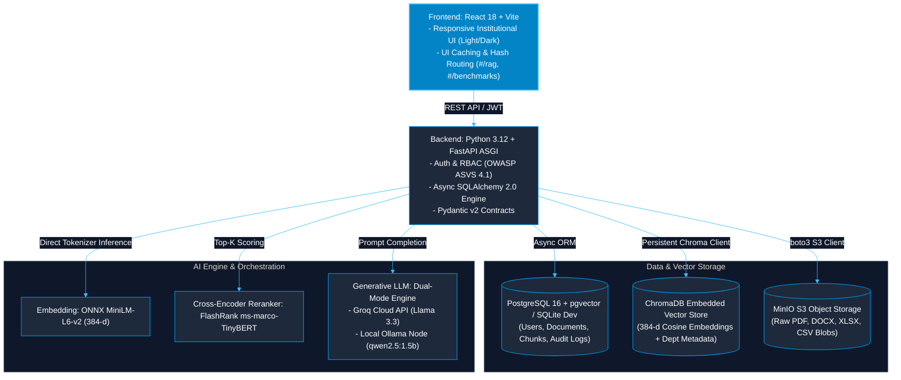
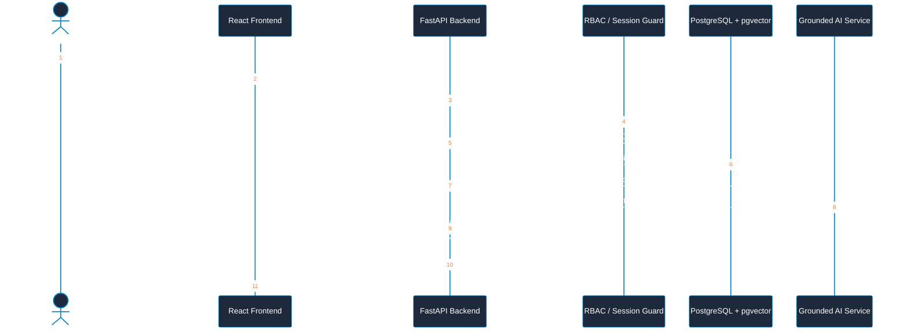

# CONCORD IKMS — Technology Stack & Architectural Decision Reference

[← Back to Main Documentation Index](../README.md#📚-documentation-index)



---

## Executive Architectural Strategy

For CONCORD, the technology stack balances three core priorities:
1. **Developer Velocity**: Leveraging clean, modern React + JavaScript on the frontend.
2. **AI & NLP Ecosystem Strengths**: Utilizing Python 3.11+ and FastAPI for performant asynchronous processing, document extraction, vector indexing, and RAG execution.
3. **Institutional Rigor**: Designing clean module boundaries and dependency inversion without the operational fragility of premature microservices.

> **Design Tenet**: React handles the user interface; FastAPI provides typed contracts and verifies permissions; PostgreSQL/pgvector ensures relational and semantic integrity; LangChain/LangGraph are applied selectively for multi-step workflows.

---

## 1. The Recommended CONCORD Stack

| Layer | Technology Choice | Architectural Responsibility |
| :--- | :--- | :--- |
| **Frontend UI** | **React 18 + Vite (JavaScript)** | Institutional dashboard, multi-format upload view, interactive citation inspector, real-time chat with streaming status, and role-based admin consoles. |
| **Backend & Core API** | **Python 3.11+ + FastAPI** | Server-side authentication, RBAC authorization, document parsing, chunking, hybrid retrieval, citation verification, and tamper-evident audit logging. |
| **AI Orchestration** | **Selective LangChain & LangGraph** | Applied specifically where stateful multi-step pipelines, checkpoints, and human approval gates are required. Ordinary Python service classes govern standard CRUD and permissions. |
| **Data & Vector Layer** | **PostgreSQL 16 + pgvector** | Unified operational store: relational entities (users, roles, documents, audit trails) co-located with 384-d dense vector embeddings. |
| **File Storage** | **S3-Compatible Object Store / MinIO** | Isolates binary document blobs (PDFs, DOCX, XLSX) from database tables; enables secure pre-signed retrieval. |
| **Tool Protocol** | **Model Context Protocol (MCP)** | *(Optional / Progressive)* Standardized connector layer for external tools and enterprise systems, enforced strictly behind server-side RBAC. |

---

## 2. Component Interaction & Separation of Concerns

Clear boundaries prevent architectural drift: React never executes AI logic or talks directly to databases; LangGraph never controls standard business logic; and MCP tools never bypass authorization.



---

## 3. Standardized Project Directory Structure

```
concord/
├── frontend/                     # React 18 + Vite (JavaScript)
│   ├── src/
│   │   ├── api/                  # Axios/Fetch HTTP client with JWT interceptors
│   │   ├── components/           # Reusable UI component library (cards, modals, badges)
│   │   │   ├── chat/             # Message threads, citation modals, bottom composer
│   │   │   ├── layout/           # Sidebar, navbar, department switcher
│   │   │   └── common/           # Loaders, error boundaries, tooltips
│   │   ├── utils/                # uiCache (sessionStorage), markdown sanitizer
│   │   └── views/                # Routed views (RAGAssistant, Documents, Benchmarks, Admin)
│   ├── package.json
│   └── vite.config.js
│
├── backend/                      # Python 3.11+ + FastAPI
│   ├── app/
│   │   ├── api/v1/               # Versioned REST route controllers
│   │   │   ├── endpoints/        # auth, documents, search, chat, benchmarks
│   │   ├── core/                 # Config, security, DB engine session lifecycle
│   │   ├── modules/              # Modular domain logic
│   │   │   ├── identity/         # Users, roles, permissions, department tenancy
│   │   │   ├── documents/        # Logical documents, versions, lifecycle states
│   │   │   ├── ingestion/        # Multi-format parsers, OCR, tabular chunkers
│   │   │   ├── retrieval/        # Dense ONNX embeddings, BM25/TSVector, RRF, FlashRank
│   │   │   ├── memory/           # Session conversation history, governed preferences
│   │   │   ├── trust/            # Conflict detection, deprecation & staleness monitors
│   │   │   ├── workflows/        # Multi-step stateful workflows & human approval
│   │   │   ├── audit/            # Cryptographic hash-chained audit log ledger
│   │   │   └── evaluation/       # Benchmark runner (MRR, P95, Faithfulness)
│   │   ├── providers/            # Pluggable LLM, OCR, and embedding adapters
│   │   └── main.py               # FastAPI application entry point
│   ├── migrations/               # Alembic database schema migrations
│   └── tests/                    # Unit, integration, and security test suite
│
├── workers/                      # Asynchronous background job processors
│   └── ingestion.py              # Long-running document parsing and OCR workers
│
├── infra/                        # Infrastructure and deployment profiles
│   └── docker/                   # Dockerfiles, compose specs, environment samples
│
├── docs/                         # Engineering briefs and architectural references
└── README.md                     # Repository entry point and setup instructions
```

---

## 4. When to Use LangChain, LangGraph, and MCP

To prevent over-engineering, specialized frameworks are applied only where they solve specific architectural problems:

```
┌─────────────────────────────────────────────────────────────────────────────────────────────┐
│ 1. Core Python Services (The Foundation)                                                    │
│ Used for: RBAC, CRUD, document upload, chunking, database migrations, and audit logging.    │
├─────────────────────────────────────────────────────────────────────────────────────────────┤
│ 2. LangChain (During RAG Integration)                                                       │
│ Used for: Model adapters, prompt templates, and retrieval pipeline utilities.               │
├─────────────────────────────────────────────────────────────────────────────────────────────┤
│ 3. LangGraph (During Workflow Orchestration)                                                │
│ Used for: Stateful multi-step workflows, branch conditions, failure retries, and HITL gates.│
├─────────────────────────────────────────────────────────────────────────────────────────────┤
│ 4. Model Context Protocol / MCP (Tool Interoperability)                                     │
│ Used for: Exposing validated, authorized backend tools to external clients/agents.          │
└─────────────────────────────────────────────────────────────────────────────────────────────┘
```

### Strategic Implementation Sequence
1. **Phase 1**: React, FastAPI, PostgreSQL, authentication, and document ingestion.
2. **Phase 2**: Local embeddings (ONNX), hybrid retrieval (dense + lexical), and grounded RAG with citations.
3. **Phase 3**: Persistent conversational memory and conflict candidate detection.
4. **Phase 4**: LangGraph for stateful multi-step administrative workflows requiring human sign-off.
5. **Phase 5**: MCP server adapters for standardized tool invocation across institutional agents.

---

## 5. Architectural Addendum & Decision Guidelines

### A. React Frontend Responsibilities
- User authentication and role selection interface.
- Document drag-and-drop ingestion with live processing status.
- Hybrid search and conversational RAG interface.
- Interactive, inspectable evidence citations with page coordinates.
- Conflict review and human-in-the-loop approval screens.
- *Constraint*: Frontend controls never make authorization decisions; server-side guards strictly enforce access policies.

### B. FastAPI Backend Responsibilities
- Centralized JWT verification and department-scoped RBAC enforcement.
- Document lifecycle management (`Draft` → `Active` → `Superseded` → `Archived`).
- Ingestion pipeline orchestration (text extraction, OCR, normalization, chunking).
- Grounded RAG answer synthesis with backend citation verification.
- Cryptographic hash-chained audit trails.
- *Constraint*: Keep API routes thin; encapsulate domain logic in modular application services.

### C. PostgreSQL + pgvector Database
- Single unified database for transactional relational records and high-dimensional vector embeddings.
- Native SQL combination of `tsvector` full-text search with `pgvector` cosine similarity (`<=>`).
- Governed by explicit Alembic schema migrations—manual unversioned schema edits are prohibited.

### D. Provider Independence (Hexagonal Architecture)
The backend decouples business logic from specific vendors by using abstract interfaces:
- `ChatModelProvider`: Ollama / Groq / Gemini / vLLM.
- `EmbeddingProvider`: ONNX MiniLM-L6-v2 / BGE-M3.
- `OCRProvider`: Tesseract / PaddleOCR.
- `RerankerProvider`: FlashRank / Cross-Encoder.
- `ObjectStorageProvider`: S3 / MinIO / Local File Storage.

---
*CONCORD IKMS · Technology Stack & Architectural Decision Reference · Mega Project 2026–27*
