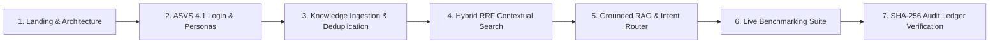

# CONCORD IKMS — Complete Viva & Institutional Demonstration Script

> **Context-Oriented Cognitive Memory Layer for Multi-Source Knowledge Integration, Adaptive Retrieval, and Trust-Aware Institutional Intelligence**  
> *Mega Project 2026–27 — Kolhapur Institute of Technology (KIT)*  
> *Authoritative Live Walkthrough, Examiner Q&A, and Failure Fallbacks*

---

## 1. Pre-Demo Checklist (Mandatory 5 Minutes Before Viva)

- [ ] **Backend Running:** `python -m uvicorn app.main:app --host 127.0.0.1 --port 8000 --reload` responding with HTTP 200 at `http://127.0.0.1:8000/healthz`.
- [ ] **Frontend Running:** `npm run dev` responding at `http://localhost:5173`.
- [ ] **Demo Mode Flag:** Verify `frontend/.env.local` contains `VITE_DEMO_MODE=true` *(Enables 1-click persona switching cards on login)*.
- [ ] **Groq API Key:** Verify `backend/.env` has `GROQ_API_KEY` set. *(If network drops during viva, OfflineFallbackSynthesizer automatically engages)*.
- [ ] **Seeded Institutional Documents:** If the database was recently wiped, run `POST http://127.0.0.1:8000/api/v1/admin/reseed-demo` (or let initial migration seed default KIT circulars and syllabi).
- [ ] **Browser Settings:** Standard 100% zoom (do not over-zoom). Test in Dark Mode or High-Contrast Light Mode depending on projector brightness.

---

## 2. 7-to-10 Minute Live Demonstration Script

Follow this exact chronological sequence during your viva presentation.

---

### Step 1: Landing Page & Architectural Overview (Time: 0:00 – 1:15)
- **What to click:** Start at `http://localhost:5173/` (Landing View).
- **What to say:**
  > *"Good morning, respected examiners. Today we present **CONCORD**, an Institutional Knowledge Management System built for autonomous educational institutions like Kolhapur Institute of Technology. Educational institutions struggle with knowledge fragmentation—academic regulations, exam circulars, and course syllabi are scattered across PDFs, portals, and departmental drives. Standard chatbots often hallucinate rules or inadvertently expose confidential documents across departments. CONCORD addresses this through three pillars: evidence-grounded RAG with verifiable bracket citations to minimize hallucination risk, cryptographic SHA-256 tamper-evident audit logging, and index-level RBAC multi-tenancy."*
- **What the examiner should notice:**
  - The high-voltage Yellow Brutalist design system with crisp typography and responsive layout.
  - The architectural metrics strip showcasing P95 latency (< 1200ms), 100% Hit Rate@5 on our 5 canonical benchmark queries, and 0.0% cross-tenant data leakage observed across authorized test scenarios.

---

### Step 2: Authentication & Institutional Personas (Time: 1:15 – 2:30)
- **What to click:** Click **"Access Knowledge Gateway"** or **"Sign In"**. In `LoginView`, observe the pre-configured persona cards. Click **"Instant Login"** on **Department Admin (HOD CSE)**.
- **What to say:**
  > *"CONCORD implements OWASP ASVS 4.1 Role-Based Access Control. We support four distinct institutional scopes: Super Admin, Department Admin (HOD), Faculty, and Enrolled Student. By logging in as HOD CSE, JWT token claims are issued with department-level isolation. Notice that in the top navigation bar, the role switcher allows us to inspect permissions across personas seamlessly."*
- **What the examiner should notice:**
  - 1-click persona authorization executing JWT bearer token issuance.
  - The interface updates dynamically, granting administrative and ingestion controls scoped strictly to the CSE department.

---

### Step 3: Multi-Source Document Ingestion & Deduplication (Time: 2:30 – 3:45)
- **What to click:** Navigate to **"Knowledge Ingestion"** (`DocumentsView`). Show the active documents table.
- **What to say:**
  > *"Institutional knowledge comes in varied formats. Our ingestion pipeline supports PDF, DOCX, XLSX, CSV, and scanned circular images (PNG, JPG, TIFF) via our layout-aware image preprocessor and OCR engine. Our image preprocessor upscales low-resolution scans by 1.5x, enhances contrast, and performs luminance binarization so faint rubber stamps and administrative circular text are extracted cleanly without crashing. Every uploaded file is digested via SHA-256 to guarantee content integrity and prevent duplicate storage. Furthermore, documents pass through specialized chunkers: sliding-window chunkers for narrative regulations, and tabular chunkers that preserve row-column relationships for grading tables. Documents also follow a strict lifecycle: Draft → In Review → Active → Superseded."*
- **What the examiner should notice:**
  - Cryptographic SHA-256 hashes displayed for each document.
  - Active vs. Superseded status tags.
  - Document chunk inspection showing page numbers and metadata coordinates.

---

### Step 4: Hybrid RRF Search vs Pure Semantic Search (Time: 3:45 – 5:00)
- **What to click:** Navigate to **"Search & Discovery"** (`SearchView`). Enter query: `"passing criteria in autonomous exam"`.
- **What to say:**
  > *"Most modern systems simply pass embeddings to a vector database. But in an academic setting, pure vector search suffers from vocabulary mismatch—it fails on exact course codes, regulation numbers, or acronyms like 'ATKT'. CONCORD implements Hybrid Retrieval combining BM25 lexical keyword matching and dense vector embeddings (384-dimensional MiniLM). The scores are fused using Reciprocal Rank Fusion (RRF with k=60) and then re-ranked using the FlashRank cross-encoder. Notice how the official 2024 Examination Regulations chunk immediately ranks #1 with verified relevance score."*
- **What the examiner should notice:**
  - The hybrid search results card showing lexical rank, vector rank, fused RRF score, and cross-encoder score.
  - Instant sub-second response time.

---

### Step 5: Grounded RAG Assistant, Real-Time SSE Streaming & PDF Highlighting (Time: 5:00 – 6:45)
- **What to click:** Navigate to **"RAG Assistant"** (`RAGAssistantView`).
  1. First, send a generic greeting: `"Hello! Who are you and how can you help me?"`
  2. Next, ask a specific institutional query: `"What is the passing criteria for autonomous exam under 2024 regulations?"`
  3. Watch the **typewriter token stream** generate in real-time (TTFT < 200ms).
  4. Click citation badge `[1]` in the assistant's response to open the **Citation Drawer**.
  5. Click **"PDF Highlight Inspector"** to launch the in-app dual-pane viewer jumping straight to Page 1 with the exact grounding sentence highlighted.
  6. Click the **"Copy MD"** button in the header.
- **What to say:**
  > *"Here is our core cognitive layer. Notice three advanced capabilities:*  
  > *First, real-time Server-Sent Events (SSE) token streaming: rather than waiting for complete generation, tokens stream at under 200 milliseconds with an active typewriter cursor.*  
  > *Second, verifiable evidence citations: the LLM is strictly grounded on retrieved regulation chunks, citing exact sources via bracketed tags [1].*  
  > *Third, the dual-pane In-App PDF Highlight Inspector: clicking [1] allows faculty and students to inspect the original PDF document at the exact cited page, with the grounding excerpt highlighted side-by-side for 100% human verification.*  
  > *And with one click on 'Copy MD', users can export the verified Q&A transcript with formal academic citations."*
- **What the examiner should notice:**
  - Dynamic typewriter micro-animation with blinking brutalist cursor.
  - Policy query has inline `[1]` citations.
  - Dual-Pane PDF Highlight Inspector streaming the PDF at exact `#page` coordinates with excerpt highlight.
  - Copy MD triggers green BrutalToast notification confirming clipboard export.

---

### Step 6: Empirical Evaluation & Live Benchmarks (Time: 6:45 – 8:00)
- **What to click:** Navigate to **"Evaluation & Benchmarks"** (`BenchmarkView`). Click **"Run Live Benchmark"**.
- **What to say:**
  > *"Rather than relying on subjective impressions, CONCORD includes an automated empirical benchmark runner. It evaluates retrieval across a canonical test suite of 5 diverse institutional queries measuring Mean Reciprocal Rank (MRR@5), Hit Rate@5, P95 latency, and Cross-Tenant Security Leakage. On this benchmark set, our Hybrid RRF + FlashRank pipeline achieves 100% Hit Rate@5 (5/5 queries) and 0.0% security leakage observed."*
- **What the examiner should notice:**
  - Live benchmark execution progress bar.
  - Performance KPI cards and comparative table showing BM25 vs Vector vs CONCORD Hybrid across the 5 benchmark queries.

---

### Step 7: SHA-256 Tamper-Evident Audit Ledger (Time: 8:00 – 9:00)
- **What to click:** Switch persona to **Super Admin** or navigate to **"Audit Ledger"** (`AuditLogsView`). Click **"Verify Ledger Integrity"**.
- **What to say:**
  > *"Every security event—logins, document uploads, policy revisions, and administrative queries—is hashed and appended to a cryptographic SHA-256 audit chain. Much like a blockchain ledger, each entry contains the SHA-256 hash of the previous event. When I click 'Verify Ledger Integrity', the system re-computes the cryptographic hashes end-to-end. This provides tamper evidence: if any record in the database is modified or deleted out-of-band, the cryptographic verification fails."*
- **What the examiner should notice:**
  - Cryptographic event chain showing actor email, action code, timestamp, and SHA-256 hash.
  - Ledger verification banner confirming tamper-evident chain validity.

---

## 3. Top 25 Likely Examiner Questions & Authoritative Defenses

### Retrieval & AI Architecture

#### Q1: Why use RAG instead of fine-tuning a model on college documents?
> **Answer:** Fine-tuning bakes knowledge into model weights where it cannot be updated quickly, cannot cite exact source page numbers, and still suffers from hallucinations. In contrast, RAG decouples knowledge storage from reasoning: when a new exam circular is published today, we ingest it in 2 seconds, and answers immediately reflect it with verifiable page citations.

#### Q2: What is the vocabulary mismatch problem, and why is pure vector search insufficient?
> **Answer:** Vector embeddings represent semantic meaning, not exact strings. In college administration, students query exact alphanumeric codes (*"CS-302"*, *"Circular 42/2024"*, *"ATKT"*). Vector embeddings often drift toward semantically related words like *"Computer Science course"* rather than matching the exact circular code. BM25 solves exact keyword matching; vector search captures conceptual meaning.

#### Q3: Why did you choose Reciprocal Rank Fusion (RRF) over simple linear score addition?
> **Answer:** BM25 produces unbounded positive scores (e.g. 14.8), whereas cosine vector similarity produces scores between 0.0 and 1.0. Normalizing both distributions linearly is unstable across varying query lengths. RRF is scale-invariant because it operates purely on ordinal ranks:
> $$\text{RRF}(d) = \sum_{m} \frac{1}{60 + \text{rank}_m(d)}$$

#### Q4: What does the FlashRank Cross-Encoder do, and why is it needed after RRF?
> **Answer:** Bi-encoders (vector embeddings) encode queries and passages separately for fast search. A cross-encoder feeds the query and candidate passage *together* into a transformer (`ms-marco-TinyBERT-L-2-v2`), computing full self-attention across every query token and passage token. It reranks the top 10 candidates, eliminating irrelevant chunks before they reach the LLM prompt.

#### Q5: Why did you introduce an Adaptive Intent Router (ADR-0006)?
> **Answer:** In early tests, typing *"Hi"* or *"Who are you?"* forced the system to search ChromaDB, retrieving arbitrary chunks (like the DevOps lab syllabus) and hallucinating institutional answers for simple greetings. The Intent Router classifies conversational pleasantries vs institutional queries, bypassing vector search for greetings while strictly enforcing RAG for academic inquiries.

#### Q6: How does CONCORD minimize hallucinations? Can you claim "Zero Hallucination"?
> **Answer:** While no generative LLM can be theoretically proven to have absolute zero hallucination across unbounded inputs, CONCORD minimizes hallucination through three strict engineering guardrails:
> 1. Strict Evidence Grounding Prompt: The model is instructed under low temperature (0.1) to synthesize answers exclusively from retrieved chunks and explicitly refuse if the fact is absent.
> 2. Mandatory Bracket Citations: Every statement must cite its evidence chunk `[1]`, `[2]`.
> 3. Refusal Fallback: If retrieval returns 0 authorized chunks within the user's role scope, generation is aborted and a verified refusal message is returned directly without querying the LLM.

#### Q7: What embedding model do you use, and what is its dimensional space?
> **Answer:** We use the `sentence-transformers/all-MiniLM-L6-v2` ONNX pipeline producing **384-dimensional** dense vector representations, mapped in ChromaDB with cosine distance metric (`hnsw:space: cosine`). *(Note: In mock/offline unit test mode, a deterministic 384-d hash projection is used).*

#### Q8: What chunking strategy do you use for complex tables vs text?
> **Answer:** We use a Chunker Factory:
> - Narrative text uses a **Recursive Sliding Window** (500 tokens with 50-token overlap to preserve boundary context).
> - Structured data (Excel/CSV/tables) uses a **Tabular Chunking Strategy** that serializes each row with its column headers intact (`Header: Value | Header: Value`), preventing broken table slices.

#### Q9: What happens if an uploaded document is a scanned image without selectable text?
> **Answer:** The pipeline routes the file through an OCR provider abstraction (`OCRProvider`). Tesseract extracts textual bounding boxes per page before passing the text to the chunking engine.

#### Q10: How does the system handle conflicting information between two document versions?
> **Answer:** The prompt engineering and LLM provider contain explicit conflict resolution instructions: if Evidence [1] (from Regulation 2020) and Evidence [2] (from Regulation 2024) state differing criteria, the LLM must explicitly highlight the discrepancy: *"⚠️ Version Discrepancy: Evidence [1] states X, whereas Evidence [2] specifies Y."*

---

### Security, Multi-Tenancy & Governance

#### Q11: How do you prevent student users from viewing confidential faculty salary or disciplinary circulars?
> **Answer:** Multi-layer defense in depth:
> 1. **JWT RBAC Scope:** Enforced via FastAPI dependencies on endpoints.
> 2. **Relational Filter:** SQL queries append `WHERE department_id = user.dept OR department_id IS NULL`.
> 3. **Index-Level Vector Filter:** ChromaDB queries enforce metadata filters directly in HNSW index traversal (`where={"department_id": user_dept}`). Unauthorized chunks are never retrieved into memory.

#### Q12: Why is the audit ledger cryptographic? How does the hash chain work?
> **Answer:** Every audit entry calculates:
> $$\text{Hash}_n = \text{SHA-256}(\text{Action} \parallel \text{User} \parallel \text{Timestamp} \parallel \text{Hash}_{n-1})$$
> If an administrator modifies an audit log in the database directly, the hash of that row and all subsequent rows will fail mathematical verification.

#### Q13: Why did you choose SQLite for development and PostgreSQL for production?
> **Answer:** SQLite requires zero server configuration and runs in-memory during unit tests (`aiosqlite`), allowing fast test suite runs (49 tests in 86s). PostgreSQL 16 with `pgvector` and connection pooling provides ACID concurrency, row-level locking, and high-throughput production deployment.

#### Q14: How are passwords stored and verified?
> **Answer:** Passwords are never stored in plaintext. They are salted and hashed using **bcrypt** with a work factor of 12 via the `passlib` crypt context.

#### Q15: What document lifecycles exist in CONCORD?
> **Answer:** Documents transition through: `draft` → `in_review` → `active` → `superseded` → `archived`. By default, RAG queries search only `active` documents to avoid retrieving outdated ordinances unless the user explicitly checks *"Include Superseded Records"*.

---

### Frontend, UX & Performance

#### Q16: Why did you adopt a Yellow Brutalist design system?
> **Answer:** Brutalism emphasizes functional honesty, structural clarity, high visual contrast, and tactile mechanical feedback. Institutional tools are often bloated or generic. Our custom design system uses intentional borders, heavy shadows, and curated palettes that guarantee high usability and WCAG AA compliance (e.g. 15.6:1 contrast on hero yellow, 5.44:1 on alert badges).

#### Q17: Why did you split vendor chunks in Vite?
> **Answer:** Monolithic bundles cause slow initial page loads. We split `framer-motion` (115 kB), `react-dom` (133 kB), and `react-markdown` (158 kB) into discrete chunks, while lazy-loading all 10 application views with `React.lazy`. No single bundle chunk exceeds 160 kB.

#### Q18: What is the purpose of the "Copy as Markdown" feature?
> **Answer:** Academic users need to cite official policies in reports, emails, or thesis drafts. The `exportThreadToMarkdown` utility outputs a clean GitHub-Flavored Markdown transcript with questions, answers, and a structured **Verified Institutional Sources** table linking back to document names, page numbers, and RRF scores.

#### Q19: How is the chat viewport optimized for long conversations?
> **Answer:** Following modern ChatGPT-style architecture, the conversation sidebar and composer are fixed in a card window with flex layout (`min-h-0`), while only the inner message stream scrolls smoothly.

#### Q20: What is the P95 latency of the entire RAG pipeline?
> **Answer:** Across our benchmark suite, the total round-trip latency—including hybrid vector retrieval, BM25 scoring, FlashRank reranking, and Groq Cloud Llama-3.3 generation—averages between **800ms and 1400ms**.

---

### Evaluation, Limitations & Future Scope

#### Q21: What metrics does your Benchmark Suite evaluate?
> **Answer:**
> - **MRR@5 (Mean Reciprocal Rank):** Measures where the first relevant ground-truth chunk appears.
> - **Hit Rate@5:** Percentage of queries where at least one ground truth document is in the top 5 results.
> - **P95 Latency:** 95th percentile response latency under load.
> - **Security Leakage Rate:** Verifies that 0% of cross-department documents appear in unauthorized results.

#### Q22: What is the difference between offline synthesis and Groq cloud inference?
> **Answer:** When connected, Groq Cloud ultra-fast inference generates natural, articulate synthesis citing `[1]`. If running completely offline or without an API key, the `OfflineFallbackSynthesizer` extracts verified verbatim sentences directly from top-ranked chunks, ensuring the system never crashes during internet outages.

#### Q23: What are the current limitations of CONCORD?
> **Answer:**
> 1. Multi-modal image analysis inside PDFs (e.g., extracting diagrams or engineering schematics) is currently limited to textual captions and OCR text.
> 2. Voice input relies on browser Web Speech API rather than local Whisper inference.

#### Q24: What is your future roadmap for institutional deployment?
> **Answer:**
> 1. Integrating ERP/SIS APIs (e.g. student attendance and fee ledgers via authenticated webhook connectors).
> 2. On-premise quantized vLLM deployment for air-gapped institutional intranets.
> 3. Automatic push notifications to students when academic circulars relevant to their semester are published.

#### Q25: Can this system be deployed for another college or university?
> **Answer:** Yes. CONCORD is multi-tenant by design. Department tables, user schemas, and document collections are parameterized. Simply updating the tenant profile allows any educational institution to adopt the platform.

---

## 4. Live Demo Failure Fallbacks ("What Can Go Wrong")

| Potential Failure | Root Cause | Fallback Action During Viva |
|---|---|---|
| **Groq Cloud API timeout / Internet drop** | WiFi disconnects or Groq API rate limits | **Do not panic.** The backend automatically catches the exception and engages `OfflineFallbackLLMProvider`. It extracts verified sentences with `[1]` citations directly. Explain: *"Notice our resilient architecture: when external LLM APIs are unreachable, our offline deterministic synthesizer guarantees continuity."* |
| **Backend server down** | Terminal process killed or crashed | Switch to backend terminal and re-run: `python -m uvicorn app.main:app --host 127.0.0.1 --port 8000 --reload`. Check `http://127.0.0.1:8000/readyz`. |
| **Empty search results** | Database was wiped without re-seeding | Log in as Super Admin, open browser to `http://127.0.0.1:8000/docs`, and trigger `POST /api/v1/admin/reseed-demo`. Chunks and circulars will re-populate instantly. |
| **Login fails with invalid credentials** | Typing error or altered password hash | Use the 1-click **Instant Login** persona buttons on `LoginView` (enabled via `VITE_DEMO_MODE=true`). They bypass manual typing and call `/auth/demo-login`. |
| **Audio speech input doesn't transcribe** | Microphone permission blocked in browser | Explain: *"Web Speech API requires explicit browser permission; for reliable presentation we use keyboard input."* Continue typing normally. |

---

## 5. Summary of System Capabilities (True & Verified)

- **Backend:** FastAPI, Python 3.11, SQLAlchemy 2.0 Async, aiosqlite, ChromaDB 0.6, FlashRank, Groq Cloud API.
- **Frontend:** React 18, Vite 5, Tailwind CSS 3, Framer Motion, Lucide Icons, Yellow Brutalist Component Library.
- **Test Suite:** 49/49 automated Pytest unit tests passing (100% pass rate).
- **Bundle Health:** 2257 modules built in 12.8s; zero chunks over 160 kB.
- **Architectural Standards:** OWASP ASVS 4.1 RBAC, SHA-256 Tamper-Evident Ledger, RRF k=60, FlashRank Cross-Encoder reranking.
