# CONCORD IKMS — Comprehensive Viva & Institutional Demonstration Guide

> **Context-Oriented Cognitive Memory Layer for Multi-Source Knowledge Integration, Adaptive Retrieval, and Trust-Aware Institutional Intelligence**  
> *Mega Project 2026–27 — Kolhapur Institute of Technology (KIT)*

[← Back to Main Documentation Index](../README.md#📚-documentation-index)

---

## 1. Executive Summary & Architecture

**CONCORD** is an enterprise-grade Institutional Knowledge Management System (IKMS) built as a high-integrity, multi-tenant cognitive platform. It eliminates institutional knowledge silos (syllabi, exam circulars, administrative policies, lab guidelines) across college departments while enforcing **cryptographic provenance (SHA-256)**, **strict RBAC multi-tenancy (OWASP ASVS 4.1)**, and **grounded zero-hallucination Q&A with verifiable source citations**.

### 1.1 Architecture Diagram (Modular Monolith)

```mermaid
%%{init: {'theme': 'base', 'themeVariables': { 'primaryColor': '#0284c7', 'primaryTextColor': '#ffffff', 'primaryBorderColor': '#0369a1', 'lineColor': '#38bdf8', 'secondaryColor': '#0f172a', 'tertiaryColor': '#1e293b', 'clusterBkg': '#0f172a', 'clusterBorder': '#334155', 'fontFamily': 'Inter, sans-serif'}}}%%
graph TD
    UI["React 18 (Vite) Presentation Layer<br/>- Clean Institutional UI (Light/Dark Support)<br/>- Click-to-Inspect Citations Modal<br/>- Real-Time Cached Benchmark Dashboard"]
    
    API["FastAPI Backend (Modular Monolith)<br/>- OWASP ASVS 4.1 RBAC Enforcement<br/>- SHA-256 Tamper-Evident Audit Ledger<br/>- Typed Pydantic v2 Contracts"]
    
    subgraph Core_Pipelines ["Core Intelligence Pipelines"]
        Ingest["Document Ingestion Pipeline<br/>PDF • DOCX • XLSX • CSV • Scanned OCR<br/>Tabular & Semantic Chunkers"]
        Retrieval["Hybrid Retrieval Engine<br/>Dense ONNX MiniLM (384-d) + BM25 Lexical<br/>Reciprocal Rank Fusion (RRF)"]
        Rerank["FlashRank Cross-Encoder<br/>(ms-marco-TinyBERT-L-2-v2)"]
        Groq["Groq Cloud LLM (Llama 3.3)<br/>+ Offline Grounded Synthesizer"]
    end
    
    subgraph Data_Storage ["Data & Storage Layer"]
        DB[("Relational Database<br/>PostgreSQL 16 + SQLite Dev<br/>(Users, Policies, Versions, Audit)")]
        Chroma[("Embedded Vector Store<br/>ChromaDB / pgvector<br/>(Index-Level RBAC Filtering)")]
        MinIO[("Object Storage (MinIO / S3)<br/>Raw Source Document Blobs")]
    end

    UI -->|REST API / JWT Session| API
    API --> Ingest
    API --> Retrieval
    Ingest --> DB
    Ingest -->|Binary Storage| MinIO
    Ingest -->|Approved Embeddings| Chroma
    Retrieval --> Chroma
    Retrieval --> DB
    Retrieval --> Rerank --> Groq
    Groq -->|Verified Citations [1]| UI

    classDef default fill:#1e293b,stroke:#0284c7,stroke-width:1.5px,color:#ffffff;
    classDef uiClass fill:#0284c7,stroke:#38bdf8,stroke-width:2px,color:#ffffff;
    class UI uiClass;
```

### 1.2 Five-Stage RAG Execution Flow

```mermaid
%%{init: {'theme': 'base', 'themeVariables': { 'primaryColor': '#0284c7', 'primaryTextColor': '#ffffff', 'primaryBorderColor': '#0369a1', 'lineColor': '#38bdf8', 'secondaryColor': '#0f172a', 'tertiaryColor': '#1e293b', 'fontFamily': 'Inter, sans-serif'}}}%%
flowchart LR
    Q["Student / Faculty<br/>Question"] --> N["Query Normalizer &<br/>Acronym Expansion"]
    N --> H["Hybrid Retrieval<br/>(Vector + Lexical)"]
    H --> RRF["Reciprocal Rank<br/>Fusion (RRF k=60)"]
    RRF --> CE["FlashRank<br/>Cross-Encoder"]
    CE --> LLM["Groq Cloud LLM /<br/>Offline Synthesizer"]
    LLM --> A["Verifiable Response<br/>with Clickable Citations"]

    classDef default fill:#1e293b,stroke:#0284c7,stroke-width:1.5px,color:#ffffff;
```



---

## 2. 5-Minute Live Evaluator Walkthrough Script

| Time | Demonstration Phase | Evaluator Takeaway | Actionable Commands / Clicks |
| :--- | :--- | :--- | :--- |
| **0:00–1:00** | **Persona Switching & RBAC Multi-Tenancy** | True multi-tenant RBAC enforced at API and database layers, not just hidden UI buttons. | Switch between role pills: **Admin**, **HOD CSE**, **Faculty**, and **Student**. Observe dynamic menu permissions. |
| **1:00–2:00** | **Document Ingestion & Chunk Provenance** | Multi-format ingestion preserving structural tables with SHA-256 deduplication and OCR. | Navigate to **Knowledge Ingestion**. Click **Inspect Chunks** on academic regulations to view page coordinates and token splits. |
| **2:00–3:00** | **Hybrid Retrieval & Zero Cross-Tenant Leakage** | RRF eliminates vocabulary mismatch while department filters isolate confidential data. | Search *"passing criteria in autonomous exam"*. Show ground truth regulations at Rank 1. Switch to Student and search confidential records (0.0% leakage). |
| **3:00–4:00** | **Grounded RAG, SSE Streaming & PDF Highlighting** | Real-time typewriter streaming (<200ms TTFT) with verified citations and dual-pane in-app PDF sentence highlighting. | Ask: *"What is the passing criteria for autonomous exam under 2024 regulations?"* Watch real-time stream, then click `[1]` to launch the dual-pane **PDF Highlight Inspector**. |
| **4:00–5:00** | **Live Benchmark Suite & Audit Verification** | Empirically proven accuracy with cryptographic tamper-evident audit logging. | Navigate to **Evaluation & Benchmarks**. Click **Run Live Benchmark** to execute real-time evaluation assertions. |

---

## 3. High-Probability Viva Questions & Defenses

### Q1: Why not just connect an LLM to standard ChromaDB vector search? Why do you need Hybrid Search and RRF?
> **Defense:** Pure vector embeddings suffer from the **vocabulary mismatch problem** in institutional environments. When students or faculty query exact course codes (*"CS301"*), circular references (*"EXAM/2024/09"*), or academic acronyms (*"ATKT"*), dense vector embeddings often drift toward semantically similar terms rather than the exact regulatory notice. Conversely, pure keyword search fails when students ask questions using synonyms.  
> 
> CONCORD combines both using **Reciprocal Rank Fusion (RRF)**:
> $$\text{RRF}(d) = \sum_{m \in \{\text{BM25}, \text{Vector}\}} \frac{1}{60 + \text{rank}_m(d)}$$
> followed by a **FlashRank Cross-Encoder reranker** (`ms-marco-TinyBERT-L-2-v2`). This boosts Hit Rate@5 from **80.0%** to **100%**.

### Q2: How do you prevent confidential department documents from leaking to unauthorized students?
> **Defense:** We enforce defense-in-depth across three decoupled layers:
> 1. **Application Layer:** FastAPI dependency injection guards enforcing OWASP ASVS 4.1 RBAC.
> 2. **SQL Layer:** Relational queries automatically append tenant conditions:  
>    `WHERE (department_id = :user_dept OR department_id IS NULL)`
> 3. **Vector Layer:** Vector queries apply metadata filters directly at the index level:  
>    `where={"department_id": user_dept_id}`  
> 
> Cross-department leakage is mathematically prevented and empirically verified at **0.0%**.

### Q3: How does the system handle outdated circulars and contradictory policies?
> **Defense:** CONCORD implements an explicit **Document Lifecycle State Machine** (`Draft` → `Active` → `Superseded` → `Archived`):
> - When a new circular is approved, prior versions automatically transition to `Superseded`.
> - By default, active RAG queries filter exclusively for `Active` policies.
> - When comparative queries are detected (e.g., *"Compare 2020 vs 2024 passing thresholds"*), the system fetches both documents, identifies the superseded status, and generates a structured comparison table with warning badges.

### Q4: What happens if the Groq Cloud API is down or the internet is disconnected?
> **Defense:** CONCORD implements the **Strategy Pattern** for LLM orchestration (`LLMProviderInterface`). If Groq Cloud experiences network latency, rate limits, or downtime, the system automatically falls back to an internal deterministic local synthesizer (`OfflineFallbackLLMProvider`), extracting grounded answers directly from retrieved evidence chunks without breaking the user experience.

### Q5: How do you ensure the LLM does not hallucinate answers or fabricate citations?
> **Defense:** 
> 1. **Zero-Hallucination Guardrails:** System prompts instruct the model to answer exclusively based on the provided evidence bundle and explicitly abstain (*"I do not have sufficient institutional records..."*) if evidence is missing.
> 2. **Server-Side Citation Validation:** The backend inspects the generated answer, extracts citation tags, and cross-references them against the IDs of retrieved chunks. Any fabricated or ungrounded citation is stripped before reaching the client.
> 3. **Clickable Provenance:** Every citation in the UI is rendered as an interactive chip that opens the exact chunk, page number, and SHA-256 hash in a verification modal.

---

## 4. Key Metrics Summary for Presentation Slides

| Evaluation Metric | Traditional / Naive RAG Baseline | CONCORD IKMS Platform | Technical Significance |
| :--- | :---: | :---: | :--- |
| **Hit Rate @ 5** | 72.0% – 80.0% | **100%** | All ground-truth answers captured within top 5 candidates. |
| **Mean Reciprocal Rank (MRR@5)** | 0.650 – 0.750 | **1.000** | Ground-truth institutional document consistently ranked at #1. |
| **Cross-Tenant Security Leakage** | Common (unfiltered RAG) | **0.0% (Zero)** | Complete departmental multi-tenancy and isolation. |
| **Query Latency (P95)** | 2500ms – 4000ms | **< 1200ms (Groq) / 62ms (Local)** | Instantaneous streaming responses suitable for campus load. |
| **Test Suite Coverage** | Minimal / Ad-hoc | **101 Passing Tests (92 Pytest + 9 Node)** | Rigorous verification across auth, ingestion, search, database, onboarding, and RAG. |

---

## 5. Standard Institutional Verification Commands

For live terminal demonstration in front of the viva panel:

```bash
# 1. Run the comprehensive automated test suite
pytest -v

# 2. Re-seed clean institutional demonstration fixtures
python backend/scripts/seed_demo_data.py

# 3. Verify server-side tamper-evident audit logs
curl -H "Authorization: Bearer <TOKEN>" http://127.0.0.1:8000/api/v1/audit/logs
```

---
*CONCORD IKMS · Comprehensive Viva & Institutional Demonstration Guide · Mega Project 2026–27*
