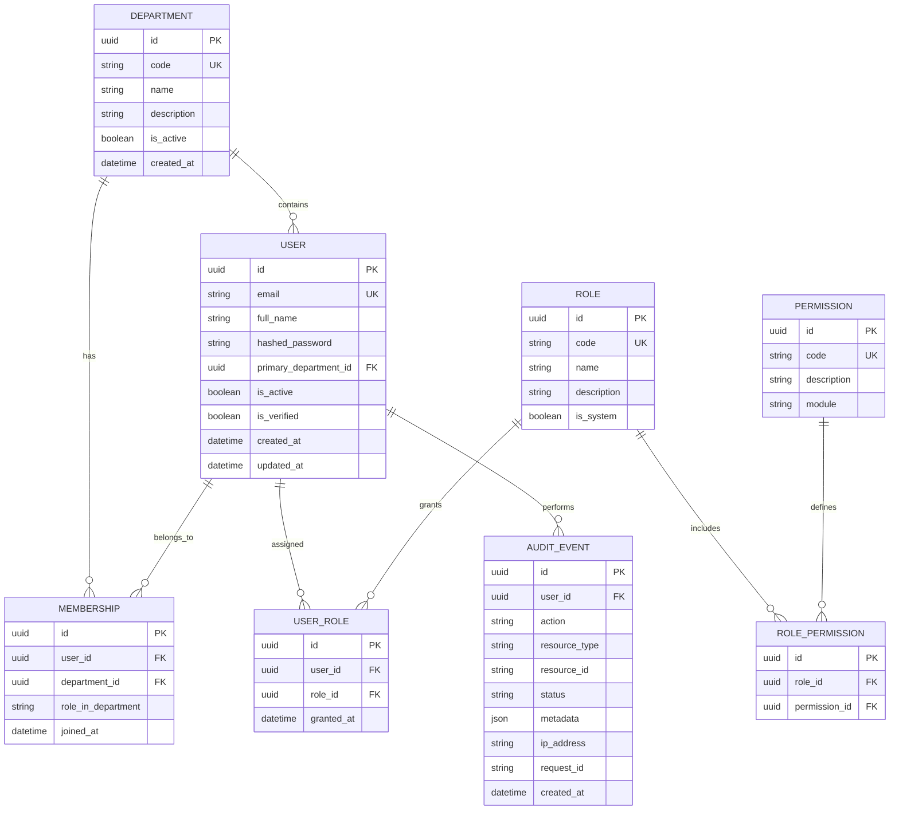

# CONCORD — Initial Data Model Specification (Milestone 0)

## 1. Overview

CONCORD uses a normalized relational data model managed via SQLAlchemy 2.0 and Alembic migrations. Vector columns (`pgvector`) will be attached in Milestone 2–3 on chunk tables.

## 2. Milestone 1 Core Entities

## 3. Seed Roles & Default Permissions

1. **`platform_admin`**: Full access across all institutional departments, audit inspection, document management, system configuration.
2. **`dept_admin`**: Administrative control scoped to their specific department (uploading policies, viewing department users and audit logs).
3. **`faculty`**: Ingestion of course materials, search across authorized institutional resources, conversation access.
4. **`student`**: Read-only search, retrieval, and Q&A over student-accessible documents.
