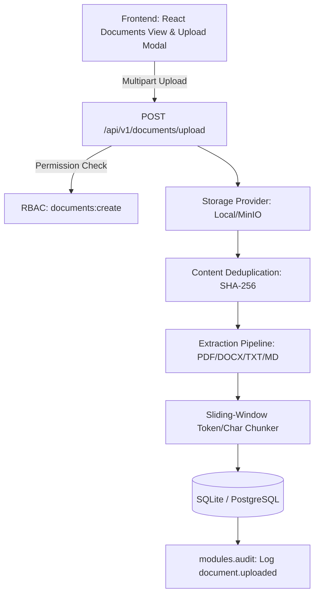

# Milestone 2: Document Ingestion, Parsing & Chunking Engine — Implementation Plan

## 1. Project Goal & Context
CONCORD requires an enterprise-grade document ingestion pipeline that handles multi-source institutional documents (PDF, DOCX, TXT, Markdown). It must parse unstructured text, handle document metadata, deduplicate via cryptographic hashes, chunk documents for subsequent semantic retrieval (M3), and strictly enforce role/department access boundaries.

---

## 2. Milestone 2 Deliverables & Architecture

### Key Components to Implement:
1. **Data Model (`modules.documents.models`)**:
   - `Document`: UUID, title, filename, file_path, file_size, mime_type, sha256_hash, department_id (FK), uploader_id (FK), status (`pending`, `processed`, `failed`), error_message, chunk_count, timestamps.
   - `DocumentChunk`: UUID, document_id (FK), chunk_index, content, char_count, metadata (page_number, headers, etc.), created_at.

2. **Storage Abstraction (`core.storage`)**:
   - `BaseStorageProvider`: Abstract interface for `save(file, path)`, `read(path)`, `delete(path)`, `exists(path)`.
   - `LocalStorageProvider`: Secure local disk store in `storage/documents/`.

3. **Multi-Format Extraction Pipeline (`modules.documents.parsers`)**:
   - `PDFParser`: Page-by-page extraction with `pypdf`.
   - `DocxParser`: Paragraph and table text extraction with `python-docx`.
   - `TextParser`: Plain text and markdown parser with encoding detection.
   - Parser factory with mime-type routing.

4. **Chunking Engine (`modules.documents.chunker`)**:
   - Configurable chunk size (e.g. 800 characters) and overlap (e.g. 100 characters).
   - Paragraph/sentence boundary awareness.
   - Per-chunk metadata enrichment (page numbers, chunk sequence).

5. **REST API Endpoints (`api.v1.documents`)**:
   - `POST /api/v1/documents/upload`: Upload document with department tagging.
   - `GET /api/v1/documents`: List documents filtered by department and status.
   - `GET /api/v1/documents/{id}`: Detailed view including metadata and chunk samples.
   - `DELETE /api/v1/documents/{id}`: Soft delete or purge document and associated chunks.
   - `GET /api/v1/documents/{id}/download`: Download raw document.

6. **Frontend Documents Management UI**:
   - Interactive document management interface (`frontend/src/views/DocumentsView.jsx`).
   - Drag-and-drop file uploader with real-time feedback.
   - Department selector, document status indicators (`processed`, `pending`, `failed`).
   - Chunk preview inspector modal to review extracted text segments.

7. **Verification & Testing**:
   - Pytest suite covering PDF/DOCX/TXT parsing, chunking math, upload validation, deduplication, and RBAC guard tests.
