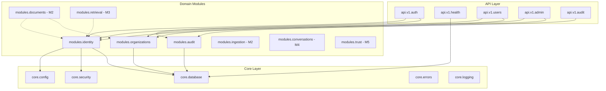

# CONCORD — Module Dependency Map (Milestone 0)

## Module Dependency Graph

## Import Direction Rules

1. **Inward Dependencies:** Web / API routes depend on modules; modules depend on `core`; `core` has no dependencies on business modules.
2. **No Circular Imports:** Identity and Organizations communicate via service contracts or ID references, never tight circular coupling.
3. **Audit Decoupling:** Audit events can be logged synchronously or via background tasks without blocking primary transaction commits.
